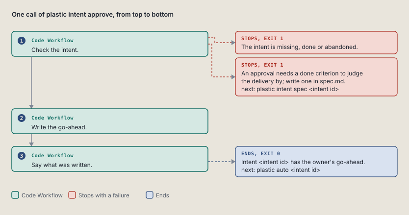

# plastic intent approve

Write the owner's go-ahead for an intent; auto refuses an intent without it.

```sh
plastic intent approve ID
```

| Argument or option | What it gives | Default |
| --- | --- | --- |
| `ID` | the intent | |

## The events of one call, step by step



The boxes on the left run in order. The boxes on the right are the ways the call stops or ends at that step.

## What one call changes

| What changes | Where | Reach |
| --- | --- | --- |
| The approval of the intent is recorded | the work graph database, in the store folder | goes with the store |
| The files of the intent and the index of the store are rewritten | the store folder | goes with the store |

Goes with the store: the files of the store carry the change, and `plastic sync up` rebuilds it on another machine. The database files themselves stay on this machine.

The command is `Plastic::Commands::Intent::Approve`, in [`approve.rb:9`](../../../../lib/plastic/commands/intent/approve.rb#L9).
