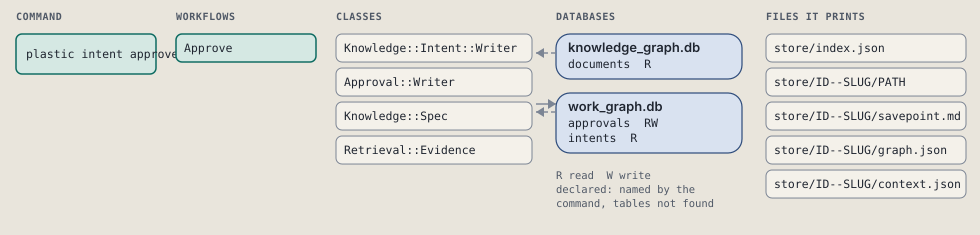
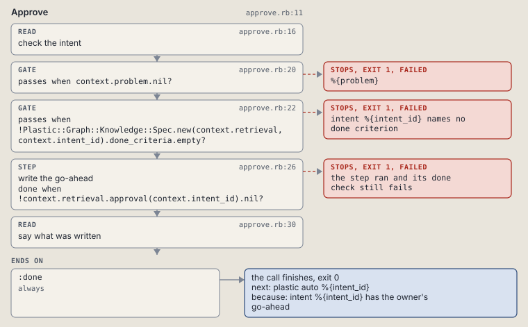

# plastic intent approve

Write the owner's go-ahead for an intent; auto refuses an intent without it.

```sh
plastic intent approve ID
```

The command is `Intent::Approve`, in [`approve.rb:9`](../../../../lib/plastic/commands/intent/approve.rb#L9). The words on this page, such as gate, step and outcome, are explained in [the command DSL](../../dsl/README.md).

| Argument or option | What it gives | Default |
| --- | --- | --- |
| `ID` | the intent | |

## What it touches



## How the call flows


| Workflow | Kind | Code |
| --- | --- | --- |
| [Code::Intent::Approve](#codeintentapprove) | code | [`approve.rb:11`](../../../../lib/plastic/workflows/code/intent/approve.rb#L11) |

### Code::Intent::Approve

The code workflow `:code_approve_intent`, in [`approve.rb:11`](../../../../lib/plastic/workflows/code/intent/approve.rb#L11).

Writes the go-ahead row of an open or active intent. A second call changes nothing.



| Step | Kind | Check | Code |
| --- | --- | --- | --- |
| check the intent | read |  | [`approve.rb:16`](../../../../lib/plastic/workflows/code/intent/approve.rb#L16) |
| %{problem} | gate, stops with exit 1 | `context.problem.nil?` | [`approve.rb:20`](../../../../lib/plastic/workflows/code/intent/approve.rb#L20) |
| intent %{intent_id} names no done criterion | gate, stops with exit 1 | `!Plastic::Graph::Knowledge::Spec.new(context.retrieval, context.intent_id).done_criteria.empty?` | [`approve.rb:22`](../../../../lib/plastic/workflows/code/intent/approve.rb#L22) |
| write the go-ahead | step | `!context.retrieval.approval(context.intent_id).nil?` | [`approve.rb:26`](../../../../lib/plastic/workflows/code/intent/approve.rb#L26) |
| say what was written | read |  | [`approve.rb:30`](../../../../lib/plastic/workflows/code/intent/approve.rb#L30) |

| Outcome | When | Then | Code |
| --- | --- | --- | --- |
| `:done` | always | finishes, exit 0; next: plastic auto %{intent_id} | [`approve.rb:34`](../../../../lib/plastic/workflows/code/intent/approve.rb#L34) |

It sets `problem`.

## Outcomes

Every call can also end in [the ways any call can end](../../dsl/README.md#how-any-call-can-end).

| Ending | Exit | next: | Code |
| --- | --- | --- | --- |
| %{problem} | 1 | prints no next: line | [`approve.rb:20`](../../../../lib/plastic/workflows/code/intent/approve.rb#L20) |
| intent %{intent_id} names no done criterion | 1 | plastic intent spec %{intent_id} | [`approve.rb:22`](../../../../lib/plastic/workflows/code/intent/approve.rb#L22) |
| intent %{intent_id} has the owner's go-ahead | 0 | plastic auto %{intent_id} | [`approve.rb:34`](../../../../lib/plastic/workflows/code/intent/approve.rb#L34) |
| a step raises | 1 | prints no next: line | [`code_workflow.rb:102`](../../../../lib/plastic/code_workflow.rb#L102) |
