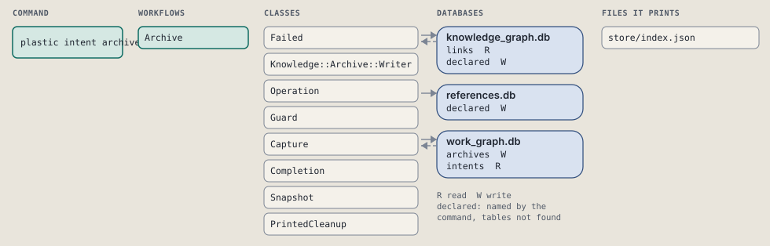
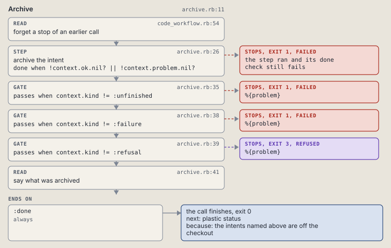
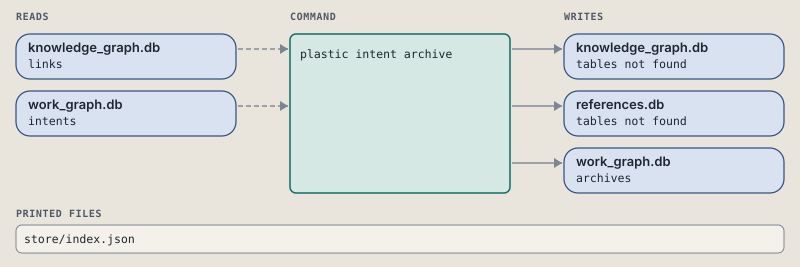

# plastic intent archive

Archive an intent directory.

Takes a done, abandoned or future intent off the checkout, or each one older than a date; its rows stay.

```sh
plastic intent archive (ID | --older-than DATE) [--dry-run]
```

The command is `Intent::Archive`, in [`archive.rb:10`](../../../../lib/plastic/commands/intent/archive.rb#L10). The words on this page, such as gate, step and outcome, are explained in [the command DSL](../../dsl/README.md).

| Argument or option | What it gives | Default |
| --- | --- | --- |
| `ID` | the intent to archive | |
| `--older-than DATE` | archive every intent older than this date or time instead of one |  |
| `--dry-run` | preview the call in a disposable copy | `false` |

## Components



The figure shows the command, the workflows it runs, the classes behind them, and the databases and files they reach.

## The events of one call

### The command's own call

The command's own `call`, at [`archive.rb:23`](../../../../lib/plastic/commands/intent/archive.rb#L23), runs first, then starts the workflow [Code::Intent::Archive](#codeintentarchive).

```ruby
def call
  check_choice
  super
end
```

### Code::Intent::Archive

The code workflow `:code_archive_intent`, in [`archive.rb:11`](../../../../lib/plastic/workflows/code/intent/archive.rb#L11).

Takes a done, abandoned or future intent off the checkout, or each one older than a date. Its rows stay.



Its rows run in this order:

1. Read: forget a stop of an earlier call. [`code_workflow.rb:54`](../../../../lib/plastic/code_workflow.rb#L54)
2. Step: archive the intent. Done when `!context.ok.nil? || !context.problem.nil?`, so a second call skips it. [`archive.rb:26`](../../../../lib/plastic/workflows/code/intent/archive.rb#L26)
3. Gate: passes when `context.kind != :unfinished`; otherwise the call stops with exit 1 and prints PROBLEM. [`archive.rb:36`](../../../../lib/plastic/workflows/code/intent/archive.rb#L36)
4. Gate: passes when `context.kind != :failure`; otherwise the call stops with exit 1 and prints PROBLEM. [`archive.rb:39`](../../../../lib/plastic/workflows/code/intent/archive.rb#L39)
5. Gate: passes when `context.kind != :refusal`; otherwise the call stops with exit 3 and prints PROBLEM. [`archive.rb:42`](../../../../lib/plastic/workflows/code/intent/archive.rb#L42)
6. Read: say what was archived. [`archive.rb:46`](../../../../lib/plastic/workflows/code/intent/archive.rb#L46)
7. Outcome `:done`, always: finishes with exit 0; next: plastic status. [`archive.rb:50`](../../../../lib/plastic/workflows/code/intent/archive.rb#L50)

It sets `problem`, `kind`, `ok`, `lines`.

In the words of workflow engines, the rows are these four parts:

- **Trigger**: the call starts the workflow `Code::Intent::Archive`.
- **Activities**: 2 reads and 1 step.
- **Transitions**: 3 gates stop the call when their checks fail; a step runs only while its done check fails.
- **Outcomes**: `:done` ends the call.

## What one call reads, writes and prints



| Place | Database or file | Tables | Reads or writes | Code |
| --- | --- | --- | --- | --- |
| the store folder | knowledge_graph.db | `links` | reads and writes | [`archive.rb:16`](../../../../lib/plastic/commands/intent/archive.rb#L16) |
| the store folder | references.db | not found in the code | writes | [`archive.rb:16`](../../../../lib/plastic/commands/intent/archive.rb#L16) |
| the store folder | work_graph.db | `archives`, `intents` | reads and writes | [`archive.rb:16`](../../../../lib/plastic/commands/intent/archive.rb#L16) |
| the store folder | store/index.json | | writes | [`prints.rb:18`](../../../../lib/plastic/graph/prints.rb#L18) |

A second call runs the same rows again. A step runs again only when its done check fails.

| Step | Done when | The second call | Code |
| --- | --- | --- | --- |
| archive the intent | `!context.ok.nil? \|\| !context.problem.nil?` | skips it | [`archive.rb:26`](../../../../lib/plastic/workflows/code/intent/archive.rb#L26) |

## How a call ends

Every call can also end in [the ways any call can end](../../dsl/README.md#how-any-call-can-end).

| Ending | Exit | next: | Code |
| --- | --- | --- | --- |
| PROBLEM | 1 | plastic intent end INTENT_ID | [`archive.rb:36`](../../../../lib/plastic/workflows/code/intent/archive.rb#L36) |
| PROBLEM | 1 | prints no next: line | [`archive.rb:39`](../../../../lib/plastic/workflows/code/intent/archive.rb#L39) |
| PROBLEM | 3 | prints no next: line | [`archive.rb:42`](../../../../lib/plastic/workflows/code/intent/archive.rb#L42) |
| the intents named above are off the checkout | 0 | plastic status | [`archive.rb:50`](../../../../lib/plastic/workflows/code/intent/archive.rb#L50) |
| a step raises | 1 | prints no next: line | [`code_workflow.rb:108`](../../../../lib/plastic/code_workflow.rb#L108) |
| Usage error: give an intent ID or --older-than DATE | 2 | prints no next: line | [`archive.rb:32`](../../../../lib/plastic/commands/intent/archive.rb#L32) |
| Usage error: an intent ID and --older-than exclude each other | 2 | prints no next: line | [`archive.rb:33`](../../../../lib/plastic/commands/intent/archive.rb#L33) |
| Usage error | 2 | prints no next: line | [`archive.rb:41`](../../../../lib/plastic/commands/intent/archive.rb#L41) |

## What the page leaves out

Every call shares a few things that this page does not repeat; [the command DSL](../../dsl/README.md#what-every-call-shares) names them.

- A call that writes saves a routine run row in local.db. A stop by a gate or a step saves the run, and the next call resumes from it. A dry run saves no row.
