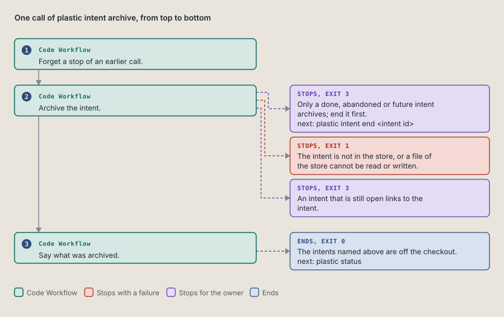

# plastic intent archive

Archive an intent directory.

Takes a done, abandoned or future intent off the checkout, or each one older than a date; its rows stay.

```sh
plastic intent archive (ID | --older-than DATE) [--dry-run]
```

| Argument or option | What it gives | Default |
| --- | --- | --- |
| `ID` | the intent to archive | |
| `--older-than DATE` | archive every intent older than this date or time instead of one |  |
| `--dry-run` | preview the call in a disposable copy | `false` |

## The events of one call, step by step



The boxes on the left run in order. The boxes on the right are the ways the call stops or ends at that step.

## What one call changes

| What changes | Where | Reach |
| --- | --- | --- |
| The intent is marked archived | the work graph database, in the store folder | goes with the store |
| The files of the intent are kept in the references database | the references database, in the store folder | goes with the store |
| The hash of each file printed is recorded in the knowledge database | the knowledge graph database, in the store folder | goes with the store |
| The index of the store is rewritten | the store folder | goes with the store |

Goes with the store: the files of the store carry the change, and `plastic sync up` rebuilds it on another machine. The database files themselves stay on this machine.

The command is `Plastic::Commands::Intent::Archive`, in [`archive.rb:10`](../../../../lib/plastic/commands/intent/archive.rb#L10).
