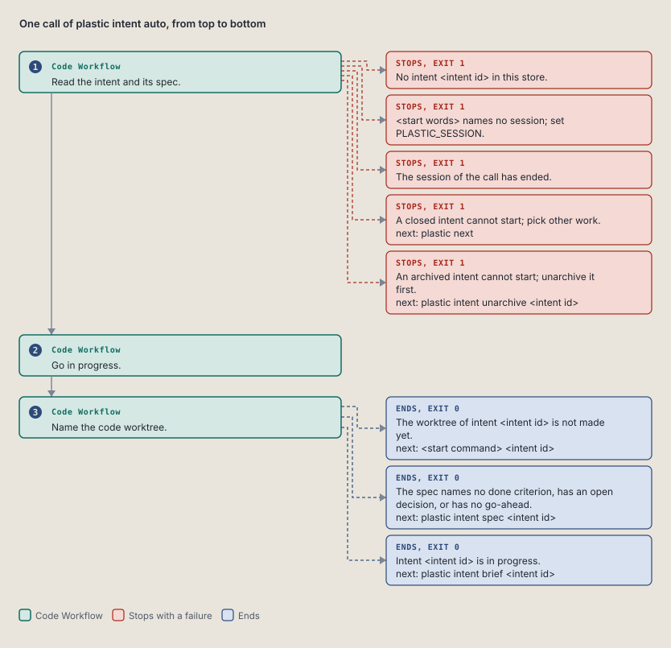

# plastic intent auto

Start an intent for agent delivery: set it in progress and print its worktree.

```sh
plastic intent auto ID [--take-over REASON]
```

| Argument or option | What it gives | Default |
| --- | --- | --- |
| `ID` | the intent | |
| `--take-over REASON` | the owner's word that this session takes over a live driver; the reason goes in the work log | `""` |

## The events of one call, step by step



The boxes on the left run in order. The boxes on the right are the ways the call stops or ends at that step.

## What one call changes

| What changes | Where | Reach |
| --- | --- | --- |
| The intent goes in progress | the work graph database, in the store folder | goes with the store |
| This session becomes the driver of the intent; a take-over or a lapsed claim leaves one work log line with the old and the new driver | the work graph database, in the store folder | stays on this machine |
| The files of the intent and the index of the store are rewritten | the store folder | goes with the store |

Goes with the store: the files of the store carry the change, and `plastic store sync up` rebuilds it on another machine. The database files themselves stay on this machine.

The command is `Plastic::Commands::Intent::Auto`, in [`commands/intent/auto.rb`](../../../../lib/plastic/commands/intent/auto.rb).
