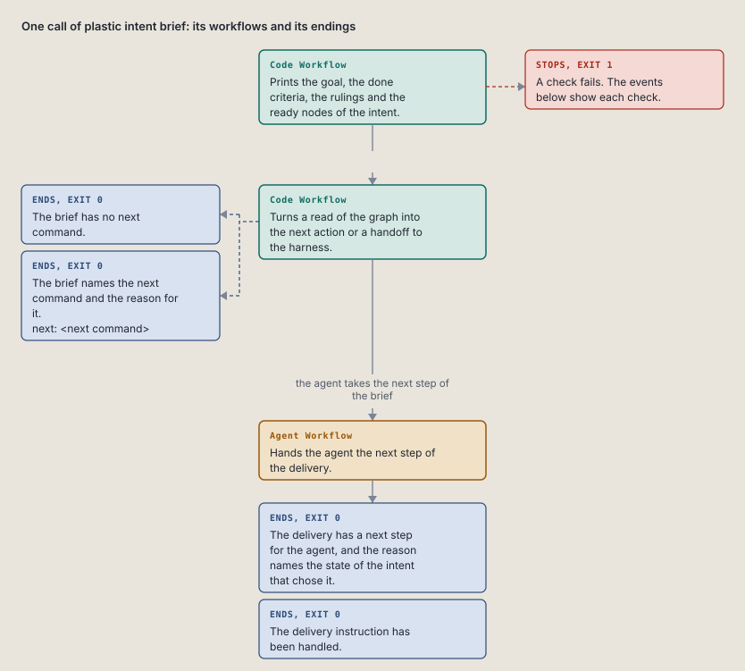
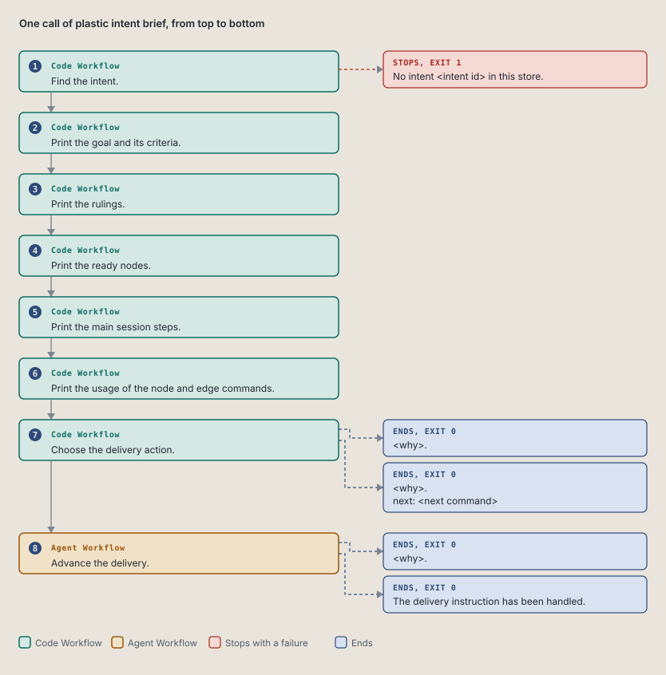

# plastic intent brief

Print an intent's goal, criteria, rulings, ready nodes and command usage.

```sh
plastic intent brief ID
```

| Argument or option | What it gives | Default |
| --- | --- | --- |
| `ID` | the intent | |

## The workflows of one call



Each box is a workflow. The words between the boxes say when the call moves on, and the last boxes say how the call ends.

## The events of one call, step by step



The boxes on the left run in order. The boxes on the right are the ways the call stops or ends at that step.

## What one call changes

This command changes nothing.

## What the agent workflow steps print

| Step | The text the agent gets |
| --- | --- |
| 8 | \<handoff text> |

The command is `Plastic::Commands::Intent::Brief`, in [`brief.rb:11`](../../../../lib/plastic/commands/intent/brief.rb#L11).
