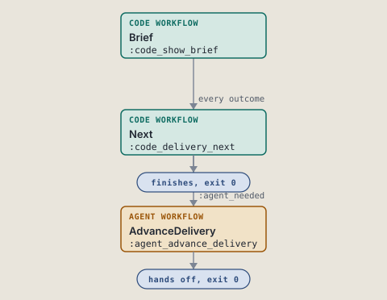

# plastic intent brief

Print an intent's goal, criteria, rulings, ready nodes and command usage.

```sh
plastic intent brief ID
```

The command is `Intent::Brief`, in [`brief.rb:11`](../../../../lib/plastic/commands/intent/brief.rb#L11). The words on this page, such as gate, step and outcome, are explained in [the command DSL](../../dsl/README.md).

| Argument or option | What it gives | Default |
| --- | --- | --- |
| `ID` | the intent | |

## What it touches


## How the call flows



| Workflow | Kind | Code |
| --- | --- | --- |
| [Code::Intent::Brief](#codeintentbrief) | code | [`brief.rb:26`](../../../../lib/plastic/workflows/code/intent/brief.rb#L26) |
| [Code::Intent::Brief::Next](#codeintentbriefnext) | code | [`next.rb:13`](../../../../lib/plastic/workflows/code/intent/brief/next.rb#L13) |
| [Agent::Shared::AdvanceDelivery](#agentsharedadvancedelivery) | agent | [`advance_delivery.rb:10`](../../../../lib/plastic/workflows/agent/shared/advance_delivery.rb#L10) |

### Code::Intent::Brief

The code workflow `:code_show_brief`, in [`brief.rb:26`](../../../../lib/plastic/workflows/code/intent/brief.rb#L26).

Prints the goal, the done criteria, the rulings with superseded ones marked, the ready nodes, the main session steps and the usage of the node and edge commands.


| Step | Kind | Check | Code |
| --- | --- | --- | --- |
| find the intent | read |  | [`brief.rb:43`](../../../../lib/plastic/workflows/code/intent/brief.rb#L43) |
| no intent %{intent_id} in this store | gate, stops with exit 1 | `!context.intent.nil?` | [`brief.rb:47`](../../../../lib/plastic/workflows/code/intent/brief.rb#L47) |
| print the goal and its criteria | read |  | [`brief.rb:49`](../../../../lib/plastic/workflows/code/intent/brief.rb#L49) |
| print the rulings | read |  | [`brief.rb:56`](../../../../lib/plastic/workflows/code/intent/brief.rb#L56) |
| print the ready nodes | read |  | [`brief.rb:60`](../../../../lib/plastic/workflows/code/intent/brief.rb#L60) |
| print the main session steps | read |  | [`brief.rb:64`](../../../../lib/plastic/workflows/code/intent/brief.rb#L64) |
| print the usage of the node and edge commands | read |  | [`brief.rb:68`](../../../../lib/plastic/workflows/code/intent/brief.rb#L68) |

| Outcome | When | Then | Code |
| --- | --- | --- | --- |
| `:done` | always | runs [Code::Intent::Brief::Next](#codeintentbriefnext) | [`brief.rb:72`](../../../../lib/plastic/workflows/code/intent/brief.rb#L72) |

It sets `intent`.

### Code::Intent::Brief::Next

The code workflow `:code_delivery_next`, in [`next.rb:13`](../../../../lib/plastic/workflows/code/intent/brief/next.rb#L13).

Resolves a graph read into an action or a checked harness handoff.


| Step | Kind | Check | Code |
| --- | --- | --- | --- |
| choose the delivery action | read |  | [`next.rb:16`](../../../../lib/plastic/workflows/code/intent/brief/next.rb#L16) |

| Outcome | When | Then | Code |
| --- | --- | --- | --- |
| `:agent_needed` | when `!context.handoff_text.nil?` | runs [Agent::Shared::AdvanceDelivery](#agentsharedadvancedelivery) | [`next.rb:20`](../../../../lib/plastic/workflows/code/intent/brief/next.rb#L20) |
| `:nothing` | when `context.next_command.nil?` | finishes, exit 0; prints no next: line | [`next.rb:21`](../../../../lib/plastic/workflows/code/intent/brief/next.rb#L21) |
| `:done` | otherwise | finishes, exit 0; next: %{next_command} | [`next.rb:22`](../../../../lib/plastic/workflows/code/intent/brief/next.rb#L22) |

It sets `next_command`, `why`, `handoff_text`.

### Agent::Shared::AdvanceDelivery

The agent workflow `:agent_advance_delivery`, in [`advance_delivery.rb:10`](../../../../lib/plastic/workflows/agent/shared/advance_delivery.rb#L10).

The harness performs judgment and records the result through commands.


| Step | Kind | Check | Code |
| --- | --- | --- | --- |
| advance the delivery | agent step | `context.handoff_text.nil?` | [`advance_delivery.rb:11`](../../../../lib/plastic/workflows/agent/shared/advance_delivery.rb#L11) |

| Outcome | When | Then | Code |
| --- | --- | --- | --- |
| `:handoff` | when a step is left | hands off, exit 0; prints no next: line | [`advance_delivery.rb:12`](../../../../lib/plastic/workflows/agent/shared/advance_delivery.rb#L12) |
| `:done` | when every done check holds | finishes, exit 0; prints no next: line | [`advance_delivery.rb:13`](../../../../lib/plastic/workflows/agent/shared/advance_delivery.rb#L13) |

The agent step "advance the delivery" prints:

> %{handoff_text}

## Outcomes

Every call can also end in [the ways any call can end](../../dsl/README.md#how-any-call-can-end).

| Ending | Exit | next: | Code |
| --- | --- | --- | --- |
| no intent %{intent_id} in this store | 1 | prints no next: line | [`brief.rb:47`](../../../../lib/plastic/workflows/code/intent/brief.rb#L47) |
| %{why} | 0 | prints no next: line | [`next.rb:21`](../../../../lib/plastic/workflows/code/intent/brief/next.rb#L21) |
| %{why} | 0 | %{next_command} | [`next.rb:22`](../../../../lib/plastic/workflows/code/intent/brief/next.rb#L22) |
| %{why} | 0 | prints no next: line | [`advance_delivery.rb:12`](../../../../lib/plastic/workflows/agent/shared/advance_delivery.rb#L12) |
| the delivery instruction has been handled | 0 | prints no next: line | [`advance_delivery.rb:13`](../../../../lib/plastic/workflows/agent/shared/advance_delivery.rb#L13) |
| a step raises | 1 | prints no next: line | [`code_workflow.rb:102`](../../../../lib/plastic/code_workflow.rb#L102) |
