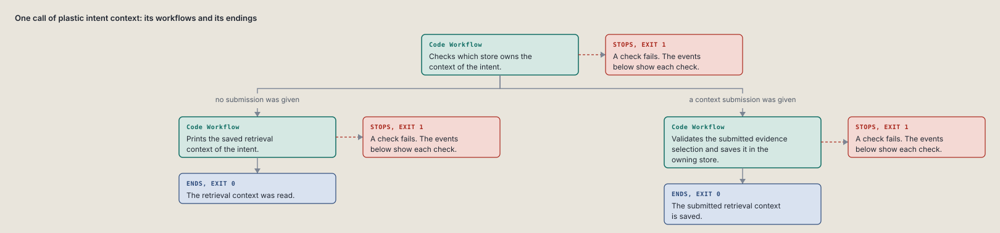
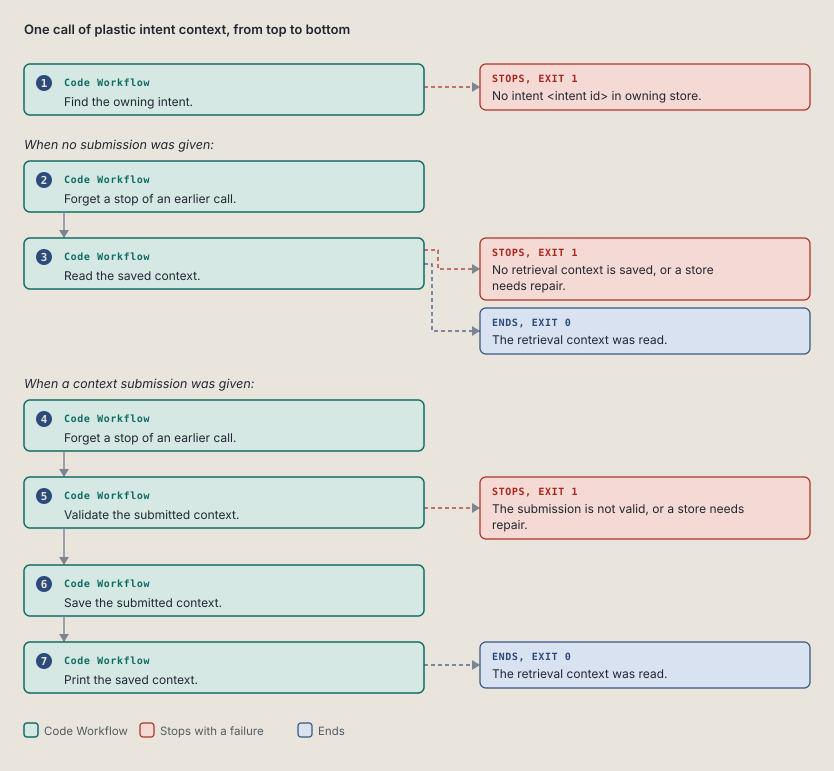

# plastic intent context

Read or submit selected retrieval context for an intent.

```sh
plastic intent context ID [--from FILE]
```

| Argument or option | What it gives | Default |
| --- | --- | --- |
| `ID` | the owning intent | |
| `--from FILE` | JSON file holding the arrays evidence, facts, interpretations, gaps and rulings |  |

## The workflows of one call



Each box is a workflow. The words between the boxes say when the call moves on, and the last boxes say how the call ends.

## The events of one call, step by step



The boxes on the left run in order. The boxes on the right are the ways the call stops or ends at that step.

## What one call changes

| What changes | Where | Reach |
| --- | --- | --- |
| The submitted context is saved as a document of the intent, unless the same document is saved already | the knowledge graph database, in the store folder | goes with the store |
| The files of the intent and the index of the store are rewritten | the store folder | goes with the store |

Goes with the store: the files of the store carry the change, and `plastic sync up` rebuilds it on another machine. The database files themselves stay on this machine.

The command is `Plastic::Commands::Intent::Context`, in [`commands/intent/context.rb`](../../../../lib/plastic/commands/intent/context.rb).
