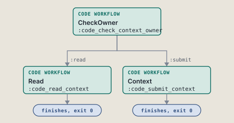

# plastic intent context

Read or submit selected retrieval context for an intent.

Persists the agent's selected evidence without judging its relevance.

```sh
plastic intent context ID [--from FILE]
```

The command is `Intent::Context`, in [`context.rb:9`](../../../../lib/plastic/commands/intent/context.rb#L9). The words on this page, such as gate, step and outcome, are explained in [the command DSL](../../dsl/README.md).

| Argument or option | What it gives | Default |
| --- | --- | --- |
| `ID` | the owning intent | |
| `--from FILE` | JSON file holding the arrays evidence, facts, interpretations, gaps and rulings |  |

## What it touches


## How the call flows



| Workflow | Kind | Code |
| --- | --- | --- |
| [Code::Intent::Context::CheckOwner](#codeintentcontextcheckowner) | code | [`check_owner.rb:13`](../../../../lib/plastic/workflows/code/intent/context/check_owner.rb#L13) |
| [Code::Intent::Context::Read](#codeintentcontextread) | code | [`read.rb:15`](../../../../lib/plastic/workflows/code/intent/context/read.rb#L15) |
| [Code::Intent::Context](#codeintentcontext) | code | [`context.rb:17`](../../../../lib/plastic/workflows/code/intent/context.rb#L17) |

### Code::Intent::Context::CheckOwner

The code workflow `:code_check_context_owner`, in [`check_owner.rb:13`](../../../../lib/plastic/workflows/code/intent/context/check_owner.rb#L13).

Confirms that a context request names an existing intent in its owning store.


| Step | Kind | Check | Code |
| --- | --- | --- | --- |
| find the owning intent | read |  | [`check_owner.rb:18`](../../../../lib/plastic/workflows/code/intent/context/check_owner.rb#L18) |
| no intent %{intent_id} in owning store | gate, stops with exit 1 | `context.intent` | [`check_owner.rb:23`](../../../../lib/plastic/workflows/code/intent/context/check_owner.rb#L23) |

| Outcome | When | Then | Code |
| --- | --- | --- | --- |
| `:submit` | when `context.from` | runs [Code::Intent::Context](#codeintentcontext) | [`check_owner.rb:25`](../../../../lib/plastic/workflows/code/intent/context/check_owner.rb#L25) |
| `:read` | otherwise | runs [Code::Intent::Context::Read](#codeintentcontextread) | [`check_owner.rb:26`](../../../../lib/plastic/workflows/code/intent/context/check_owner.rb#L26) |

It sets `intent`.

### Code::Intent::Context::Read

The code workflow `:code_read_context`, in [`read.rb:15`](../../../../lib/plastic/workflows/code/intent/context/read.rb#L15).

Reads the saved retrieval context of one intent with its evidence freshness.


| Step | Kind | Check | Code |
| --- | --- | --- | --- |
| forget a stop of an earlier call | read |  | [`code_workflow.rb:54`](../../../../lib/plastic/code_workflow.rb#L54) |
| read the saved context | read |  | [`read.rb:22`](../../../../lib/plastic/workflows/code/intent/context/read.rb#L22) |
| %{problem} | gate, stops with exit 1 | `context.problem.nil?` | [`read.rb:30`](../../../../lib/plastic/workflows/code/intent/context/read.rb#L30) |

| Outcome | When | Then | Code |
| --- | --- | --- | --- |
| `:done` | always | finishes, exit 0; prints no next: line | [`read.rb:32`](../../../../lib/plastic/workflows/code/intent/context/read.rb#L32) |

It sets `problem`.

### Code::Intent::Context

The code workflow `:code_submit_context`, in [`context.rb:17`](../../../../lib/plastic/workflows/code/intent/context.rb#L17).

Validates a submitted evidence selection and persists it in the owning store.


| Step | Kind | Check | Code |
| --- | --- | --- | --- |
| forget a stop of an earlier call | read |  | [`code_workflow.rb:54`](../../../../lib/plastic/code_workflow.rb#L54) |
| persist the submitted context | read |  | [`context.rb:24`](../../../../lib/plastic/workflows/code/intent/context.rb#L24) |
| %{problem} | gate, stops with exit 1 | `context.problem.nil?` | [`context.rb:35`](../../../../lib/plastic/workflows/code/intent/context.rb#L35) |

| Outcome | When | Then | Code |
| --- | --- | --- | --- |
| `:done` | always | finishes, exit 0; prints no next: line | [`context.rb:37`](../../../../lib/plastic/workflows/code/intent/context.rb#L37) |

It sets `problem`.

## Outcomes

Every call can also end in [the ways any call can end](../../dsl/README.md#how-any-call-can-end).

| Ending | Exit | next: | Code |
| --- | --- | --- | --- |
| no intent %{intent_id} in owning store | 1 | prints no next: line | [`check_owner.rb:23`](../../../../lib/plastic/workflows/code/intent/context/check_owner.rb#L23) |
| %{problem} | 1 | prints no next: line | [`read.rb:30`](../../../../lib/plastic/workflows/code/intent/context/read.rb#L30) |
| the retrieval context was read | 0 | prints no next: line | [`read.rb:32`](../../../../lib/plastic/workflows/code/intent/context/read.rb#L32) |
| %{problem} | 1 | prints no next: line | [`context.rb:35`](../../../../lib/plastic/workflows/code/intent/context.rb#L35) |
| the retrieval context was read | 0 | prints no next: line | [`context.rb:37`](../../../../lib/plastic/workflows/code/intent/context.rb#L37) |
| a step raises | 1 | prints no next: line | [`code_workflow.rb:102`](../../../../lib/plastic/code_workflow.rb#L102) |
