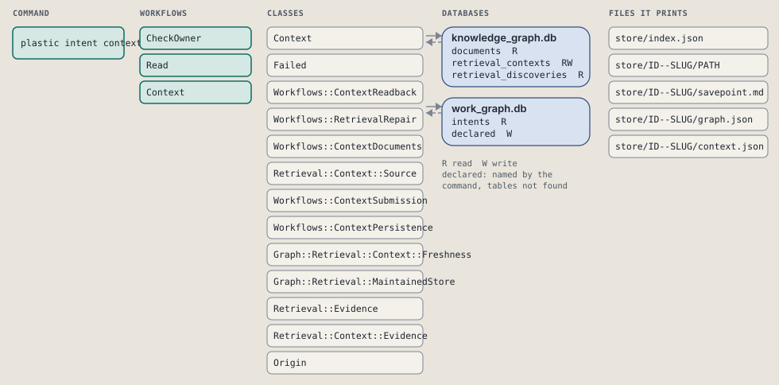
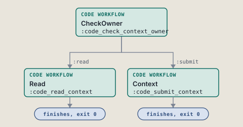
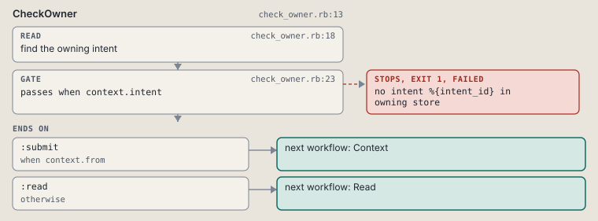
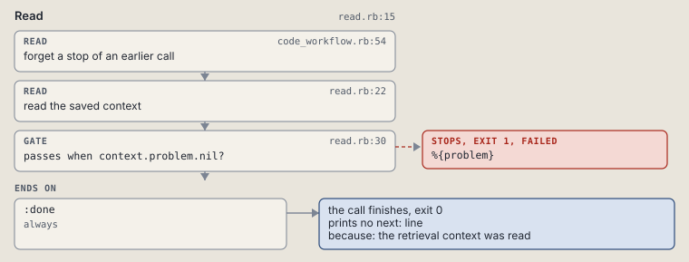
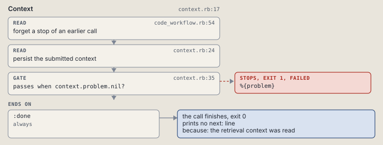
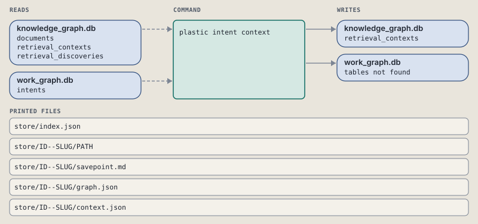

# plastic intent context

Read or submit selected retrieval context for an intent.

Persists the agent's selected evidence without judging its relevance.

```sh
plastic intent context ID [--from FILE]
```

The command is `Intent::Context`, in [`context.rb:9`](../../../../lib/plastic/commands/intent/context.rb#L9). The words on this page, such as gate, step and outcome, are explained in [the command DSL](../../dsl/README.md).

| Argument or option | What it gives | Default |
| --- | --- | --- |
| `ID` | the owning intent | |
| `--from FILE` | JSON file holding the arrays evidence, facts, interpretations, gaps and rulings |  |

## Components



The figure shows the command, the workflows it runs, the classes behind them, and the databases and files they reach.

## The events of one call



| Workflow | Kind | Code |
| --- | --- | --- |
| [Code::Intent::Context::CheckOwner](#codeintentcontextcheckowner) | code | [`check_owner.rb:13`](../../../../lib/plastic/workflows/code/intent/context/check_owner.rb#L13) |
| [Code::Intent::Context::Read](#codeintentcontextread) | code | [`read.rb:15`](../../../../lib/plastic/workflows/code/intent/context/read.rb#L15) |
| [Code::Intent::Context](#codeintentcontext) | code | [`context.rb:17`](../../../../lib/plastic/workflows/code/intent/context.rb#L17) |

### Code::Intent::Context::CheckOwner

The code workflow `:code_check_context_owner`, in [`check_owner.rb:13`](../../../../lib/plastic/workflows/code/intent/context/check_owner.rb#L13).

Confirms that a context request names an existing intent in its owning store.



Its rows run in this order:

1. Read: find the owning intent. [`check_owner.rb:18`](../../../../lib/plastic/workflows/code/intent/context/check_owner.rb#L18)
2. Gate: passes when `context.intent`; otherwise the call stops with exit 1 and prints no intent INTENT_ID in owning store. [`check_owner.rb:23`](../../../../lib/plastic/workflows/code/intent/context/check_owner.rb#L23)
3. Outcome `:submit`, when `context.from`: starts the workflow [Code::Intent::Context](#codeintentcontext). [`check_owner.rb:25`](../../../../lib/plastic/workflows/code/intent/context/check_owner.rb#L25)
4. Outcome `:read`, otherwise: starts the workflow [Code::Intent::Context::Read](#codeintentcontextread). [`check_owner.rb:26`](../../../../lib/plastic/workflows/code/intent/context/check_owner.rb#L26)

It sets `intent`.

### Code::Intent::Context::Read

The code workflow `:code_read_context`, in [`read.rb:15`](../../../../lib/plastic/workflows/code/intent/context/read.rb#L15).

Reads the saved retrieval context of one intent with its evidence freshness.



Its rows run in this order:

1. Read: forget a stop of an earlier call. [`code_workflow.rb:54`](../../../../lib/plastic/code_workflow.rb#L54)
2. Read: read the saved context. [`read.rb:22`](../../../../lib/plastic/workflows/code/intent/context/read.rb#L22)
3. Gate: passes when `context.problem.nil?`; otherwise the call stops with exit 1 and prints PROBLEM. [`read.rb:30`](../../../../lib/plastic/workflows/code/intent/context/read.rb#L30)
4. Outcome `:done`, always: finishes with exit 0; prints no next: line. [`read.rb:32`](../../../../lib/plastic/workflows/code/intent/context/read.rb#L32)

It sets `problem`.

### Code::Intent::Context

The code workflow `:code_submit_context`, in [`context.rb:17`](../../../../lib/plastic/workflows/code/intent/context.rb#L17).

Validates a submitted evidence selection and persists it in the owning store.



Its rows run in this order:

1. Read: forget a stop of an earlier call. [`code_workflow.rb:54`](../../../../lib/plastic/code_workflow.rb#L54)
2. Read: persist the submitted context. [`context.rb:24`](../../../../lib/plastic/workflows/code/intent/context.rb#L24)
3. Gate: passes when `context.problem.nil?`; otherwise the call stops with exit 1 and prints PROBLEM. [`context.rb:35`](../../../../lib/plastic/workflows/code/intent/context.rb#L35)
4. Outcome `:done`, always: finishes with exit 0; prints no next: line. [`context.rb:37`](../../../../lib/plastic/workflows/code/intent/context.rb#L37)

It sets `problem`.

In the words of workflow engines, the rows are these four parts:

- **Trigger**: the call starts the workflow `Code::Intent::Context::CheckOwner`; each later workflow starts from an outcome of the one before it.
- **Activities**: 5 reads.
- **Transitions**: 3 gates stop the call when their checks fail; CheckOwner goes to Context on `:submit`; CheckOwner goes to Read on `:read`.
- **Outcomes**: `:done` of Read, `:done` of Context end the call.

## What one call reads, writes and prints



| Place | Database or file | Tables | Reads or writes | Code |
| --- | --- | --- | --- | --- |
| the store folder | knowledge_graph.db | `documents`, `retrieval_contexts`, `retrieval_discoveries` | reads and writes | [`context.rb:12`](../../../../lib/plastic/commands/intent/context.rb#L12), [`context.rb:13`](../../../../lib/plastic/commands/intent/context.rb#L13) |
| the store folder | work_graph.db | `intents` | reads and writes | [`context.rb:13`](../../../../lib/plastic/commands/intent/context.rb#L13) |
| the store folder | store/index.json | | writes | [`prints.rb:14`](../../../../lib/plastic/graph/prints.rb#L14) |
| the store folder | store/ID--SLUG/PATH | | writes | [`prints.rb:15`](../../../../lib/plastic/graph/prints.rb#L15) |
| the store folder | store/ID--SLUG/savepoint.md | | writes | [`prints.rb:16`](../../../../lib/plastic/graph/prints.rb#L16) |
| the store folder | store/ID--SLUG/graph.json | | writes | [`prints.rb:17`](../../../../lib/plastic/graph/prints.rb#L17) |
| the store folder | store/ID--SLUG/context.json | | writes | [`prints.rb:18`](../../../../lib/plastic/graph/prints.rb#L18) |

## How a call ends

Every call can also end in [the ways any call can end](../../dsl/README.md#how-any-call-can-end).

| Ending | Exit | next: | Code |
| --- | --- | --- | --- |
| no intent INTENT_ID in owning store | 1 | prints no next: line | [`check_owner.rb:23`](../../../../lib/plastic/workflows/code/intent/context/check_owner.rb#L23) |
| PROBLEM | 1 | prints no next: line | [`read.rb:30`](../../../../lib/plastic/workflows/code/intent/context/read.rb#L30) |
| the retrieval context was read | 0 | prints no next: line | [`read.rb:32`](../../../../lib/plastic/workflows/code/intent/context/read.rb#L32) |
| PROBLEM | 1 | prints no next: line | [`context.rb:35`](../../../../lib/plastic/workflows/code/intent/context.rb#L35) |
| the retrieval context was read | 0 | prints no next: line | [`context.rb:37`](../../../../lib/plastic/workflows/code/intent/context.rb#L37) |
| a step raises | 1 | prints no next: line | [`code_workflow.rb:102`](../../../../lib/plastic/code_workflow.rb#L102) |

## What the page leaves out

Every call shares a few things that this page does not repeat; [the command DSL](../../dsl/README.md#what-every-call-shares) names them.

- No gate of this command refuses, so exit 3 never happens.
- A call that writes saves a routine run row in local.db. A stop by a gate or a step saves the run, and the next call resumes from it. A dry run saves no row.
