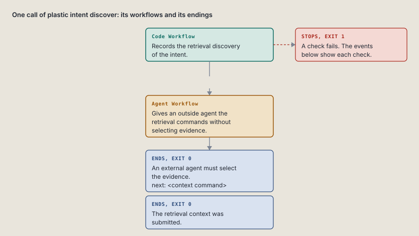
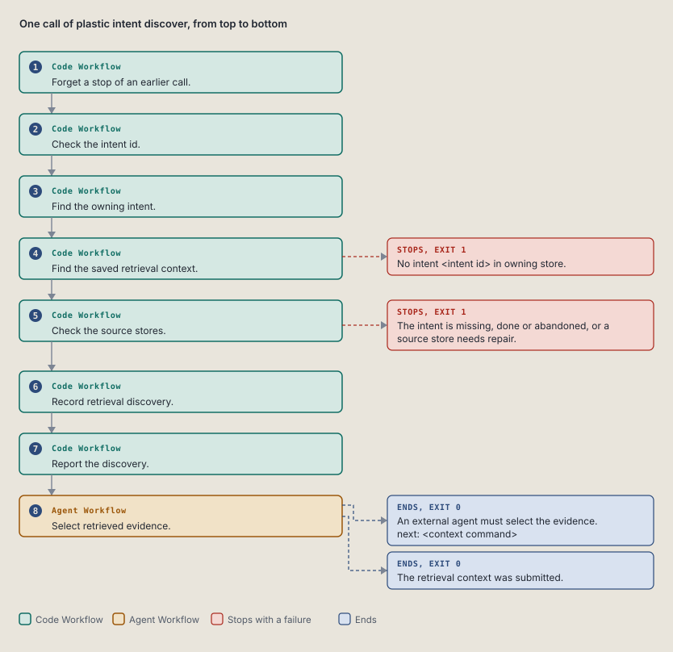

# plastic intent discover

Record deterministic retrieval candidates for an intent.

Builds the retrieval handoff manifest; the harness chooses its evidence.

```sh
plastic intent discover ID TERMS... [--source-project SLUG]
```

| Argument or option | What it gives | Default |
| --- | --- | --- |
| `ID` | the owning intent | |
| `TERMS` | literal search terms | |
| `--source-project SLUG` | a source store | `[]` |

## The workflows of one call



Each box is a workflow. The words between the boxes say when the call moves on, and the last boxes say how the call ends.

## The events of one call, step by step



The boxes on the left run in order. The boxes on the right are the ways the call stops or ends at that step.

## What one call changes

| What changes | Where | Reach |
| --- | --- | --- |
| The retrieval discovery is recorded for the intent | the knowledge graph database, in the store folder | goes with the store |
| The hash of each file printed is recorded in the work database | the work graph database, in the store folder | goes with the store |
| The files of the intent and the index of the store are rewritten | the store folder | goes with the store |

Goes with the store: the files of the store carry the change, and `plastic sync up` rebuilds it on another machine. The database files themselves stay on this machine.

## What the agent workflow steps print

| Step | The text the agent gets |
| --- | --- |
| 8 | The instruction to pick the retrieved evidence that bears on the intent and to submit it with plastic intent context |

The command is `Plastic::Commands::Intent::Discover`, in [`discover.rb:9`](../../../../lib/plastic/commands/intent/discover.rb#L9).
