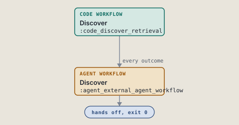
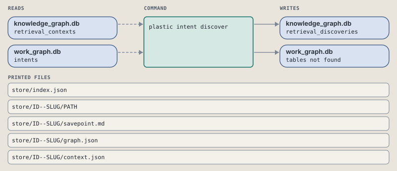

# plastic intent discover

Record deterministic retrieval candidates for an intent.

Builds the retrieval handoff manifest; the harness chooses its evidence.

```sh
plastic intent discover ID TERMS... [--source-project SLUG]
```

The command is `Intent::Discover`, in [`discover.rb:9`](../../../../lib/plastic/commands/intent/discover.rb#L9). The words on this page, such as gate, step and outcome, are explained in [the command DSL](../../dsl/README.md).

| Argument or option | What it gives | Default |
| --- | --- | --- |
| `ID` | the owning intent | |
| `TERMS` | literal search terms | |
| `--source-project SLUG` | a source store | `[]` |

## Components


The figure shows the command, the workflows it runs, the classes behind them, and the databases and files they reach.

## The events of one call



| Workflow | Kind | Code |
| --- | --- | --- |
| [Code::Intent::Discover](#codeintentdiscover) | code | [`discover.rb:17`](../../../../lib/plastic/workflows/code/intent/discover.rb#L17) |
| [Agent::Intent::Discover](#agentintentdiscover) | agent | [`discover.rb:11`](../../../../lib/plastic/workflows/agent/intent/discover.rb#L11) |

### Code::Intent::Discover

The code workflow `:code_discover_retrieval`, in [`discover.rb:17`](../../../../lib/plastic/workflows/code/intent/discover.rb#L17).

Records lexical retrieval candidates before an external agent selects them.


Its rows run in this order:

1. Read: forget a stop of an earlier call. [`code_workflow.rb:54`](../../../../lib/plastic/code_workflow.rb#L54)
2. Read: check the intent id. [`discover.rb:24`](../../../../lib/plastic/workflows/code/intent/discover.rb#L24)
3. Read: find the owning intent. [`discover.rb:28`](../../../../lib/plastic/workflows/code/intent/discover.rb#L28)
4. Read: find the saved retrieval context. [`discover.rb:32`](../../../../lib/plastic/workflows/code/intent/discover.rb#L32)
5. Gate: passes when `!context.intent.nil?`; otherwise the call stops with exit 1 and prints no intent INTENT_ID in owning store. [`discover.rb:36`](../../../../lib/plastic/workflows/code/intent/discover.rb#L36)
6. Read: check the source stores. [`discover.rb:38`](../../../../lib/plastic/workflows/code/intent/discover.rb#L38)
7. Gate: passes when `context.problem.nil?`; otherwise the call stops with exit 1 and prints PROBLEM. [`discover.rb:42`](../../../../lib/plastic/workflows/code/intent/discover.rb#L42)
8. Step: record retrieval discovery. Done when `!context.discovery.nil?`, so a second call skips it. [`discover.rb:44`](../../../../lib/plastic/workflows/code/intent/discover.rb#L44)
9. Read: report the discovery. [`discover.rb:54`](../../../../lib/plastic/workflows/code/intent/discover.rb#L54)
10. Outcome `:done`, always: starts the workflow [Agent::Intent::Discover](#agentintentdiscover). [`discover.rb:58`](../../../../lib/plastic/workflows/code/intent/discover.rb#L58)

It sets `intent`, `source_scope`, `discovery`, `handoff_text`, `context_command`, `context_complete`, `problem`.

### Agent::Intent::Discover

The agent workflow `:agent_external_agent_workflow`, in [`discover.rb:11`](../../../../lib/plastic/workflows/agent/intent/discover.rb#L11).

Gives an external agent deterministic retrieval commands without selecting evidence.


Its rows run in this order:

1. Agent step: select retrieved evidence. Done when `context.context_complete`; while it fails, the call prints its `say:` text. [`discover.rb:16`](../../../../lib/plastic/workflows/agent/intent/discover.rb#L16)
2. Outcome `:handoff`, when a step is left: hands off with exit 0; next: CONTEXT_COMMAND. [`discover.rb:17`](../../../../lib/plastic/workflows/agent/intent/discover.rb#L17)
3. Outcome `:done`, when every done check holds: finishes with exit 0; prints no next: line. [`discover.rb:18`](../../../../lib/plastic/workflows/agent/intent/discover.rb#L18)

The agent step "select retrieved evidence" prints:

> HANDOFF_TEXT

It sets `handoff_text`, `context_command`, `context_complete`.

While a step is left, the call hands off with exit 0 from `:handoff`: it prints the `say:` text of each failing step and offers next: CONTEXT_COMMAND. The command writes, so the call keeps its routine run row in local.db. The next call loads its facts, restarts at the first workflow and skips each step whose `done:` check holds.

In the words of workflow engines, the rows are these four parts:

- **Trigger**: the call starts the workflow `Code::Intent::Discover`; each later workflow starts from an outcome of the one before it.
- **Activities**: 6 reads, 1 step and 1 agent step.
- **Transitions**: 2 gates stop the call when their checks fail; a step runs only while its done check fails; Discover goes to Discover on every outcome.
- **Outcomes**: `:handoff` of Discover, `:done` of Discover end the call.

## What one call reads, writes and prints



| Place | Database or file | Tables | Reads or writes | Code |
| --- | --- | --- | --- | --- |
| the store folder | knowledge_graph.db | `retrieval_contexts`, `retrieval_discoveries` | reads and writes | [`discover.rb:14`](../../../../lib/plastic/commands/intent/discover.rb#L14), [`discover.rb:15`](../../../../lib/plastic/commands/intent/discover.rb#L15) |
| the store folder | work_graph.db | `intents` | reads and writes | [`discover.rb:15`](../../../../lib/plastic/commands/intent/discover.rb#L15) |
| the store folder | store/index.json | | writes | [`prints.rb:14`](../../../../lib/plastic/graph/prints.rb#L14) |
| the store folder | store/ID--SLUG/PATH | | writes | [`prints.rb:15`](../../../../lib/plastic/graph/prints.rb#L15) |
| the store folder | store/ID--SLUG/savepoint.md | | writes | [`prints.rb:16`](../../../../lib/plastic/graph/prints.rb#L16) |
| the store folder | store/ID--SLUG/graph.json | | writes | [`prints.rb:17`](../../../../lib/plastic/graph/prints.rb#L17) |
| the store folder | store/ID--SLUG/context.json | | writes | [`prints.rb:18`](../../../../lib/plastic/graph/prints.rb#L18) |

A second call runs the same rows again. A step runs again only when its done check fails.

| Step | Done when | The second call | Code |
| --- | --- | --- | --- |
| record retrieval discovery | `!context.discovery.nil?` | skips it | [`discover.rb:44`](../../../../lib/plastic/workflows/code/intent/discover.rb#L44) |
| select retrieved evidence | `context.context_complete` | skips it | [`discover.rb:16`](../../../../lib/plastic/workflows/agent/intent/discover.rb#L16) |

## How a call ends

Every call can also end in [the ways any call can end](../../dsl/README.md#how-any-call-can-end).

| Ending | Exit | next: | Code |
| --- | --- | --- | --- |
| no intent INTENT_ID in owning store | 1 | prints no next: line | [`discover.rb:36`](../../../../lib/plastic/workflows/code/intent/discover.rb#L36) |
| PROBLEM | 1 | prints no next: line | [`discover.rb:42`](../../../../lib/plastic/workflows/code/intent/discover.rb#L42) |
| an external agent must select the evidence | 0 | CONTEXT_COMMAND | [`discover.rb:17`](../../../../lib/plastic/workflows/agent/intent/discover.rb#L17) |
| the retrieval context was submitted | 0 | prints no next: line | [`discover.rb:18`](../../../../lib/plastic/workflows/agent/intent/discover.rb#L18) |
| a step raises | 1 | prints no next: line | [`code_workflow.rb:102`](../../../../lib/plastic/code_workflow.rb#L102) |

## What the page leaves out

Every call shares a few things that this page does not repeat; [the command DSL](../../dsl/README.md#what-every-call-shares) names them.

- No gate of this command refuses, so exit 3 never happens.
- A call that writes saves a routine run row in local.db. A stop by a gate or a step saves the run, and the next call resumes from it. A dry run saves no row.
