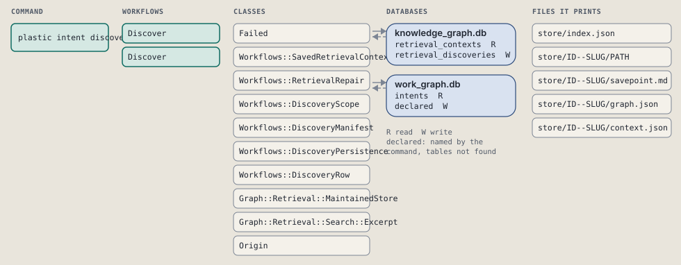
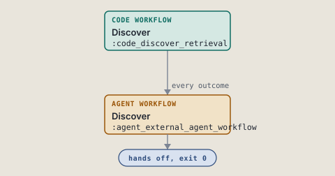
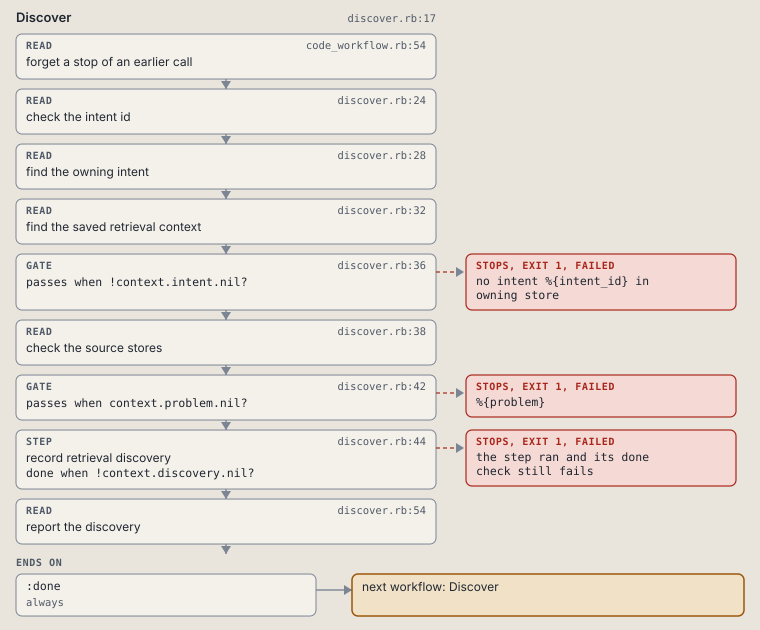
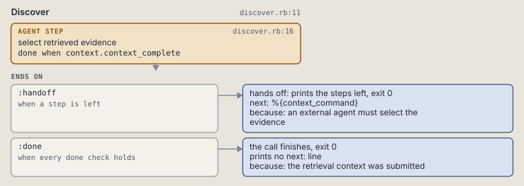

# plastic intent discover

Record deterministic retrieval candidates for an intent.

Builds the retrieval handoff manifest; the harness chooses its evidence.

```sh
plastic intent discover ID TERMS... [--source-project SLUG]
```

The command is `Intent::Discover`, in [`discover.rb:9`](../../../../lib/plastic/commands/intent/discover.rb#L9). The words on this page, such as gate, step and outcome, are explained in [the command DSL](../../dsl/README.md).

| Argument or option | What it gives | Default |
| --- | --- | --- |
| `ID` | the owning intent | |
| `TERMS` | literal search terms | |
| `--source-project SLUG` | a source store | `[]` |

## What it touches



## How the call flows



| Workflow | Kind | Code |
| --- | --- | --- |
| [Code::Intent::Discover](#codeintentdiscover) | code | [`discover.rb:17`](../../../../lib/plastic/workflows/code/intent/discover.rb#L17) |
| [Agent::Intent::Discover](#agentintentdiscover) | agent | [`discover.rb:11`](../../../../lib/plastic/workflows/agent/intent/discover.rb#L11) |

### Code::Intent::Discover

The code workflow `:code_discover_retrieval`, in [`discover.rb:17`](../../../../lib/plastic/workflows/code/intent/discover.rb#L17).

Records lexical retrieval candidates before an external agent selects them.



| Step | Kind | Check | Code |
| --- | --- | --- | --- |
| forget a stop of an earlier call | read |  | [`code_workflow.rb:54`](../../../../lib/plastic/code_workflow.rb#L54) |
| check the intent id | read |  | [`discover.rb:24`](../../../../lib/plastic/workflows/code/intent/discover.rb#L24) |
| find the owning intent | read |  | [`discover.rb:28`](../../../../lib/plastic/workflows/code/intent/discover.rb#L28) |
| find the saved retrieval context | read |  | [`discover.rb:32`](../../../../lib/plastic/workflows/code/intent/discover.rb#L32) |
| no intent %{intent_id} in owning store | gate, stops with exit 1 | `!context.intent.nil?` | [`discover.rb:36`](../../../../lib/plastic/workflows/code/intent/discover.rb#L36) |
| check the source stores | read |  | [`discover.rb:38`](../../../../lib/plastic/workflows/code/intent/discover.rb#L38) |
| %{problem} | gate, stops with exit 1 | `context.problem.nil?` | [`discover.rb:42`](../../../../lib/plastic/workflows/code/intent/discover.rb#L42) |
| record retrieval discovery | step | `!context.discovery.nil?` | [`discover.rb:44`](../../../../lib/plastic/workflows/code/intent/discover.rb#L44) |
| report the discovery | read |  | [`discover.rb:54`](../../../../lib/plastic/workflows/code/intent/discover.rb#L54) |

| Outcome | When | Then | Code |
| --- | --- | --- | --- |
| `:done` | always | runs [Agent::Intent::Discover](#agentintentdiscover) | [`discover.rb:58`](../../../../lib/plastic/workflows/code/intent/discover.rb#L58) |

It sets `intent`, `source_scope`, `discovery`, `handoff_text`, `context_command`, `context_complete`, `problem`.

### Agent::Intent::Discover

The agent workflow `:agent_external_agent_workflow`, in [`discover.rb:11`](../../../../lib/plastic/workflows/agent/intent/discover.rb#L11).

Gives an external agent deterministic retrieval commands without selecting evidence.



| Step | Kind | Check | Code |
| --- | --- | --- | --- |
| select retrieved evidence | agent step | `context.context_complete` | [`discover.rb:16`](../../../../lib/plastic/workflows/agent/intent/discover.rb#L16) |

| Outcome | When | Then | Code |
| --- | --- | --- | --- |
| `:handoff` | when a step is left | hands off, exit 0; next: %{context_command} | [`discover.rb:17`](../../../../lib/plastic/workflows/agent/intent/discover.rb#L17) |
| `:done` | when every done check holds | finishes, exit 0; prints no next: line | [`discover.rb:18`](../../../../lib/plastic/workflows/agent/intent/discover.rb#L18) |

The agent step "select retrieved evidence" prints:

> %{handoff_text}

It sets `handoff_text`, `context_command`, `context_complete`.

## Outcomes

Every call can also end in [the ways any call can end](../../dsl/README.md#how-any-call-can-end).

| Ending | Exit | next: | Code |
| --- | --- | --- | --- |
| no intent %{intent_id} in owning store | 1 | prints no next: line | [`discover.rb:36`](../../../../lib/plastic/workflows/code/intent/discover.rb#L36) |
| %{problem} | 1 | prints no next: line | [`discover.rb:42`](../../../../lib/plastic/workflows/code/intent/discover.rb#L42) |
| an external agent must select the evidence | 0 | %{context_command} | [`discover.rb:17`](../../../../lib/plastic/workflows/agent/intent/discover.rb#L17) |
| the retrieval context was submitted | 0 | prints no next: line | [`discover.rb:18`](../../../../lib/plastic/workflows/agent/intent/discover.rb#L18) |
| a step raises | 1 | prints no next: line | [`code_workflow.rb:102`](../../../../lib/plastic/code_workflow.rb#L102) |
