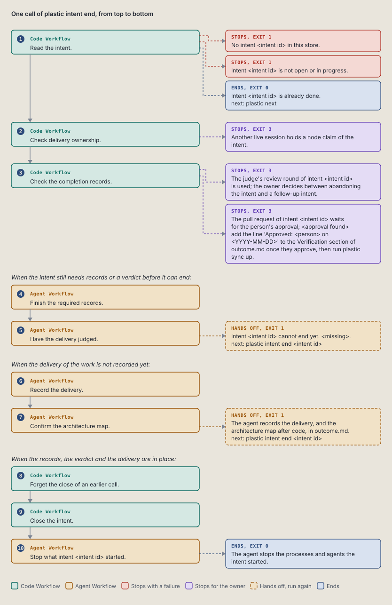

# plastic intent end

Close a delivered intent once its verdict, nodes and outcome allow it, or print what is missing.

```sh
plastic intent end ID
```

| Argument or option | What it gives | Default |
| --- | --- | --- |
| `ID` | the intent | |

## The workflows of one call


Each box is a workflow. The words between the boxes say when the call moves on, and the last boxes say how the call ends.

## The events of one call, step by step



The boxes on the left run in order. The boxes on the right are the ways the call stops or ends at that step.

## What one call changes

| What changes | Where | Reach |
| --- | --- | --- |
| The intent is marked done and its completion is saved | the work graph database, in the store folder | goes with the store |
| The files of the intent and the index of the store are rewritten | the store folder | goes with the store |

Goes with the store: the files of the store carry the change, and `plastic sync up` rebuilds it on another machine. The database files themselves stay on this machine.

## What the agent workflow steps print

| Step | The text the agent gets |
| --- | --- |
| 4 | Complete these recorded prerequisites: \<requirements> |
| 5 | No accepted review counts yet. Run plastic intent judge \<intent id>; the judge records the verdict of the next review round with plastic intent verdict. Then run plastic intent end \<intent id> again. |
| 6 | \<merge found> Use version control as the project's AGENTS.md or CLAUDE.md defines it, or as the project's history shows when neither does: merge the pull request of intent \<intent id> into the intent's base, and leave it open only when the owner asked. \<template found> Then add the line '- Merged: \<branch> into \<base> at \<commit or pull request>' under ## Verification in \<intent folder>/outcome.md, then run plastic sync up. Plastic runs no version control command; it records what you write. |
| 7 | Now that the work is delivered, fetch the architecture map once more, with the tool you used before planning or by mapping the code yourself, and confirm that it describes the delivered code. Then add the line '- Architecture map: \<tool> at \<source revision>' under ## Verification in \<intent folder>/outcome.md. Run plastic sync up and then plastic intent end \<intent id> again. |
| 10 | Stop the processes and the agents that intent \<intent id> started: servers, watchers, background jobs and subagents. Plastic runs none of them and stops none of them. |

The command is `Plastic::Commands::Intent::End`, in [`commands/intent/end.rb`](../../../../lib/plastic/commands/intent/end.rb).
