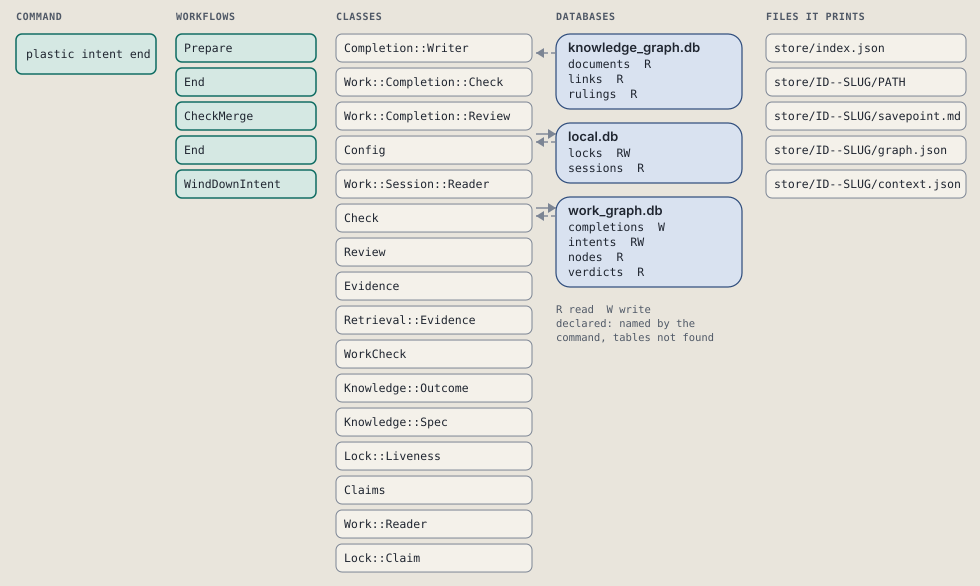
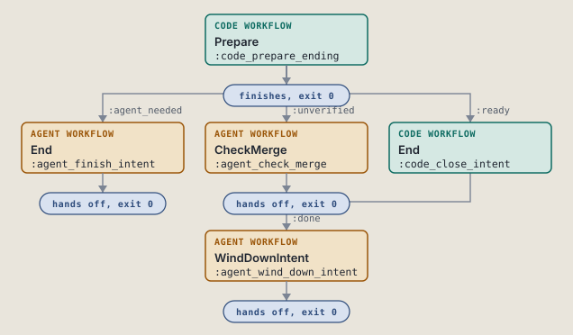
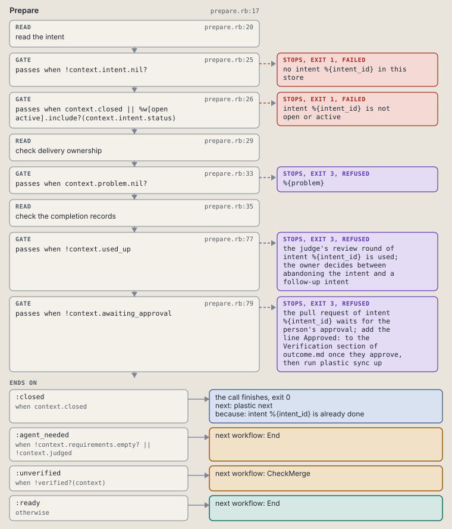
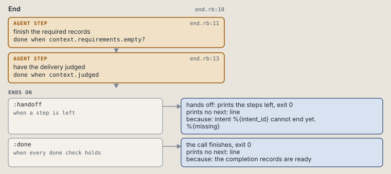
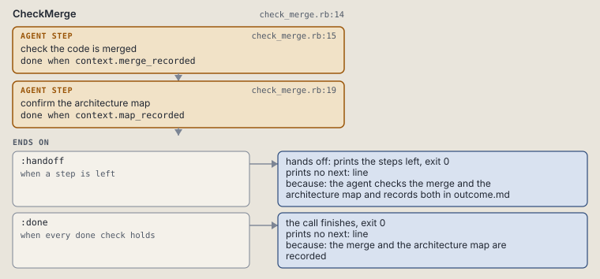
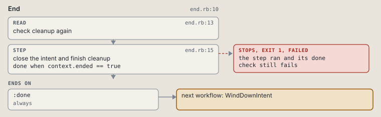
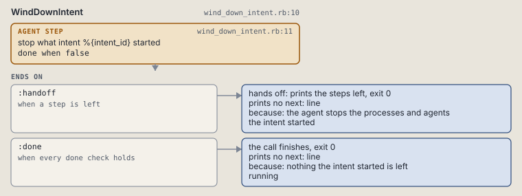
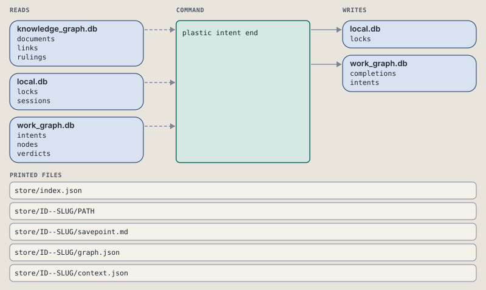

# plastic intent end

Close a delivered intent once its verdict, nodes and outcome allow it, or print what is missing.

```sh
plastic intent end ID
```

The command is `Intent::End`, in [`end.rb:9`](../../../../lib/plastic/commands/intent/end.rb#L9). The words on this page, such as gate, step and outcome, are explained in [the command DSL](../../dsl/README.md).

| Argument or option | What it gives | Default |
| --- | --- | --- |
| `ID` | the intent | |

## Components



The figure shows the command, the workflows it runs, the classes behind them, and the databases and files they reach.

## The events of one call



| Workflow | Kind | Code |
| --- | --- | --- |
| [Code::Intent::End::Prepare](#codeintentendprepare) | code | [`prepare.rb:17`](../../../../lib/plastic/workflows/code/intent/end/prepare.rb#L17) |
| [Agent::Intent::End](#agentintentend) | agent | [`end.rb:10`](../../../../lib/plastic/workflows/agent/intent/end.rb#L10) |
| [Agent::Intent::End::CheckMerge](#agentintentendcheckmerge) | agent | [`check_merge.rb:14`](../../../../lib/plastic/workflows/agent/intent/end/check_merge.rb#L14) |
| [Code::Intent::End](#codeintentend) | code | [`end.rb:10`](../../../../lib/plastic/workflows/code/intent/end.rb#L10) |
| [Agent::Shared::WindDownIntent](#agentsharedwinddownintent) | agent | [`wind_down_intent.rb:10`](../../../../lib/plastic/workflows/agent/shared/wind_down_intent.rb#L10) |

### Code::Intent::End::Prepare

The code workflow `:code_prepare_ending`, in [`prepare.rb:17`](../../../../lib/plastic/workflows/code/intent/end/prepare.rb#L17).

Reads what closing an intent needs: the rows, the judge's verdict, outcome.md and, by the review setting, the pull request.



Its rows run in this order:

1. Read: read the intent. [`prepare.rb:20`](../../../../lib/plastic/workflows/code/intent/end/prepare.rb#L20)
2. Gate: passes when `!context.intent.nil?`; otherwise the call stops with exit 1 and prints no intent INTENT_ID in this store. [`prepare.rb:25`](../../../../lib/plastic/workflows/code/intent/end/prepare.rb#L25)
3. Gate: passes when `context.closed || %w[open active].include?(context.intent.status)`; otherwise the call stops with exit 1 and prints intent INTENT_ID is not open or active. [`prepare.rb:26`](../../../../lib/plastic/workflows/code/intent/end/prepare.rb#L26)
4. Read: check delivery ownership. [`prepare.rb:29`](../../../../lib/plastic/workflows/code/intent/end/prepare.rb#L29)
5. Gate: passes when `context.problem.nil?`; otherwise the call stops with exit 3 and prints PROBLEM. [`prepare.rb:33`](../../../../lib/plastic/workflows/code/intent/end/prepare.rb#L33)
6. Read: check the completion records. [`prepare.rb:35`](../../../../lib/plastic/workflows/code/intent/end/prepare.rb#L35)
7. Gate: passes when `!context.used_up`; otherwise the call stops with exit 3 and prints the judge's review round of intent INTENT_ID is used; the owner decides between abandoning the intent and a follow-up intent. [`prepare.rb:77`](../../../../lib/plastic/workflows/code/intent/end/prepare.rb#L77)
8. Gate: passes when `!context.awaiting_approval`; otherwise the call stops with exit 3 and prints the pull request of intent INTENT_ID waits for the person's approval; add the line Approved: to the Verification section of outcome.md once they approve, then run plastic sync up. [`prepare.rb:79`](../../../../lib/plastic/workflows/code/intent/end/prepare.rb#L79)
9. Outcome `:closed`, when `context.closed`: finishes with exit 0; next: plastic next. [`prepare.rb:84`](../../../../lib/plastic/workflows/code/intent/end/prepare.rb#L84)
10. Outcome `:agent_needed`, when `!context.requirements.empty? || !context.judged`: starts the workflow [Agent::Intent::End](#agentintentend). [`prepare.rb:86`](../../../../lib/plastic/workflows/code/intent/end/prepare.rb#L86)
11. Outcome `:unverified`, when `!verified?(context)`: starts the workflow [Agent::Intent::End::CheckMerge](#agentintentendcheckmerge). [`prepare.rb:87`](../../../../lib/plastic/workflows/code/intent/end/prepare.rb#L87)
12. Outcome `:ready`, otherwise: starts the workflow [Code::Intent::End](#codeintentend). [`prepare.rb:88`](../../../../lib/plastic/workflows/code/intent/end/prepare.rb#L88)

It sets `intent`, `closed`, `problem`, `requirements`, `judged`, `used_up`, `awaiting_approval`, `intent_folder`, `merge_recorded`, `map_recorded`, `missing`.

### Agent::Intent::End

The agent workflow `:agent_finish_intent`, in [`end.rb:10`](../../../../lib/plastic/workflows/agent/intent/end.rb#L10).

The harness writes the records the close needs and has the work judged.



Its rows run in this order:

1. Agent step: finish the required records. Done when `context.requirements.empty?`; while it fails, the call prints its `say:` text. [`end.rb:11`](../../../../lib/plastic/workflows/agent/intent/end.rb#L11)
2. Agent step: have the delivery judged. Done when `context.judged`; while it fails, the call prints its `say:` text. [`end.rb:13`](../../../../lib/plastic/workflows/agent/intent/end.rb#L13)
3. Outcome `:handoff`, when a step is left: hands off with exit 0; prints no next: line. [`end.rb:17`](../../../../lib/plastic/workflows/agent/intent/end.rb#L17)
4. Outcome `:done`, when every done check holds: finishes with exit 0; prints no next: line. [`end.rb:18`](../../../../lib/plastic/workflows/agent/intent/end.rb#L18)

The agent step "finish the required records" prints:

> Complete these recorded prerequisites: REQUIREMENTS

The agent step "have the delivery judged" prints:

> No accepted review counts yet. Run plastic intent judge INTENT_ID; the judge records the verdict of the next review round with plastic intent verdict. Then run plastic intent end INTENT_ID again.

While a step is left, the call hands off with exit 0 from `:handoff`: it prints the `say:` text of each failing step and prints no next: line. The command writes, so the call keeps its routine run row in local.db. The next call loads its facts, restarts at the first workflow and skips each step whose `done:` check holds.

### Agent::Intent::End::CheckMerge

The agent workflow `:agent_check_merge`, in [`check_merge.rb:14`](../../../../lib/plastic/workflows/agent/intent/end/check_merge.rb#L14).

The agent checks that the code is merged and confirms the architecture map, then records both under Verification in outcome.md. Plastic runs no version control command and records what the agent writes.



Its rows run in this order:

1. Agent step: check the code is merged. Done when `context.merge_recorded`; while it fails, the call prints its `say:` text. [`check_merge.rb:15`](../../../../lib/plastic/workflows/agent/intent/end/check_merge.rb#L15)
2. Agent step: confirm the architecture map. Done when `context.map_recorded`; while it fails, the call prints its `say:` text. [`check_merge.rb:19`](../../../../lib/plastic/workflows/agent/intent/end/check_merge.rb#L19)
3. Outcome `:handoff`, when a step is left: hands off with exit 0; prints no next: line. [`check_merge.rb:25`](../../../../lib/plastic/workflows/agent/intent/end/check_merge.rb#L25)
4. Outcome `:done`, when every done check holds: finishes with exit 0; prints no next: line. [`check_merge.rb:26`](../../../../lib/plastic/workflows/agent/intent/end/check_merge.rb#L26)

The agent step "check the code is merged" prints:

> Check with your own version control tool that the intent's branch is merged into its base. Then add the line '- Merged: <branch> into <base> at <commit or pull request>' under ## Verification in INTENT_FOLDER/outcome.md. Plastic runs no version control command; it records what you write.

The agent step "confirm the architecture map" prints:

> Now that the work is delivered, fetch the architecture map once more, with the tool you used before planning or by mapping the code yourself, and confirm that it describes the delivered code. Then add the line '- Architecture map: <tool> at <source revision>' under ## Verification in INTENT_FOLDER/outcome.md. Run plastic sync up and then plastic intent end INTENT_ID again.

While a step is left, the call hands off with exit 0 from `:handoff`: it prints the `say:` text of each failing step and prints no next: line. The command writes, so the call keeps its routine run row in local.db. The next call loads its facts, restarts at the first workflow and skips each step whose `done:` check holds.

### Code::Intent::End

The code workflow `:code_close_intent`, in [`end.rb:10`](../../../../lib/plastic/workflows/code/intent/end.rb#L10).

Closure can be retried after the work commit but before lock cleanup. The files of the intent print after the close.



Its rows run in this order:

1. Read: check cleanup again. [`end.rb:13`](../../../../lib/plastic/workflows/code/intent/end.rb#L13)
2. Step: close the intent and finish cleanup. Done when `context.ended == true`, so a second call skips it. [`end.rb:15`](../../../../lib/plastic/workflows/code/intent/end.rb#L15)
3. Outcome `:done`, always: starts the workflow [Agent::Shared::WindDownIntent](#agentsharedwinddownintent). [`end.rb:21`](../../../../lib/plastic/workflows/code/intent/end.rb#L21)

It sets `ended`.

### Agent::Shared::WindDownIntent

The agent workflow `:agent_wind_down_intent`, in [`wind_down_intent.rb:10`](../../../../lib/plastic/workflows/agent/shared/wind_down_intent.rb#L10).

The agent stops what the intent started. Plastic runs and stops nothing.



Its rows run in this order:

1. Agent step: stop what intent INTENT_ID started. Runs on every call; its done check is `false`. The call prints its `say:` text. [`wind_down_intent.rb:11`](../../../../lib/plastic/workflows/agent/shared/wind_down_intent.rb#L11)
2. Outcome `:handoff`, when a step is left: hands off with exit 0; prints no next: line. [`wind_down_intent.rb:15`](../../../../lib/plastic/workflows/agent/shared/wind_down_intent.rb#L15)
3. Outcome `:done`, when every done check holds: finishes with exit 0; prints no next: line. [`wind_down_intent.rb:16`](../../../../lib/plastic/workflows/agent/shared/wind_down_intent.rb#L16)

The agent step "stop what intent INTENT_ID started" prints:

> Stop the processes and the agents that intent INTENT_ID started: servers, watchers, background jobs and subagents. Plastic runs none of them and stops none of them.

While a step is left, the call hands off with exit 0 from `:handoff`: it prints the `say:` text of each failing step and prints no next: line. The command writes, so the call keeps its routine run row in local.db. The next call loads its facts, restarts at the first workflow and skips each step whose `done:` check holds.

In the words of workflow engines, the rows are these four parts:

- **Trigger**: the call starts the workflow `Code::Intent::End::Prepare`; each later workflow starts from an outcome of the one before it.
- **Activities**: 4 reads, 1 step and 5 agent steps.
- **Transitions**: 5 gates stop the call when their checks fail; a step runs only while its done check fails; Prepare goes to CheckMerge on `:unverified`; Prepare goes to End on `:ready`; Prepare goes to End on `:agent_needed`; End goes to WindDownIntent on `:done`.
- **Outcomes**: `:closed` of Prepare, `:handoff` of End, `:done` of End, `:handoff` of CheckMerge, `:done` of CheckMerge, `:handoff` of WindDownIntent, `:done` of WindDownIntent end the call.

## What one call reads, writes and prints



| Place | Database or file | Tables | Reads or writes | Code |
| --- | --- | --- | --- | --- |
| the store folder | knowledge_graph.db | `documents`, `links`, `rulings` | reads | [`end.rb:13`](../../../../lib/plastic/commands/intent/end.rb#L13) |
| the home folder | local.db | `locks`, `sessions` | reads and writes | found in the code, not declared |
| the store folder | work_graph.db | `completions`, `intents`, `nodes`, `verdicts` | reads and writes | [`end.rb:11`](../../../../lib/plastic/commands/intent/end.rb#L11) |
| the store folder | store/index.json | | writes | [`prints.rb:14`](../../../../lib/plastic/graph/prints.rb#L14) |
| the store folder | store/ID--SLUG/PATH | | writes | [`prints.rb:15`](../../../../lib/plastic/graph/prints.rb#L15) |
| the store folder | store/ID--SLUG/savepoint.md | | writes | [`prints.rb:16`](../../../../lib/plastic/graph/prints.rb#L16) |
| the store folder | store/ID--SLUG/graph.json | | writes | [`prints.rb:17`](../../../../lib/plastic/graph/prints.rb#L17) |
| the store folder | store/ID--SLUG/context.json | | writes | [`prints.rb:18`](../../../../lib/plastic/graph/prints.rb#L18) |

A second call runs the same rows again. A step runs again only when its done check fails.

| Step | Done when | The second call | Code |
| --- | --- | --- | --- |
| finish the required records | `context.requirements.empty?` | skips it | [`end.rb:11`](../../../../lib/plastic/workflows/agent/intent/end.rb#L11) |
| have the delivery judged | `context.judged` | skips it | [`end.rb:13`](../../../../lib/plastic/workflows/agent/intent/end.rb#L13) |
| check the code is merged | `context.merge_recorded` | skips it | [`check_merge.rb:15`](../../../../lib/plastic/workflows/agent/intent/end/check_merge.rb#L15) |
| confirm the architecture map | `context.map_recorded` | skips it | [`check_merge.rb:19`](../../../../lib/plastic/workflows/agent/intent/end/check_merge.rb#L19) |
| close the intent and finish cleanup | `context.ended == true` | skips it | [`end.rb:15`](../../../../lib/plastic/workflows/code/intent/end.rb#L15) |
| stop what intent INTENT_ID started | `false` | runs it again | [`wind_down_intent.rb:11`](../../../../lib/plastic/workflows/agent/shared/wind_down_intent.rb#L11) |

## How a call ends

Every call can also end in [the ways any call can end](../../dsl/README.md#how-any-call-can-end).

| Ending | Exit | next: | Code |
| --- | --- | --- | --- |
| no intent INTENT_ID in this store | 1 | prints no next: line | [`prepare.rb:25`](../../../../lib/plastic/workflows/code/intent/end/prepare.rb#L25) |
| intent INTENT_ID is not open or active | 1 | prints no next: line | [`prepare.rb:26`](../../../../lib/plastic/workflows/code/intent/end/prepare.rb#L26) |
| PROBLEM | 3 | prints no next: line | [`prepare.rb:33`](../../../../lib/plastic/workflows/code/intent/end/prepare.rb#L33) |
| the judge's review round of intent INTENT_ID is used; the owner decides between abandoning the intent and a follow-up intent | 3 | prints no next: line | [`prepare.rb:77`](../../../../lib/plastic/workflows/code/intent/end/prepare.rb#L77) |
| the pull request of intent INTENT_ID waits for the person's approval; add the line Approved: to the Verification section of outcome.md once they approve, then run plastic sync up | 3 | prints no next: line | [`prepare.rb:79`](../../../../lib/plastic/workflows/code/intent/end/prepare.rb#L79) |
| intent INTENT_ID is already done | 0 | plastic next | [`prepare.rb:84`](../../../../lib/plastic/workflows/code/intent/end/prepare.rb#L84) |
| intent INTENT_ID cannot end yet. MISSING | 0 | prints no next: line | [`end.rb:17`](../../../../lib/plastic/workflows/agent/intent/end.rb#L17) |
| the completion records are ready | 0 | prints no next: line | [`end.rb:18`](../../../../lib/plastic/workflows/agent/intent/end.rb#L18) |
| the agent checks the merge and the architecture map and records both in outcome.md | 0 | prints no next: line | [`check_merge.rb:25`](../../../../lib/plastic/workflows/agent/intent/end/check_merge.rb#L25) |
| the merge and the architecture map are recorded | 0 | prints no next: line | [`check_merge.rb:26`](../../../../lib/plastic/workflows/agent/intent/end/check_merge.rb#L26) |
| the agent stops the processes and agents the intent started | 0 | prints no next: line | [`wind_down_intent.rb:15`](../../../../lib/plastic/workflows/agent/shared/wind_down_intent.rb#L15) |
| nothing the intent started is left running | 0 | prints no next: line | [`wind_down_intent.rb:16`](../../../../lib/plastic/workflows/agent/shared/wind_down_intent.rb#L16) |
| a step raises | 1 | prints no next: line | [`code_workflow.rb:102`](../../../../lib/plastic/code_workflow.rb#L102) |

## What the page leaves out

Every call shares a few things that this page does not repeat; [the command DSL](../../dsl/README.md#what-every-call-shares) names them.

- A call that writes saves a routine run row in local.db. A stop by a gate or a step saves the run, and the next call resumes from it. A dry run saves no row.
