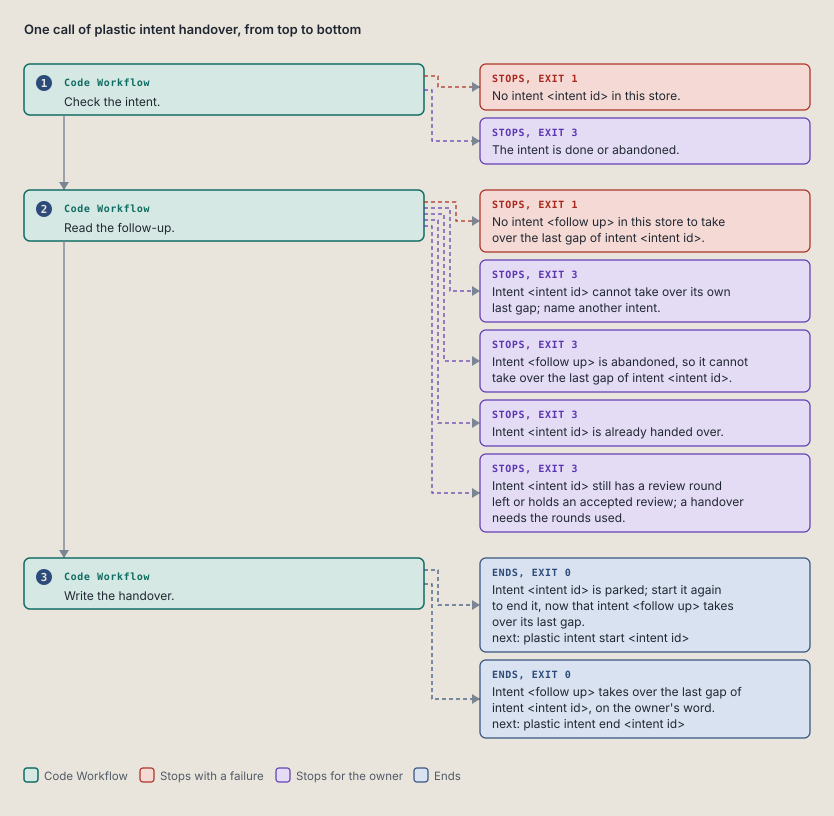

# plastic intent handover

Hand the last gap of an intent whose rounds are used to a follow-up intent, on the owner's word, so the intent can end.

```sh
plastic intent handover ID FOLLOW_UP REASON... [--owner]
```

| Argument or option | What it gives | Default |
| --- | --- | --- |
| `ID` | the intent | |
| `FOLLOW_UP` | the follow-up intent that takes over the last gap | |
| `REASON` | why the owner hands the gap over | |
| `--owner` | the owner's word: a call without it hands nothing over | `false` |

## The events of one call, step by step



The boxes on the left run in order. The boxes on the right are the ways the call stops or ends at that step.

## What one call changes

| What changes | Where | Reach |
| --- | --- | --- |
| The owner's handover of the last gap to the follow-up intent is written to the work log | the work graph database, in the store folder | goes with the store |
| The files of the intent and the index of the store are rewritten | the store folder | goes with the store |

Goes with the store: the files of the store carry the change, and `plastic store sync up` rebuilds it on another machine. The database files themselves stay on this machine.

The command is `Plastic::Commands::Intent::Handover`, in [`commands/intent/handover.rb`](../../../../lib/plastic/commands/intent/handover.rb).
