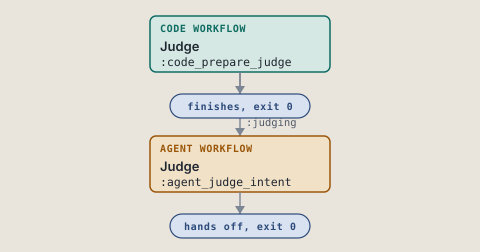
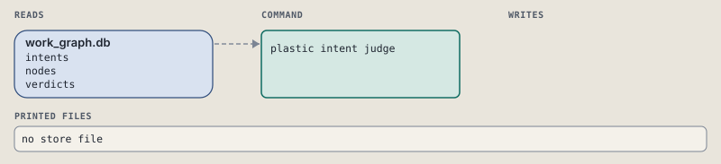

# plastic intent judge

Print the steps that start the judge of an intent.

```sh
plastic intent judge ID
```

The command is `Intent::Judge`, in [`judge.rb:9`](../../../../lib/plastic/commands/intent/judge.rb#L9). The words on this page, such as gate, step and outcome, are explained in [the command DSL](../../dsl/README.md).

| Argument or option | What it gives | Default |
| --- | --- | --- |
| `ID` | the intent | |

## Components


The figure shows the command, the workflows it runs, the classes behind them, and the databases and files they reach.

## The events of one call



| Workflow | Kind | Code |
| --- | --- | --- |
| [Code::Intent::Judge](#codeintentjudge) | code | [`judge.rb:12`](../../../../lib/plastic/workflows/code/intent/judge.rb#L12) |
| [Agent::Intent::Judge](#agentintentjudge) | agent | [`judge.rb:11`](../../../../lib/plastic/workflows/agent/intent/judge.rb#L11) |

### Code::Intent::Judge

The code workflow `:code_prepare_judge`, in [`judge.rb:12`](../../../../lib/plastic/workflows/code/intent/judge.rb#L12).

Reads the intent and its judge rounds: a missing or closed intent fails, both rounds used is the owner's step.


Its rows run in this order:

1. Read: check the intent. [`judge.rb:17`](../../../../lib/plastic/workflows/code/intent/judge.rb#L17)
2. Gate: passes when `context.problem.nil?`; otherwise the call stops with exit 1 and prints PROBLEM. [`judge.rb:21`](../../../../lib/plastic/workflows/code/intent/judge.rb#L21)
3. Gate: passes when `!Graph::Work::Completion::Review.of(context).used_up?`; otherwise the call stops with exit 3 and prints the judge's review round of intent INTENT_ID is used; the owner decides between abandoning the intent and a follow-up intent. [`review_round.rb:11`](../../../../lib/plastic/workflows/review_round.rb#L11)
4. Outcome `:accepted`, when `Plastic::Graph::Work::Completion::Review.of(context).counting?`: finishes with exit 0; next: plastic intent end INTENT_ID. [`judge.rb:24`](../../../../lib/plastic/workflows/code/intent/judge.rb#L24)
5. Outcome `:judging`, otherwise: starts the workflow [Agent::Intent::Judge](#agentintentjudge). [`judge.rb:26`](../../../../lib/plastic/workflows/code/intent/judge.rb#L26)

It sets `problem`.

### Agent::Intent::Judge

The agent workflow `:agent_judge_intent`, in [`judge.rb:11`](../../../../lib/plastic/workflows/agent/intent/judge.rb#L11).

The agent reads the spec and the findings of every node, decides, and records the verdict.


Its rows run in this order:

1. Agent step: judge the delivery. Done when `Plastic::Graph::Work::Completion::Review.of(context).counting?`; while it fails, the call prints its `say:` text. [`judge.rb:12`](../../../../lib/plastic/workflows/agent/intent/judge.rb#L12)
2. Outcome `:handoff`, when a step is left: hands off with exit 0; next: plastic intent verdict INTENT_ID accept|revise TEXT. [`judge.rb:19`](../../../../lib/plastic/workflows/agent/intent/judge.rb#L19)
3. Outcome `:done`, when every done check holds: finishes with exit 0; prints no next: line. [`judge.rb:21`](../../../../lib/plastic/workflows/agent/intent/judge.rb#L21)

The agent step "judge the delivery" prints:

> Start a reasoning judge agent; the harness picks which kind. Tell it to read spec.md and the findings of every node, check each done criterion against the delivered work and decide: accept when every criterion holds, revise when something falls short. It records the verdict with plastic intent verdict INTENT_ID accept|revise TEXT. A revise starts a second review round, and a second revise stops the intent for the owner.

While a step is left, the call hands off with exit 0 from `:handoff`: it prints the `say:` text of each failing step and offers next: plastic intent verdict INTENT_ID accept|revise TEXT. The command writes nothing, so the call keeps no routine run row. The next call starts fresh and checks the steps again.

In the words of workflow engines, the rows are these four parts:

- **Trigger**: the call starts the workflow `Code::Intent::Judge`; each later workflow starts from an outcome of the one before it.
- **Activities**: 1 read and 1 agent step.
- **Transitions**: 2 gates stop the call when their checks fail; a step runs only while its done check fails; Judge goes to Judge on `:judging`.
- **Outcomes**: `:accepted` of Judge, `:handoff` of Judge, `:done` of Judge end the call.

## What one call reads, writes and prints



| Place | Database or file | Tables | Reads or writes | Code |
| --- | --- | --- | --- | --- |
| the store folder | work_graph.db | `intents`, `nodes`, `verdicts` | reads | [`judge.rb:11`](../../../../lib/plastic/commands/intent/judge.rb#L11) |

A second call runs the same rows again. A step runs again only when its done check fails.

| Step | Done when | The second call | Code |
| --- | --- | --- | --- |
| judge the delivery | `Plastic::Graph::Work::Completion::Review.of(context).counting?` | skips it | [`judge.rb:12`](../../../../lib/plastic/workflows/agent/intent/judge.rb#L12) |

## How a call ends

Every call can also end in [the ways any call can end](../../dsl/README.md#how-any-call-can-end).

| Ending | Exit | next: | Code |
| --- | --- | --- | --- |
| PROBLEM | 1 | prints no next: line | [`judge.rb:21`](../../../../lib/plastic/workflows/code/intent/judge.rb#L21) |
| the judge's review round of intent INTENT_ID is used; the owner decides between abandoning the intent and a follow-up intent | 3 | prints no next: line | [`review_round.rb:11`](../../../../lib/plastic/workflows/review_round.rb#L11) |
| intent INTENT_ID is accepted | 0 | plastic intent end INTENT_ID | [`judge.rb:24`](../../../../lib/plastic/workflows/code/intent/judge.rb#L24) |
| the agent judges the delivery and records the verdict | 0 | plastic intent verdict INTENT_ID accept\|revise TEXT | [`judge.rb:19`](../../../../lib/plastic/workflows/agent/intent/judge.rb#L19) |
| the delivery is judged | 0 | prints no next: line | [`judge.rb:21`](../../../../lib/plastic/workflows/agent/intent/judge.rb#L21) |
| a step raises | 1 | prints no next: line | [`code_workflow.rb:102`](../../../../lib/plastic/code_workflow.rb#L102) |

## What the page leaves out

Every call shares a few things that this page does not repeat; [the command DSL](../../dsl/README.md#what-every-call-shares) names them.
