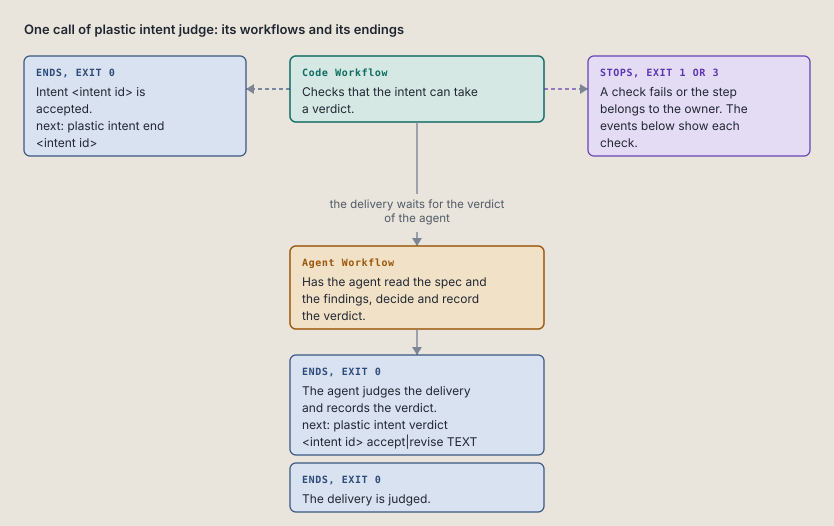
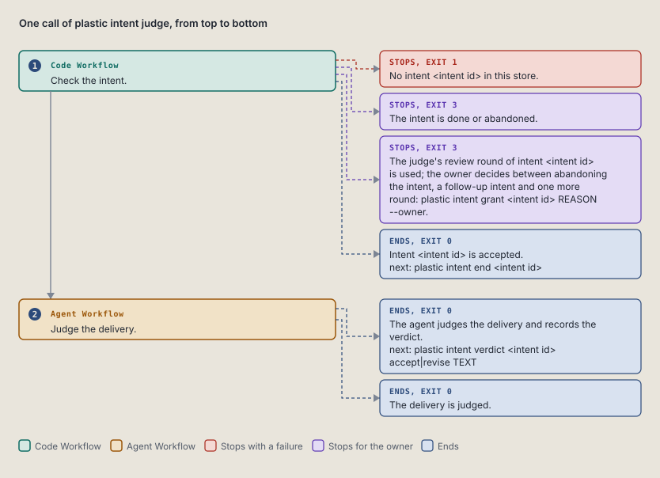

# plastic intent judge

Print the steps that start the judge of an intent.

```sh
plastic intent judge ID
```

| Argument or option | What it gives | Default |
| --- | --- | --- |
| `ID` | the intent | |

## The workflows of one call



Each box is a workflow. The words between the boxes say when the call moves on, and the last boxes say how the call ends.

## The events of one call, step by step



The boxes on the left run in order. The boxes on the right are the ways the call stops or ends at that step.

## What one call changes

This command changes nothing.

## What the agent workflow steps print

| Step | The text the agent gets |
| --- | --- |
| 2 | Start a reasoning judge agent; the harness picks which kind. Tell it to read spec.md and the findings of every node, check each done criterion against the delivered work and decide: accept when every criterion holds, revise when something falls short. It records the verdict with plastic intent verdict \<intent id> accept\|revise TEXT. A revise starts a second review round, and a second revise stops the intent for the owner, who can grant one more round with plastic intent grant. |

The command is `Plastic::Commands::Intent::Judge`, in [`commands/intent/judge.rb`](../../../../lib/plastic/commands/intent/judge.rb).
