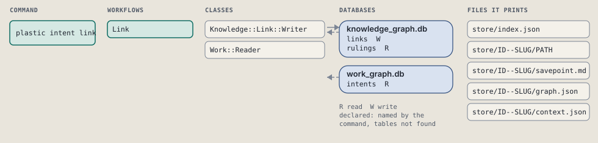
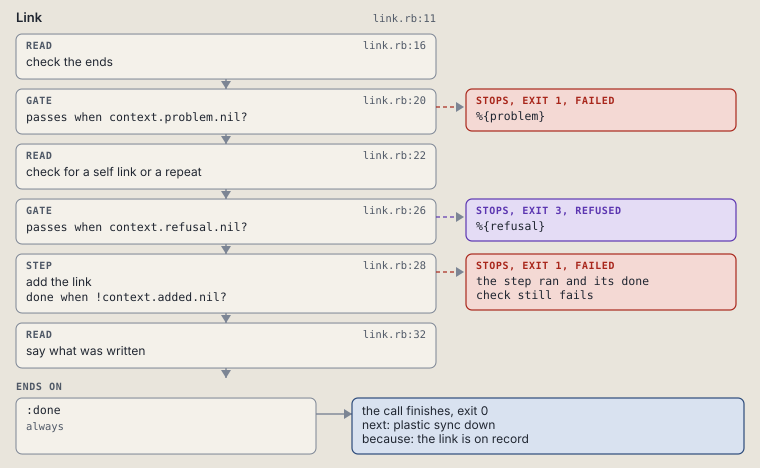
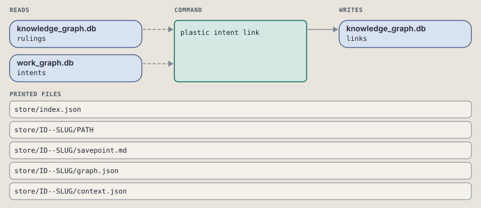

# plastic intent link

Write a typed link from an intent to a ref.

Writes one `links` row from ID to TARGET: an intent id, a ruling ref such as `1/D1`, or a ref with a store prefix such as `global:25`.

```sh
plastic intent link ID KIND TARGET
```

The command is `Intent::Link`, in [`link.rb:11`](../../../../lib/plastic/commands/intent/link.rb#L11). The words on this page, such as gate, step and outcome, are explained in [the command DSL](../../dsl/README.md).

| Argument or option | What it gives | Default |
| --- | --- | --- |
| `ID` | the intent this link starts from | |
| `KIND` | cites, supersedes, answers, source or chain | |
| `TARGET` | an intent, a ruling, or a ref with a store prefix | |

## Components



The figure shows the command, the workflows it runs, the classes behind them, and the databases and files they reach.

## The events of one call

### The command's own call

The command's own `call`, at [`link.rb:20`](../../../../lib/plastic/commands/intent/link.rb#L20), runs first, then starts the workflow [Code::Intent::Link](#codeintentlink).

```ruby
def call
  raise CLI::Command::Usage, "KIND takes #{Plastic::Graph::Knowledge::Link::KINDS.join(", ")}" unless Plastic::Graph::Knowledge::Link::KINDS.include?(parsed[:kind])

  super
end
```

### Code::Intent::Link

The code workflow `:code_add_link`, in [`link.rb:11`](../../../../lib/plastic/workflows/code/intent/link.rb#L11).

Writes one guarded link: failed on a missing id or target, refused on a self link or a link already there.



Its rows run in this order:

1. Read: check the ends. [`link.rb:16`](../../../../lib/plastic/workflows/code/intent/link.rb#L16)
2. Gate: passes when `context.problem.nil?`; otherwise the call stops with exit 1 and prints PROBLEM. [`link.rb:20`](../../../../lib/plastic/workflows/code/intent/link.rb#L20)
3. Read: check for a self link or a repeat. [`link.rb:22`](../../../../lib/plastic/workflows/code/intent/link.rb#L22)
4. Gate: passes when `context.refusal.nil?`; otherwise the call stops with exit 3 and prints REFUSAL. [`link.rb:26`](../../../../lib/plastic/workflows/code/intent/link.rb#L26)
5. Step: add the link. Done when `!context.added.nil?`, so a second call skips it. [`link.rb:28`](../../../../lib/plastic/workflows/code/intent/link.rb#L28)
6. Read: say what was written. [`link.rb:32`](../../../../lib/plastic/workflows/code/intent/link.rb#L32)
7. Outcome `:done`, always: finishes with exit 0; next: plastic sync down. [`link.rb:36`](../../../../lib/plastic/workflows/code/intent/link.rb#L36)

It sets `problem`, `refusal`, `added`.

In the words of workflow engines, the rows are these four parts:

- **Trigger**: the call starts the workflow `Code::Intent::Link`.
- **Activities**: 3 reads and 1 step.
- **Transitions**: 2 gates stop the call when their checks fail; a step runs only while its done check fails.
- **Outcomes**: `:done` end the call.

## What one call reads, writes and prints



| Place | Database or file | Tables | Reads or writes | Code |
| --- | --- | --- | --- | --- |
| the store folder | knowledge_graph.db | `links`, `rulings` | reads and writes | [`link.rb:17`](../../../../lib/plastic/commands/intent/link.rb#L17) |
| the store folder | work_graph.db | `intents` | reads | [`link.rb:16`](../../../../lib/plastic/commands/intent/link.rb#L16) |
| the store folder | store/index.json | | writes | [`prints.rb:14`](../../../../lib/plastic/graph/prints.rb#L14) |
| the store folder | store/ID--SLUG/PATH | | writes | [`prints.rb:15`](../../../../lib/plastic/graph/prints.rb#L15) |
| the store folder | store/ID--SLUG/savepoint.md | | writes | [`prints.rb:16`](../../../../lib/plastic/graph/prints.rb#L16) |
| the store folder | store/ID--SLUG/graph.json | | writes | [`prints.rb:17`](../../../../lib/plastic/graph/prints.rb#L17) |
| the store folder | store/ID--SLUG/context.json | | writes | [`prints.rb:18`](../../../../lib/plastic/graph/prints.rb#L18) |

A second call runs the same rows again. A step runs again only when its done check fails.

| Step | Done when | The second call | Code |
| --- | --- | --- | --- |
| add the link | `!context.added.nil?` | skips it | [`link.rb:28`](../../../../lib/plastic/workflows/code/intent/link.rb#L28) |

## How a call ends

Every call can also end in [the ways any call can end](../../dsl/README.md#how-any-call-can-end).

| Ending | Exit | next: | Code |
| --- | --- | --- | --- |
| PROBLEM | 1 | prints no next: line | [`link.rb:20`](../../../../lib/plastic/workflows/code/intent/link.rb#L20) |
| REFUSAL | 3 | prints no next: line | [`link.rb:26`](../../../../lib/plastic/workflows/code/intent/link.rb#L26) |
| the link is on record | 0 | plastic sync down | [`link.rb:36`](../../../../lib/plastic/workflows/code/intent/link.rb#L36) |
| a step raises | 1 | prints no next: line | [`code_workflow.rb:102`](../../../../lib/plastic/code_workflow.rb#L102) |
| Usage error: KIND takes LASTIC | 2 | prints no next: line | [`link.rb:21`](../../../../lib/plastic/commands/intent/link.rb#L21) |

## What the page leaves out

Every call shares a few things that this page does not repeat; [the command DSL](../../dsl/README.md#what-every-call-shares) names them.

- A call that writes saves a routine run row in local.db. A stop by a gate or a step saves the run, and the next call resumes from it. A dry run saves no row.
