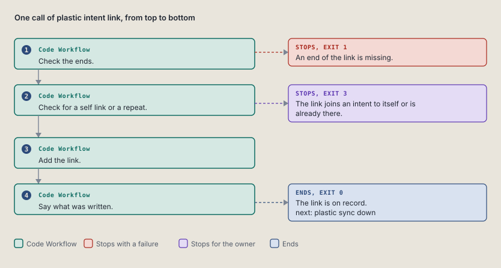

# plastic intent link

Write a typed link from an intent to a ref.

```sh
plastic intent link ID KIND TARGET
```

| Argument or option | What it gives | Default |
| --- | --- | --- |
| `ID` | the intent this link starts from | |
| `KIND` | cites, supersedes, answers, source or chain | |
| `TARGET` | an intent, a ruling, or a ref with a store prefix | |

## The events of one call, step by step



The boxes on the left run in order. The boxes on the right are the ways the call stops or ends at that step.

## What one call changes

| What changes | Where | Reach |
| --- | --- | --- |
| A link from the intent to its target is added | the knowledge graph database, in the store folder | goes with the store |
| The files of the intent and the index of the store are rewritten | the store folder | goes with the store |

Goes with the store: the files of the store carry the change, and `plastic sync up` rebuilds it on another machine. The database files themselves stay on this machine.

The command is `Plastic::Commands::Intent::Link`, in [`link.rb:11`](../../../../lib/plastic/commands/intent/link.rb#L11).
