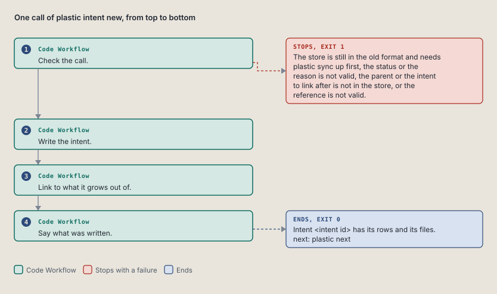

# plastic intent new

Open an intent: write its rows and its folder.

Opens an intent: writes its row and its first rows, and prints its folder and store/index.json in the same call.

```sh
plastic intent new TITLE... [--parent ID] [--ref REF] [--after ID] [--kind KIND] [--status STATUS] [--reason TEXT]
```

| Argument or option | What it gives | Default |
| --- | --- | --- |
| `TITLE` | what the intent is for, in words | |
| `--parent ID` | the intent this one is a child of |  |
| `--ref REF` | a ticket, a link, or another intent as ID-ORIGIN |  |
| `--after ID` | an intent this one grows out of, linked as source |  |
| `--kind KIND` | the kind of work | `"work"` |
| `--status STATUS` | open, parked or future | `"open"` |
| `--reason TEXT` | why a parked intent waits; required with --status parked |  |

## The events of one call, step by step



The boxes on the left run in order. The boxes on the right are the ways the call stops or ends at that step.

## What one call changes

| What changes | Where | Reach |
| --- | --- | --- |
| The intent is written with its first savepoint | the work graph database, in the store folder | goes with the store |
| The spec document of the intent is created | the knowledge graph database, in the store folder | goes with the store |
| A source link from the new intent to the intent it grows out of is added | the knowledge graph database, in the store folder | goes with the store |
| The hash of each file printed is recorded in the references database | the references database, in the store folder | goes with the store |
| The files of the intent and the index of the store are rewritten | the store folder | goes with the store |

Goes with the store: the files of the store carry the change, and `plastic sync up` rebuilds it on another machine. The database files themselves stay on this machine.

The command is `Plastic::Commands::Intent::New`, in [`new.rb:10`](../../../../lib/plastic/commands/intent/new.rb#L10).
