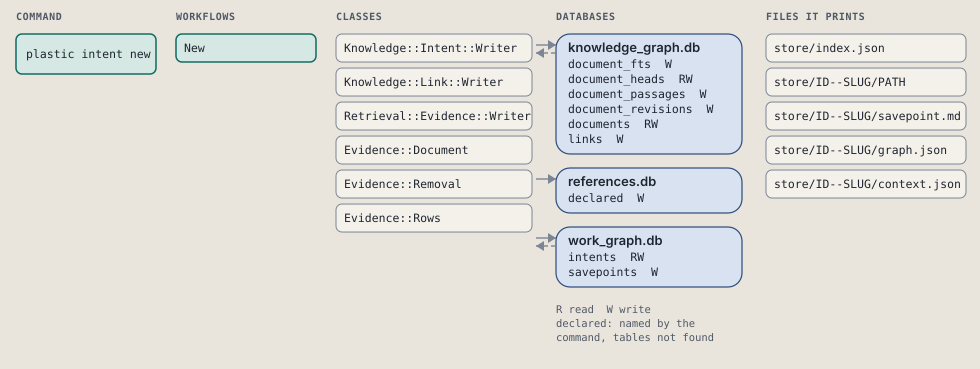
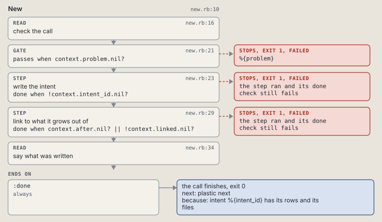
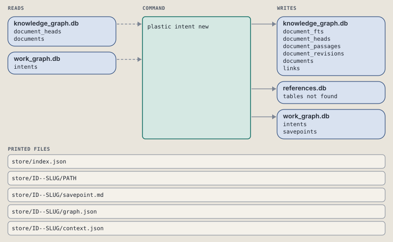

# plastic intent new

Open an intent: write its rows and its folder.

Opens an intent: writes its row and its first rows, and prints its folder and store/index.json in the same call.

```sh
plastic intent new TITLE... [--parent ID] [--ref REF] [--after ID] [--kind KIND] [--status STATUS]
```

The command is `Intent::New`, in [`new.rb:10`](../../../../lib/plastic/commands/intent/new.rb#L10). The words on this page, such as gate, step and outcome, are explained in [the command DSL](../../dsl/README.md).

| Argument or option | What it gives | Default |
| --- | --- | --- |
| `TITLE` | what the intent is for, in words | |
| `--parent ID` | the intent this one is a child of |  |
| `--ref REF` | a ticket, a link, or another intent as ID-ORIGIN |  |
| `--after ID` | an intent this one grows out of, linked as source |  |
| `--kind KIND` | the kind of work | `"work"` |
| `--status STATUS` | open, active, parked or future | `"open"` |

## Components



The figure shows the command, the workflows it runs, the classes behind them, and the databases and files they reach.

## The events of one call

The call starts the workflow `Code::Intent::New`, in [`new.rb:10`](../../../../lib/plastic/workflows/code/intent/new.rb#L10).

Writes a new intent's rows; the command prints its folder and store/index.json.



Its rows run in this order:

1. Read: check the call. [`new.rb:16`](../../../../lib/plastic/workflows/code/intent/new.rb#L16)
2. Gate: passes when `context.problem.nil?`; otherwise the call stops with exit 1 and prints PROBLEM. [`new.rb:21`](../../../../lib/plastic/workflows/code/intent/new.rb#L21)
3. Step: write the intent. Done when `!context.intent_id.nil?`, so a second call skips it. [`new.rb:23`](../../../../lib/plastic/workflows/code/intent/new.rb#L23)
4. Step: link to what it grows out of. Done when `context.after.nil? || !context.linked.nil?`, so a second call skips it. [`new.rb:29`](../../../../lib/plastic/workflows/code/intent/new.rb#L29)
5. Read: say what was written. [`new.rb:34`](../../../../lib/plastic/workflows/code/intent/new.rb#L34)
6. Outcome `:done`, always: finishes with exit 0; next: plastic next. [`new.rb:39`](../../../../lib/plastic/workflows/code/intent/new.rb#L39)

It sets `problem`, `intent_id`, `linked`.

In the words of workflow engines, the rows are these four parts:

- **Trigger**: the call starts the workflow `Code::Intent::New`.
- **Activities**: 2 reads and 2 steps.
- **Transitions**: 1 gate stops the call when its check fails; a step runs only while its done check fails.
- **Outcomes**: `:done` end the call.

## What one call reads, writes and prints



| Place | Database or file | Tables | Reads or writes | Code |
| --- | --- | --- | --- | --- |
| the store folder | knowledge_graph.db | `document_fts`, `document_heads`, `document_passages`, `document_revisions`, `documents`, `links` | reads and writes | [`new.rb:18`](../../../../lib/plastic/commands/intent/new.rb#L18) |
| the store folder | references.db | not found in the code | writes | [`new.rb:18`](../../../../lib/plastic/commands/intent/new.rb#L18) |
| the store folder | work_graph.db | `intents`, `savepoints` | reads and writes | [`new.rb:18`](../../../../lib/plastic/commands/intent/new.rb#L18) |
| the store folder | store/index.json | | writes | [`prints.rb:14`](../../../../lib/plastic/graph/prints.rb#L14) |
| the store folder | store/ID--SLUG/PATH | | writes | [`prints.rb:15`](../../../../lib/plastic/graph/prints.rb#L15) |
| the store folder | store/ID--SLUG/savepoint.md | | writes | [`prints.rb:16`](../../../../lib/plastic/graph/prints.rb#L16) |
| the store folder | store/ID--SLUG/graph.json | | writes | [`prints.rb:17`](../../../../lib/plastic/graph/prints.rb#L17) |
| the store folder | store/ID--SLUG/context.json | | writes | [`prints.rb:18`](../../../../lib/plastic/graph/prints.rb#L18) |

A second call runs the same rows again. A step runs again only when its done check fails.

| Step | Done when | The second call | Code |
| --- | --- | --- | --- |
| write the intent | `!context.intent_id.nil?` | skips it | [`new.rb:23`](../../../../lib/plastic/workflows/code/intent/new.rb#L23) |
| link to what it grows out of | `context.after.nil? \|\| !context.linked.nil?` | skips it | [`new.rb:29`](../../../../lib/plastic/workflows/code/intent/new.rb#L29) |

## How a call ends

Every call can also end in [the ways any call can end](../../dsl/README.md#how-any-call-can-end).

| Ending | Exit | next: | Code |
| --- | --- | --- | --- |
| PROBLEM | 1 | prints no next: line | [`new.rb:21`](../../../../lib/plastic/workflows/code/intent/new.rb#L21) |
| intent INTENT_ID has its rows and its files | 0 | plastic next | [`new.rb:39`](../../../../lib/plastic/workflows/code/intent/new.rb#L39) |
| a step raises | 1 | prints no next: line | [`code_workflow.rb:102`](../../../../lib/plastic/code_workflow.rb#L102) |

## What the page leaves out

Every call shares a few things that this page does not repeat; [the command DSL](../../dsl/README.md#what-every-call-shares) names them.

- No gate of this command refuses, so exit 3 never happens.
- A call that writes saves a routine run row in local.db. A stop by a gate or a step saves the run, and the next call resumes from it. A dry run saves no row.
