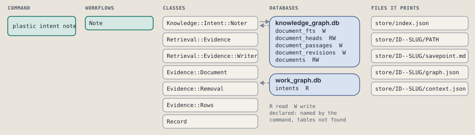
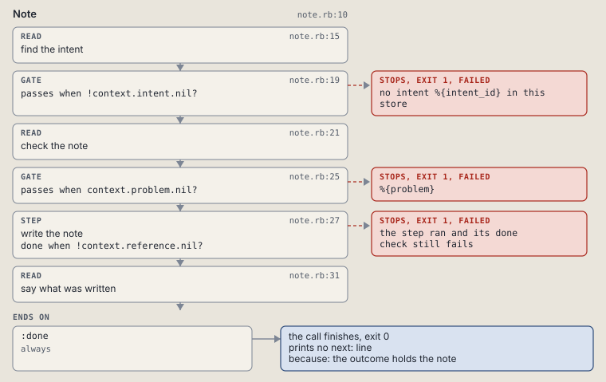
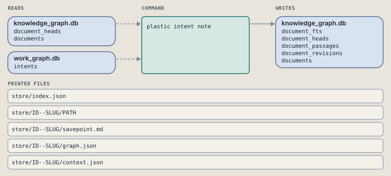

# plastic intent note

Add one line under Notes in the outcome of an intent, keeping the earlier text as a revision.

```sh
plastic intent note ID TEXT [--kind KIND]
```

The command is `Intent::Note`, in [`note.rb:11`](../../../../lib/plastic/commands/intent/note.rb#L11). The words on this page, such as gate, step and outcome, are explained in [the command DSL](../../dsl/README.md).

| Argument or option | What it gives | Default |
| --- | --- | --- |
| `ID` | the intent | |
| `TEXT` | the note, one line | |
| `--kind KIND` | Review, Commit or Report | `"Report"` |

## Components



The figure shows the command, the workflows it runs, the classes behind them, and the databases and files they reach.

## The events of one call

### The command's own call

The command's own `call`, at [`note.rb:19`](../../../../lib/plastic/commands/intent/note.rb#L19), runs first, then starts the workflow [Code::Intent::Note](#codeintentnote).

```ruby
def call
  kinds = Plastic::Graph::Knowledge::Intent::Notes::KINDS
  raise CLI::Command::Usage, "KIND takes #{kinds.join(", ")}" unless kinds.include?(parsed[:kind])

  super
end
```

### Code::Intent::Note

The code workflow `:code_note_intent`, in [`note.rb:10`](../../../../lib/plastic/workflows/code/intent/note.rb#L10).

Adds a note line to the outcome of an intent.



Its rows run in this order:

1. Read: find the intent. [`note.rb:15`](../../../../lib/plastic/workflows/code/intent/note.rb#L15)
2. Gate: passes when `!context.intent.nil?`; otherwise the call stops with exit 1 and prints no intent INTENT_ID in this store. [`note.rb:19`](../../../../lib/plastic/workflows/code/intent/note.rb#L19)
3. Read: check the note. [`note.rb:21`](../../../../lib/plastic/workflows/code/intent/note.rb#L21)
4. Gate: passes when `context.problem.nil?`; otherwise the call stops with exit 1 and prints PROBLEM. [`note.rb:25`](../../../../lib/plastic/workflows/code/intent/note.rb#L25)
5. Step: write the note. Done when `!context.reference.nil?`, so a second call skips it. [`note.rb:27`](../../../../lib/plastic/workflows/code/intent/note.rb#L27)
6. Read: say what was written. [`note.rb:31`](../../../../lib/plastic/workflows/code/intent/note.rb#L31)
7. Outcome `:done`, always: finishes with exit 0; prints no next: line. [`note.rb:35`](../../../../lib/plastic/workflows/code/intent/note.rb#L35)

It sets `intent`, `problem`, `reference`.

In the words of workflow engines, the rows are these four parts:

- **Trigger**: the call starts the workflow `Code::Intent::Note`.
- **Activities**: 3 reads and 1 step.
- **Transitions**: 2 gates stop the call when their checks fail; a step runs only while its done check fails.
- **Outcomes**: `:done` end the call.

## What one call reads, writes and prints



| Place | Database or file | Tables | Reads or writes | Code |
| --- | --- | --- | --- | --- |
| the store folder | knowledge_graph.db | `document_fts`, `document_heads`, `document_passages`, `document_revisions`, `documents` | reads and writes | [`note.rb:16`](../../../../lib/plastic/commands/intent/note.rb#L16) |
| the store folder | work_graph.db | `intents` | reads | [`note.rb:15`](../../../../lib/plastic/commands/intent/note.rb#L15) |
| the store folder | store/index.json | | writes | [`prints.rb:14`](../../../../lib/plastic/graph/prints.rb#L14) |
| the store folder | store/ID--SLUG/PATH | | writes | [`prints.rb:15`](../../../../lib/plastic/graph/prints.rb#L15) |
| the store folder | store/ID--SLUG/savepoint.md | | writes | [`prints.rb:16`](../../../../lib/plastic/graph/prints.rb#L16) |
| the store folder | store/ID--SLUG/graph.json | | writes | [`prints.rb:17`](../../../../lib/plastic/graph/prints.rb#L17) |
| the store folder | store/ID--SLUG/context.json | | writes | [`prints.rb:18`](../../../../lib/plastic/graph/prints.rb#L18) |

A second call runs the same rows again. A step runs again only when its done check fails.

| Step | Done when | The second call | Code |
| --- | --- | --- | --- |
| write the note | `!context.reference.nil?` | skips it | [`note.rb:27`](../../../../lib/plastic/workflows/code/intent/note.rb#L27) |

## How a call ends

Every call can also end in [the ways any call can end](../../dsl/README.md#how-any-call-can-end).

| Ending | Exit | next: | Code |
| --- | --- | --- | --- |
| no intent INTENT_ID in this store | 1 | prints no next: line | [`note.rb:19`](../../../../lib/plastic/workflows/code/intent/note.rb#L19) |
| PROBLEM | 1 | prints no next: line | [`note.rb:25`](../../../../lib/plastic/workflows/code/intent/note.rb#L25) |
| the outcome holds the note | 0 | prints no next: line | [`note.rb:35`](../../../../lib/plastic/workflows/code/intent/note.rb#L35) |
| a step raises | 1 | prints no next: line | [`code_workflow.rb:102`](../../../../lib/plastic/code_workflow.rb#L102) |
| Usage error: KIND takes KINDS | 2 | prints no next: line | [`note.rb:21`](../../../../lib/plastic/commands/intent/note.rb#L21) |

## What the page leaves out

Every call shares a few things that this page does not repeat; [the command DSL](../../dsl/README.md#what-every-call-shares) names them.

- No gate of this command refuses, so exit 3 never happens.
- A call that writes saves a routine run row in local.db. A stop by a gate or a step saves the run, and the next call resumes from it. A dry run saves no row.
