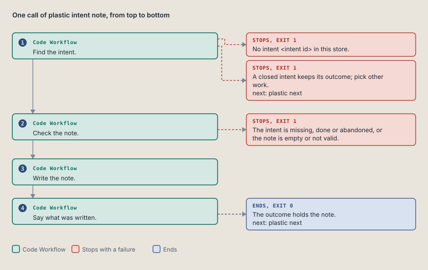

# plastic intent note

Add one line to the outcome of an intent, a note under Notes or a record of the delivery or the close under Verification, keeping the earlier text as a revision.

```sh
plastic intent note ID TEXT [--kind KIND]
```

| Argument or option | What it gives | Default |
| --- | --- | --- |
| `ID` | the intent | |
| `TEXT` | the note, one line | |
| `--kind KIND` | the kind of line, in any case: Note, Review, Commit or Report under Notes; Merged, Committed, Delivered, Pull request, Approved, Reverted or Abandoned under Verification, each in its form | `"Note"` |

## The events of one call, step by step



The boxes on the left run in order. The boxes on the right are the ways the call stops or ends at that step.

## What one call changes

| What changes | Where | Reach |
| --- | --- | --- |
| The line is added to the Notes or the Verification section of the outcome | the knowledge graph database, in the store folder | goes with the store |
| The files of the intent and the index of the store are rewritten | the store folder | goes with the store |

Goes with the store: the files of the store carry the change, and `plastic store sync up` rebuilds it on another machine. The database files themselves stay on this machine.

The command is `Plastic::Commands::Intent::Note`, in [`commands/intent/note.rb`](../../../../lib/plastic/commands/intent/note.rb).
