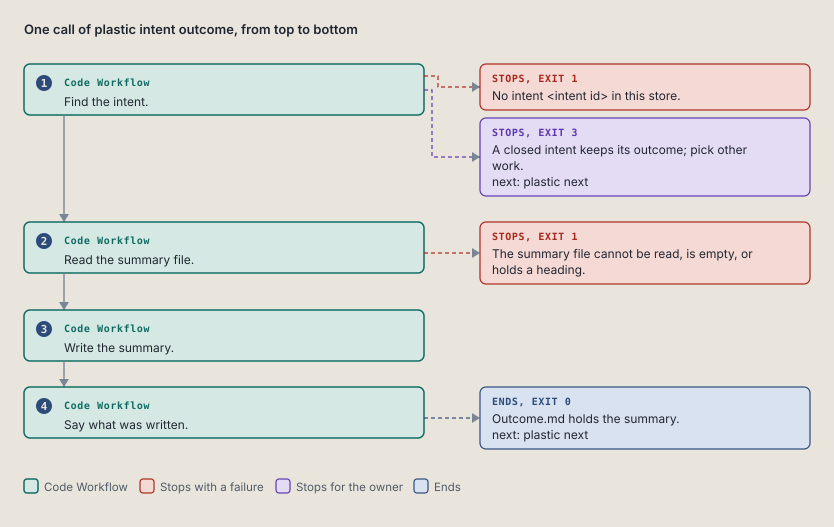

# plastic intent outcome

Write the summary of the outcome of an intent from a file, keeping its title and every section.

```sh
plastic intent outcome ID --from FILE
```

| Argument or option | What it gives | Default |
| --- | --- | --- |
| `ID` | the intent | |
| `--from FILE` | a file that holds the summary, plain text with no heading, written as the new revision of outcome.md |  |

## The events of one call, step by step



The boxes on the left run in order. The boxes on the right are the ways the call stops or ends at that step.

## What one call changes

| What changes | Where | Reach |
| --- | --- | --- |
| outcome.md holds the summary as its new revision | the knowledge graph database, in the store folder | goes with the store |
| A summarized line in the work log | the work graph database, in the store folder | goes with the store |
| The files of the intent and the index of the store are rewritten | the store folder | goes with the store |

Goes with the store: the files of the store carry the change, and `plastic store sync up` rebuilds it on another machine. The database files themselves stay on this machine.

The command is `Plastic::Commands::Intent::Outcome`, in [`commands/intent/outcome.rb`](../../../../lib/plastic/commands/intent/outcome.rb).
