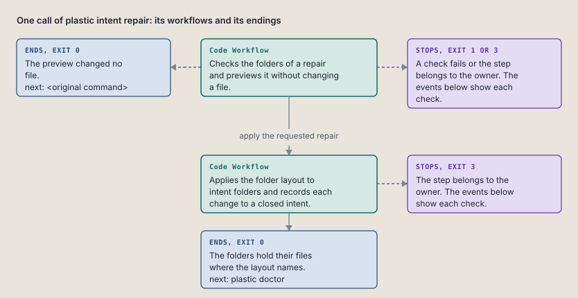
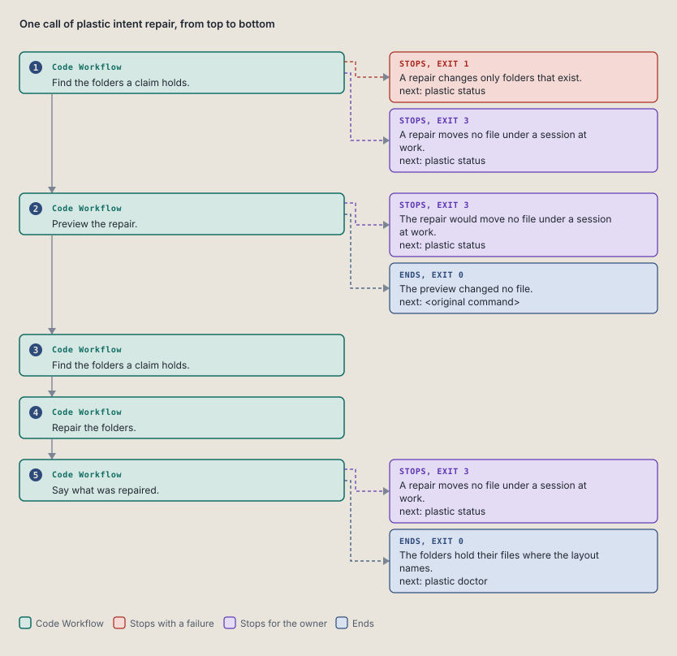

# plastic intent repair

Apply the folder layout to one intent folder, or to every one with --all.

```sh
plastic intent repair (ID | --all) [--dry-run] [--links-left]
```

| Argument or option | What it gives | Default |
| --- | --- | --- |
| `ID` | the intent whose folder to repair | |
| `--all` | repair every intent folder of the store, and remove the retired entries of its store folder | `false` |
| `--dry-run` | list one line for each intent folder the repair would change, the links that would change and the amendments of closed intents, then the totals, and change nothing | `false` |
| `--links-left` | also list each link the repair leaves as it is, which the totals otherwise count | `false` |

## The workflows of one call



Each box is a workflow. The words between the boxes say when the call moves on, and the last boxes say how the call ends.

## The events of one call, step by step



The boxes on the left run in order. The boxes on the right are the ways the call stops or ends at that step.

## What one call changes

| What changes | Where | Reach |
| --- | --- | --- |
| Files are renamed, moved or removed where the layout says, the links that point at them are rewritten, and with --all the retired entries of the store folder go | the store folder | goes with the store |
| The rows of the moved files move with them, the rows of the removed files go, and the rows of the files with changed links are rewritten | the knowledge graph database, in the store folder | stays on this machine |
| A done or abandoned intent gets one amended work log line for the renames, moves and removals of its folder and one for each link it changes, and each entry of an old revisions.md gets one, printed to its work.log | the work graph database, in the store folder | stays on this machine |

Goes with the store: the files of the store carry the change, and `plastic store sync up` rebuilds it on another machine. The database files themselves stay on this machine.

The command is `Plastic::Commands::Intent::Repair`, in [`commands/intent/repair.rb`](../../../../lib/plastic/commands/intent/repair.rb).
