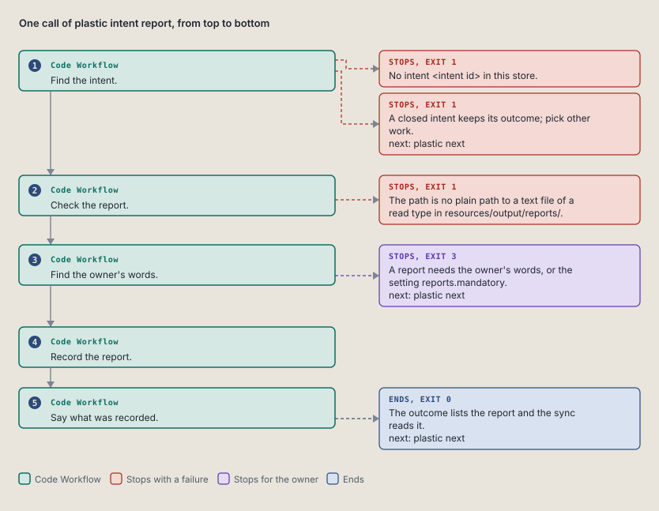

# plastic intent report

Record a report the owner asked for, with the words that asked for it, so the sync reads it.

```sh
plastic intent report ID PATH [--asked WORDS]
```

| Argument or option | What it gives | Default |
| --- | --- | --- |
| `ID` | the intent | |
| `PATH` | the report, a path inside the intent folder under resources/output/reports/ | |
| `--asked WORDS` | the owner's words that asked for the report |  |

## The events of one call, step by step



The boxes on the left run in order. The boxes on the right are the ways the call stops or ends at that step.

## What one call changes

| What changes | Where | Reach |
| --- | --- | --- |
| The report is recorded, read into the rows and listed under Reports in the outcome | the knowledge graph database, in the store folder | goes with the store |
| The files of the intent and the index of the store are rewritten | the store folder | goes with the store |

Goes with the store: the files of the store carry the change, and `plastic sync up` rebuilds it on another machine. The database files themselves stay on this machine.

The command is `Plastic::Commands::Intent::Report`, in [`commands/intent/report.rb`](../../../../lib/plastic/commands/intent/report.rb).
