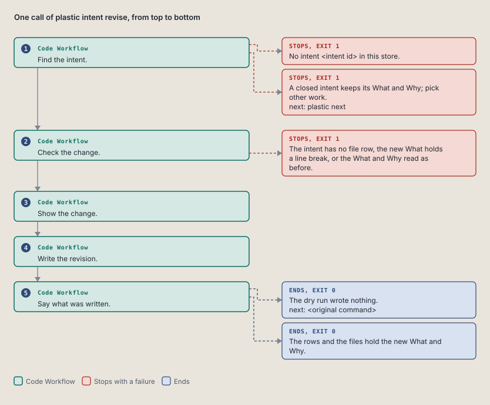

# plastic intent revise

Rewrite an intent's What and Why after grilling, keeping the old text as a revision.

```sh
plastic intent revise ID LINE [--why TEXT] [--dry-run]
```

| Argument or option | What it gives | Default |
| --- | --- | --- |
| `ID` | the intent | |
| `LINE` | the new What, the intent line | |
| `--why TEXT` | the new Why, the lead text of ## Context |  |
| `--dry-run` | print the change and write nothing | `false` |

## The events of one call, step by step



The boxes on the left run in order. The boxes on the right are the ways the call stops or ends at that step.

## What one call changes

| What changes | Where | Reach |
| --- | --- | --- |
| A new revision of the spec is written | the knowledge graph database, in the store folder | goes with the store |
| The title of the intent is updated | the work graph database, in the store folder | goes with the store |
| The files of the intent and the index of the store are rewritten | the store folder | goes with the store |

Goes with the store: the files of the store carry the change, and `plastic sync up` rebuilds it on another machine. The database files themselves stay on this machine.

The command is `Plastic::Commands::Intent::Revise`, in [`revise.rb:10`](../../../../lib/plastic/commands/intent/revise.rb#L10).
