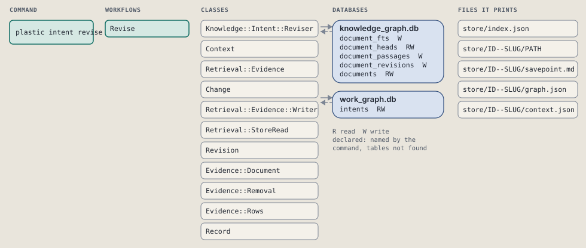
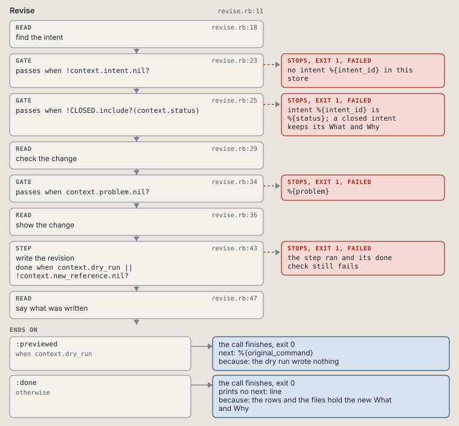
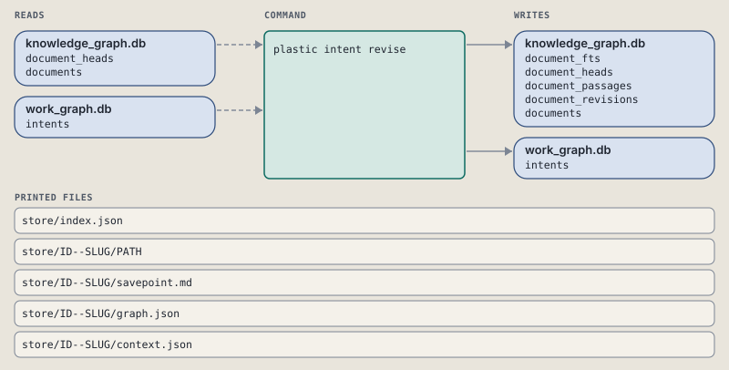

# plastic intent revise

Rewrite an intent's What and Why after grilling, keeping the old text as a revision.

```sh
plastic intent revise ID LINE [--why TEXT] [--dry-run]
```

The command is `Intent::Revise`, in [`revise.rb:10`](../../../../lib/plastic/commands/intent/revise.rb#L10). The words on this page, such as gate, step and outcome, are explained in [the command DSL](../../dsl/README.md).

| Argument or option | What it gives | Default |
| --- | --- | --- |
| `ID` | the intent | |
| `LINE` | the new What, the intent line | |
| `--why TEXT` | the new Why, the lead text of ## Context |  |
| `--dry-run` | print the change and write nothing | `false` |

## Components



The figure shows the command, the workflows it runs, the classes behind them, and the databases and files they reach.

## The events of one call

The call starts the workflow `Code::Intent::Revise`, in [`revise.rb:11`](../../../../lib/plastic/workflows/code/intent/revise.rb#L11).

Rewrites an intent's What and Why; a done or abandoned intent refuses, and a dry run prints the change and writes nothing.



Its rows run in this order:

1. Read: find the intent. [`revise.rb:18`](../../../../lib/plastic/workflows/code/intent/revise.rb#L18)
2. Gate: passes when `!context.intent.nil?`; otherwise the call stops with exit 1 and prints no intent INTENT_ID in this store. [`revise.rb:23`](../../../../lib/plastic/workflows/code/intent/revise.rb#L23)
3. Gate: passes when `!CLOSED.include?(context.status)`; otherwise the call stops with exit 1 and prints intent INTENT_ID is STATUS; a closed intent keeps its What and Why. [`revise.rb:25`](../../../../lib/plastic/workflows/code/intent/revise.rb#L25)
4. Read: check the change. [`revise.rb:29`](../../../../lib/plastic/workflows/code/intent/revise.rb#L29)
5. Gate: passes when `context.problem.nil?`; otherwise the call stops with exit 1 and prints PROBLEM. [`revise.rb:34`](../../../../lib/plastic/workflows/code/intent/revise.rb#L34)
6. Read: show the change. [`revise.rb:36`](../../../../lib/plastic/workflows/code/intent/revise.rb#L36)
7. Step: write the revision. Done when `context.dry_run || !context.new_reference.nil?`, so a second call skips it. [`revise.rb:43`](../../../../lib/plastic/workflows/code/intent/revise.rb#L43)
8. Read: say what was written. [`revise.rb:47`](../../../../lib/plastic/workflows/code/intent/revise.rb#L47)
9. Outcome `:previewed`, when `context.dry_run`: finishes with exit 0; next: ORIGINAL_COMMAND. [`revise.rb:52`](../../../../lib/plastic/workflows/code/intent/revise.rb#L52)
10. Outcome `:done`, otherwise: finishes with exit 0; prints no next: line. [`revise.rb:54`](../../../../lib/plastic/workflows/code/intent/revise.rb#L54)

It sets `intent`, `status`, `change`, `problem`, `old_reference`, `new_reference`.

In the words of workflow engines, the rows are these four parts:

- **Trigger**: the call starts the workflow `Code::Intent::Revise`.
- **Activities**: 4 reads and 1 step.
- **Transitions**: 3 gates stop the call when their checks fail; a step runs only while its done check fails.
- **Outcomes**: `:previewed`, `:done` end the call.

## What one call reads, writes and prints



| Place | Database or file | Tables | Reads or writes | Code |
| --- | --- | --- | --- | --- |
| the store folder | knowledge_graph.db | `document_fts`, `document_heads`, `document_passages`, `document_revisions`, `documents` | reads and writes | [`revise.rb:15`](../../../../lib/plastic/commands/intent/revise.rb#L15) |
| the store folder | work_graph.db | `intents` | reads and writes | [`revise.rb:15`](../../../../lib/plastic/commands/intent/revise.rb#L15) |
| the store folder | store/index.json | | writes | [`prints.rb:14`](../../../../lib/plastic/graph/prints.rb#L14) |
| the store folder | store/ID--SLUG/PATH | | writes | [`prints.rb:15`](../../../../lib/plastic/graph/prints.rb#L15) |
| the store folder | store/ID--SLUG/savepoint.md | | writes | [`prints.rb:16`](../../../../lib/plastic/graph/prints.rb#L16) |
| the store folder | store/ID--SLUG/graph.json | | writes | [`prints.rb:17`](../../../../lib/plastic/graph/prints.rb#L17) |
| the store folder | store/ID--SLUG/context.json | | writes | [`prints.rb:18`](../../../../lib/plastic/graph/prints.rb#L18) |

A second call runs the same rows again. A step runs again only when its done check fails.

| Step | Done when | The second call | Code |
| --- | --- | --- | --- |
| write the revision | `context.dry_run \|\| !context.new_reference.nil?` | skips it | [`revise.rb:43`](../../../../lib/plastic/workflows/code/intent/revise.rb#L43) |

## How a call ends

Every call can also end in [the ways any call can end](../../dsl/README.md#how-any-call-can-end).

| Ending | Exit | next: | Code |
| --- | --- | --- | --- |
| no intent INTENT_ID in this store | 1 | prints no next: line | [`revise.rb:23`](../../../../lib/plastic/workflows/code/intent/revise.rb#L23) |
| intent INTENT_ID is STATUS; a closed intent keeps its What and Why | 1 | plastic next | [`revise.rb:25`](../../../../lib/plastic/workflows/code/intent/revise.rb#L25) |
| PROBLEM | 1 | prints no next: line | [`revise.rb:34`](../../../../lib/plastic/workflows/code/intent/revise.rb#L34) |
| the dry run wrote nothing | 0 | ORIGINAL_COMMAND | [`revise.rb:52`](../../../../lib/plastic/workflows/code/intent/revise.rb#L52) |
| the rows and the files hold the new What and Why | 0 | prints no next: line | [`revise.rb:54`](../../../../lib/plastic/workflows/code/intent/revise.rb#L54) |
| a step raises | 1 | prints no next: line | [`code_workflow.rb:102`](../../../../lib/plastic/code_workflow.rb#L102) |

## What the page leaves out

Every call shares a few things that this page does not repeat; [the command DSL](../../dsl/README.md#what-every-call-shares) names them.

- A call that writes saves a routine run row in local.db. A stop by a gate or a step saves the run, and the next call resumes from it. A dry run saves no row.
