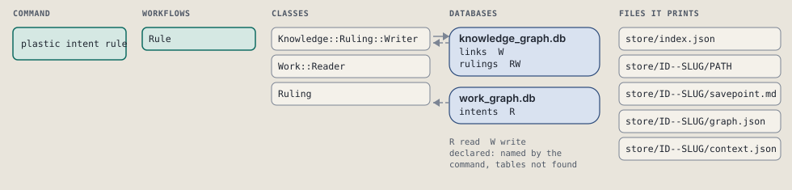
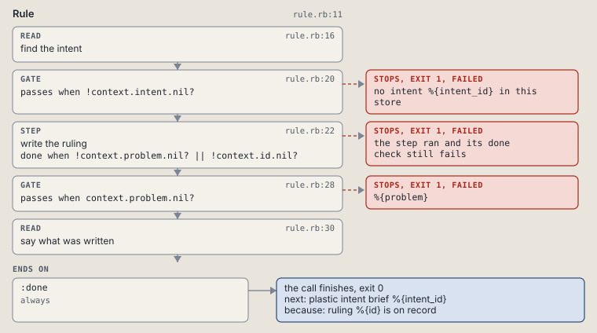
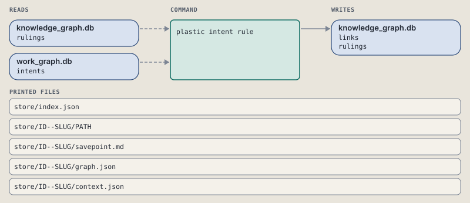

# plastic intent rule

Write an owner ruling, with --supersedes to replace an older one.

Writes one owner ruling against an intent, numbered in order, one after the last. --supersedes names an older ruling and links the two.

```sh
plastic intent rule ID TEXT [--supersedes RULING_ID]
```

The command is `Intent::Rule`, in [`rule.rb:10`](../../../../lib/plastic/commands/intent/rule.rb#L10). The words on this page, such as gate, step and outcome, are explained in [the command DSL](../../dsl/README.md).

| Argument or option | What it gives | Default |
| --- | --- | --- |
| `ID` | the intent | |
| `TEXT` | the ruling, in the owner's words | |
| `--supersedes RULING_ID` | an older ruling this one replaces |  |

## Components



The figure shows the command, the workflows it runs, the classes behind them, and the databases and files they reach.

## The events of one call

The call starts the workflow `Code::Intent::Rule`, in [`rule.rb:11`](../../../../lib/plastic/workflows/code/intent/rule.rb#L11).

Writes one ruling; fails on an unknown intent, or when --supersedes names no such ruling.



Its rows run in this order:

1. Read: find the intent. [`rule.rb:16`](../../../../lib/plastic/workflows/code/intent/rule.rb#L16)
2. Gate: passes when `!context.intent.nil?`; otherwise the call stops with exit 1 and prints no intent INTENT_ID in this store. [`rule.rb:20`](../../../../lib/plastic/workflows/code/intent/rule.rb#L20)
3. Step: write the ruling. Done when `!context.problem.nil? || !context.id.nil?`, so a second call skips it. [`rule.rb:22`](../../../../lib/plastic/workflows/code/intent/rule.rb#L22)
4. Gate: passes when `context.problem.nil?`; otherwise the call stops with exit 1 and prints PROBLEM. [`rule.rb:28`](../../../../lib/plastic/workflows/code/intent/rule.rb#L28)
5. Read: say what was written. [`rule.rb:30`](../../../../lib/plastic/workflows/code/intent/rule.rb#L30)
6. Outcome `:done`, always: finishes with exit 0; next: plastic intent brief INTENT_ID. [`rule.rb:34`](../../../../lib/plastic/workflows/code/intent/rule.rb#L34)

It sets `intent`, `problem`, `id`.

In the words of workflow engines, the rows are these four parts:

- **Trigger**: the call starts the workflow `Code::Intent::Rule`.
- **Activities**: 2 reads and 1 step.
- **Transitions**: 2 gates stop the call when their checks fail; a step runs only while its done check fails.
- **Outcomes**: `:done` ends the call.

## What one call reads, writes and prints



| Place | Database or file | Tables | Reads or writes | Code |
| --- | --- | --- | --- | --- |
| the store folder | knowledge_graph.db | `links`, `rulings` | reads and writes | [`rule.rb:15`](../../../../lib/plastic/commands/intent/rule.rb#L15) |
| the store folder | work_graph.db | `intents` | reads | [`rule.rb:14`](../../../../lib/plastic/commands/intent/rule.rb#L14) |
| the store folder | store/index.json | | writes | [`prints.rb:14`](../../../../lib/plastic/graph/prints.rb#L14) |
| the store folder | store/ID--SLUG/PATH | | writes | [`prints.rb:15`](../../../../lib/plastic/graph/prints.rb#L15) |
| the store folder | store/ID--SLUG/savepoint.md | | writes | [`prints.rb:16`](../../../../lib/plastic/graph/prints.rb#L16) |
| the store folder | store/ID--SLUG/graph.json | | writes | [`prints.rb:17`](../../../../lib/plastic/graph/prints.rb#L17) |
| the store folder | store/ID--SLUG/context.json | | writes | [`prints.rb:18`](../../../../lib/plastic/graph/prints.rb#L18) |

A second call runs the same rows again. A step runs again only when its done check fails.

| Step | Done when | The second call | Code |
| --- | --- | --- | --- |
| write the ruling | `!context.problem.nil? \|\| !context.id.nil?` | skips it | [`rule.rb:22`](../../../../lib/plastic/workflows/code/intent/rule.rb#L22) |

## How a call ends

Every call can also end in [the ways any call can end](../../dsl/README.md#how-any-call-can-end).

| Ending | Exit | next: | Code |
| --- | --- | --- | --- |
| no intent INTENT_ID in this store | 1 | prints no next: line | [`rule.rb:20`](../../../../lib/plastic/workflows/code/intent/rule.rb#L20) |
| PROBLEM | 1 | prints no next: line | [`rule.rb:28`](../../../../lib/plastic/workflows/code/intent/rule.rb#L28) |
| ruling ID is on record | 0 | plastic intent brief INTENT_ID | [`rule.rb:34`](../../../../lib/plastic/workflows/code/intent/rule.rb#L34) |
| a step raises | 1 | prints no next: line | [`code_workflow.rb:102`](../../../../lib/plastic/code_workflow.rb#L102) |

## What the page leaves out

Every call shares a few things that this page does not repeat; [the command DSL](../../dsl/README.md#what-every-call-shares) names them.

- No gate of this command refuses, so exit 3 never happens.
- A call that writes saves a routine run row in local.db. A stop by a gate or a step saves the run, and the next call resumes from it. A dry run saves no row.
