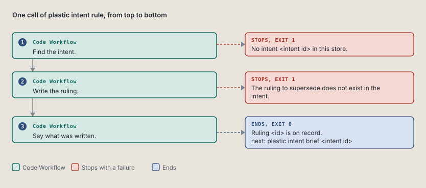

# plastic intent rule

Write an owner ruling, with --supersedes to replace an older one.

```sh
plastic intent rule ID TEXT [--supersedes RULING_ID]
```

| Argument or option | What it gives | Default |
| --- | --- | --- |
| `ID` | the intent | |
| `TEXT` | the ruling, in the owner's words | |
| `--supersedes RULING_ID` | an older ruling this one replaces |  |

## The events of one call, step by step



The boxes on the left run in order. The boxes on the right are the ways the call stops or ends at that step.

## What one call changes

| What changes | Where | Reach |
| --- | --- | --- |
| The ruling is added to the rulings of the intent | the knowledge graph database, in the store folder | goes with the store |
| The files of the intent and the index of the store are rewritten | the store folder | goes with the store |

Goes with the store: the files of the store carry the change, and `plastic sync up` rebuilds it on another machine. The database files themselves stay on this machine.

The command is `Plastic::Commands::Intent::Rule`, in [`commands/intent/rule.rb`](../../../../lib/plastic/commands/intent/rule.rb).
