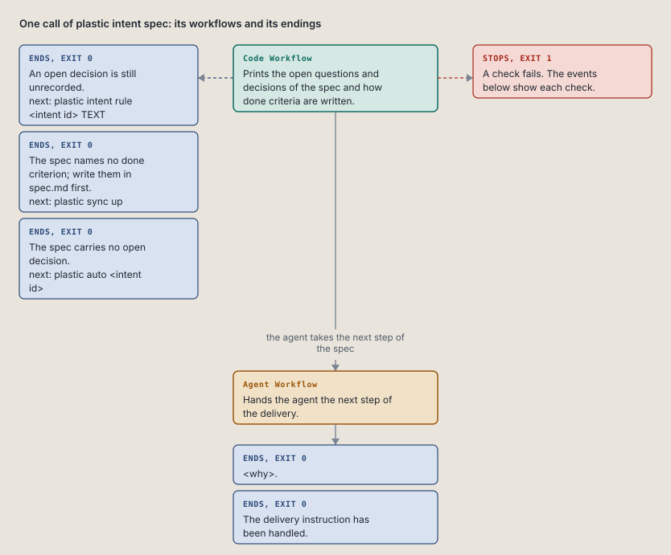
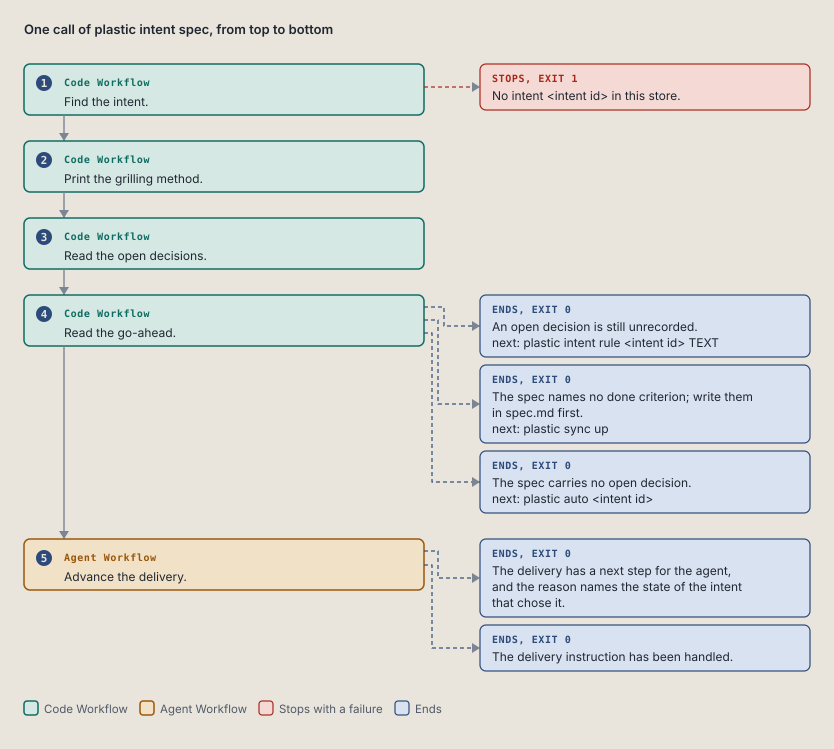

# plastic intent spec

Write spec.md from a file with --from, then print the grilling method, how done criteria are written, and the open decisions of spec.md.

```sh
plastic intent spec ID [--from FILE]
```

| Argument or option | What it gives | Default |
| --- | --- | --- |
| `ID` | the intent | |
| `--from FILE` | a file that holds the whole spec.md, written as its new revision; refused when it lacks a section of the layout or the intent is closed |  |

## The workflows of one call



Each box is a workflow. The words between the boxes say when the call moves on, and the last boxes say how the call ends.

## The events of one call, step by step



The boxes on the left run in order. The boxes on the right are the ways the call stops or ends at that step.

## What one call changes

| What changes | Where | Reach |
| --- | --- | --- |
| spec.md holds the text of the file as its new revision | the knowledge graph database, in the store folder | goes with the store |
| A specified line in the work log | the work graph database, in the store folder | goes with the store |
| The files of the intent and the index of the store are rewritten | the store folder | goes with the store |

Goes with the store: the files of the store carry the change, and `plastic store sync up` rebuilds it on another machine. The database files themselves stay on this machine.

The command is `Plastic::Commands::Intent::Spec`, in [`commands/intent/spec.rb`](../../../../lib/plastic/commands/intent/spec.rb).
