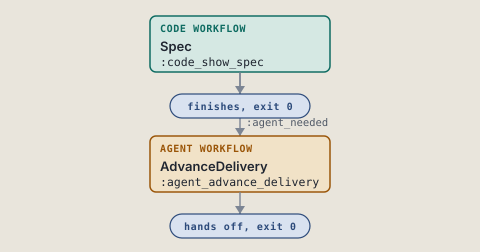

# plastic intent spec

Print the grilling method, then the intent's open decisions.

```sh
plastic intent spec ID
```

The command is `Intent::Spec`, in [`spec.rb:9`](../../../../lib/plastic/commands/intent/spec.rb#L9). The words on this page, such as gate, step and outcome, are explained in [the command DSL](../../dsl/README.md).

| Argument or option | What it gives | Default |
| --- | --- | --- |
| `ID` | the intent | |

## What it touches


## How the call flows



| Workflow | Kind | Code |
| --- | --- | --- |
| [Code::Intent::Spec](#codeintentspec) | code | [`spec.rb:14`](../../../../lib/plastic/workflows/code/intent/spec.rb#L14) |
| [Agent::Shared::AdvanceDelivery](#agentsharedadvancedelivery) | agent | [`advance_delivery.rb:10`](../../../../lib/plastic/workflows/agent/shared/advance_delivery.rb#L10) |

### Code::Intent::Spec

The code workflow `:code_show_spec`, in [`spec.rb:14`](../../../../lib/plastic/workflows/code/intent/spec.rb#L14).

Prints the grilling method, then the intent's open decisions; refuses an unknown id.


| Step | Kind | Check | Code |
| --- | --- | --- | --- |
| find the intent | read |  | [`spec.rb:23`](../../../../lib/plastic/workflows/code/intent/spec.rb#L23) |
| no intent %{intent_id} in this store | gate, stops with exit 1 | `!context.intent.nil?` | [`spec.rb:27`](../../../../lib/plastic/workflows/code/intent/spec.rb#L27) |
| print the grilling method | read |  | [`spec.rb:29`](../../../../lib/plastic/workflows/code/intent/spec.rb#L29) |
| read the open decisions | read |  | [`spec.rb:34`](../../../../lib/plastic/workflows/code/intent/spec.rb#L34) |
| read the go-ahead | read |  | [`go_ahead.rb:16`](../../../../lib/plastic/workflows/go_ahead.rb#L16) |

| Outcome | When | Then | Code |
| --- | --- | --- | --- |
| `:open` | when `context.decisions.any?` | finishes, exit 0; next: plastic intent rule %{intent_id} TEXT | [`spec.rb:43`](../../../../lib/plastic/workflows/code/intent/spec.rb#L43) |
| `:no_criterion` | when `context.criteria.empty?` | finishes, exit 0; next: plastic sync up | [`spec.rb:45`](../../../../lib/plastic/workflows/code/intent/spec.rb#L45) |
| `:agent_needed` | when `!context.handoff_text.nil?` | runs [Agent::Shared::AdvanceDelivery](#agentsharedadvancedelivery) | [`spec.rb:47`](../../../../lib/plastic/workflows/code/intent/spec.rb#L47) |
| `:done` | otherwise | finishes, exit 0; next: plastic auto %{intent_id} | [`spec.rb:48`](../../../../lib/plastic/workflows/code/intent/spec.rb#L48) |

It sets `intent`, `decisions`, `criteria`, `why`, `handoff_text`.

### Agent::Shared::AdvanceDelivery

The agent workflow `:agent_advance_delivery`, in [`advance_delivery.rb:10`](../../../../lib/plastic/workflows/agent/shared/advance_delivery.rb#L10).

The harness performs judgment and records the result through commands.


| Step | Kind | Check | Code |
| --- | --- | --- | --- |
| advance the delivery | agent step | `context.handoff_text.nil?` | [`advance_delivery.rb:11`](../../../../lib/plastic/workflows/agent/shared/advance_delivery.rb#L11) |

| Outcome | When | Then | Code |
| --- | --- | --- | --- |
| `:handoff` | when a step is left | hands off, exit 0; prints no next: line | [`advance_delivery.rb:12`](../../../../lib/plastic/workflows/agent/shared/advance_delivery.rb#L12) |
| `:done` | when every done check holds | finishes, exit 0; prints no next: line | [`advance_delivery.rb:13`](../../../../lib/plastic/workflows/agent/shared/advance_delivery.rb#L13) |

The agent step "advance the delivery" prints:

> %{handoff_text}

## Outcomes

Every call can also end in [the ways any call can end](../../dsl/README.md#how-any-call-can-end).

| Ending | Exit | next: | Code |
| --- | --- | --- | --- |
| no intent %{intent_id} in this store | 1 | prints no next: line | [`spec.rb:27`](../../../../lib/plastic/workflows/code/intent/spec.rb#L27) |
| an open decision is still unrecorded | 0 | plastic intent rule %{intent_id} TEXT | [`spec.rb:43`](../../../../lib/plastic/workflows/code/intent/spec.rb#L43) |
| the spec names no done criterion; write them in spec.md first | 0 | plastic sync up | [`spec.rb:45`](../../../../lib/plastic/workflows/code/intent/spec.rb#L45) |
| the spec carries no open decision | 0 | plastic auto %{intent_id} | [`spec.rb:48`](../../../../lib/plastic/workflows/code/intent/spec.rb#L48) |
| %{why} | 0 | prints no next: line | [`advance_delivery.rb:12`](../../../../lib/plastic/workflows/agent/shared/advance_delivery.rb#L12) |
| the delivery instruction has been handled | 0 | prints no next: line | [`advance_delivery.rb:13`](../../../../lib/plastic/workflows/agent/shared/advance_delivery.rb#L13) |
| a step raises | 1 | prints no next: line | [`code_workflow.rb:102`](../../../../lib/plastic/code_workflow.rb#L102) |
