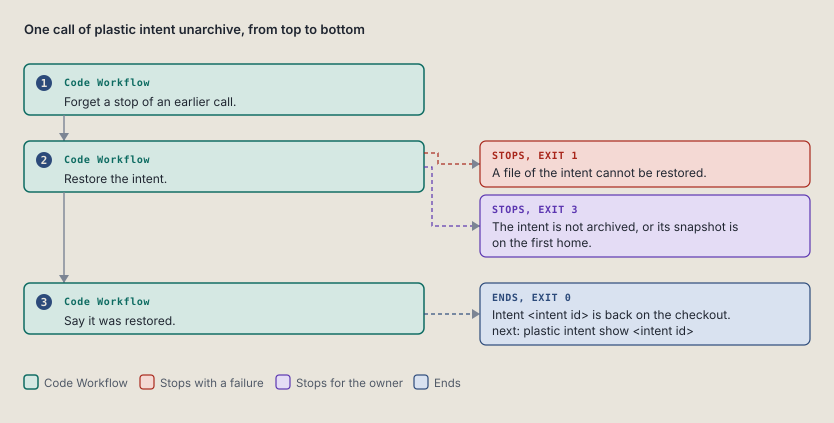

# plastic intent unarchive

Restore an archived intent's directory exactly as it was archived.

```sh
plastic intent unarchive ID [--dry-run]
```

| Argument or option | What it gives | Default |
| --- | --- | --- |
| `ID` | the archived intent to restore | |
| `--dry-run` | preview the call in a disposable copy | `false` |

## The events of one call, step by step



The boxes on the left run in order. The boxes on the right are the ways the call stops or ends at that step.

## What one call changes

| What changes | Where | Reach |
| --- | --- | --- |
| The intent leaves the archive | the work graph database, in the store folder | goes with the store |
| The files kept for the intent are restored | the knowledge graph database, in the store folder | goes with the store |
| The index of the store is rewritten | the store folder | goes with the store |

Goes with the store: the files of the store carry the change, and `plastic sync up` rebuilds it on another machine. The database files themselves stay on this machine.

The command is `Plastic::Commands::Intent::Unarchive`, in [`commands/intent/unarchive.rb`](../../../../lib/plastic/commands/intent/unarchive.rb).
