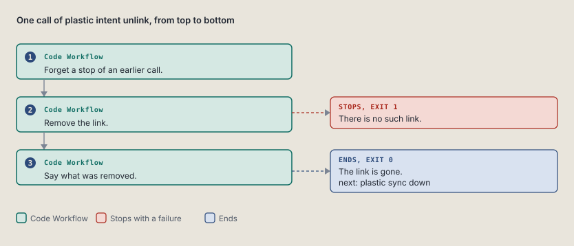

# plastic intent unlink

Remove a link.

Removes one `links` row from ID to TARGET of the given kind.

```sh
plastic intent unlink ID KIND TARGET [--dry-run]
```

| Argument or option | What it gives | Default |
| --- | --- | --- |
| `ID` | the intent this link starts from | |
| `KIND` | cites, supersedes, answers, source or chain | |
| `TARGET` | the link's other end, as written when it was added | |
| `--dry-run` | preview the call in a disposable copy | `false` |

## The events of one call, step by step



The boxes on the left run in order. The boxes on the right are the ways the call stops or ends at that step.

## What one call changes

| What changes | Where | Reach |
| --- | --- | --- |
| The link between the intent and its target is removed | the knowledge graph database, in the store folder | goes with the store |
| The files of the intent and the index of the store are rewritten | the store folder | goes with the store |

Goes with the store: the files of the store carry the change, and `plastic sync up` rebuilds it on another machine. The database files themselves stay on this machine.

The command is `Plastic::Commands::Intent::Unlink`, in [`unlink.rb:9`](../../../../lib/plastic/commands/intent/unlink.rb#L9).
