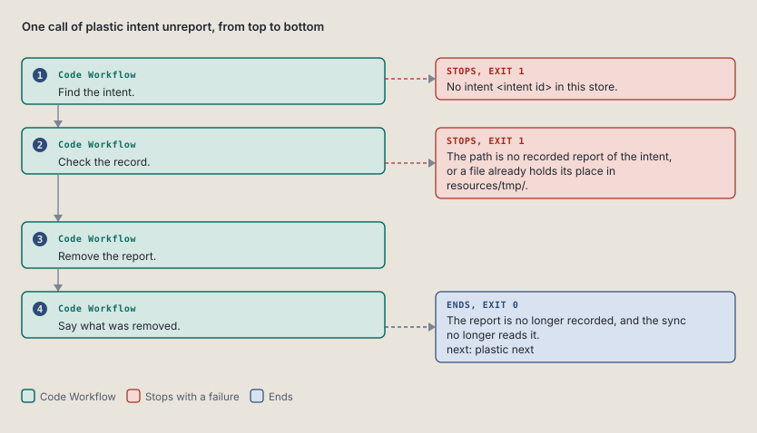

# plastic intent unreport

Remove a report recorded by mistake: its rows, its outcome line and its file, which --to-tmp moves to resources/tmp/.

```sh
plastic intent unreport ID PATH --reason TEXT [--to-tmp] [--dry-run]
```

| Argument or option | What it gives | Default |
| --- | --- | --- |
| `ID` | the intent | |
| `PATH` | the recorded report, a path inside the intent folder under resources/output/reports/ | |
| `--reason TEXT` | why the report is removed, kept on the removed line of the work log |  |
| `--to-tmp` | move the file to resources/tmp/ instead of deleting it | `false` |
| `--dry-run` | preview the call in a disposable copy | `false` |

## The events of one call, step by step



The boxes on the left run in order. The boxes on the right are the ways the call stops or ends at that step.

## What one call changes

| What changes | Where | Reach |
| --- | --- | --- |
| The rows of the report are dropped, its line leaves the Reports list of the outcome, and its file is deleted or moved to resources/tmp/ | the knowledge graph database, in the store folder | goes with the store |
| A removed line with the reason follows the reported line, and a closed intent gets an amended line | the work graph database, in the store folder | goes with the store |
| The files of the intent and the index of the store are rewritten | the store folder | goes with the store |

Goes with the store: the files of the store carry the change, and `plastic store sync up` rebuilds it on another machine. The database files themselves stay on this machine.

The command is `Plastic::Commands::Intent::Unreport`, in [`commands/intent/unreport.rb`](../../../../lib/plastic/commands/intent/unreport.rb).
