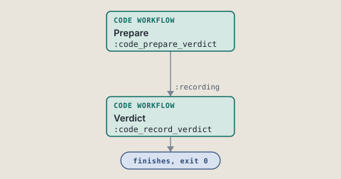
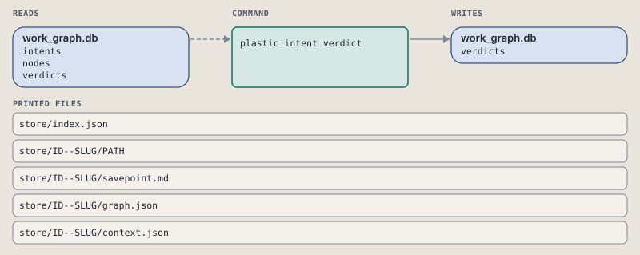

# plastic intent verdict

Record the verdict of the next review round of an intent.

```sh
plastic intent verdict ID accept|revise TEXT
```

The command is `Intent::Verdict`, in [`verdict.rb:9`](../../../../lib/plastic/commands/intent/verdict.rb#L9). The words on this page, such as gate, step and outcome, are explained in [the command DSL](../../dsl/README.md).

| Argument or option | What it gives | Default |
| --- | --- | --- |
| `ID` | the intent | |
| `accept|revise` | the verdict of this review round | |
| `TEXT` | what the review showed | |

## Components


The figure shows the command, the workflows it runs, the classes behind them, and the databases and files they reach.

## The events of one call



| Workflow | Kind | Code |
| --- | --- | --- |
| [Code::Intent::Verdict::Prepare](#codeintentverdictprepare) | code | [`prepare.rb:13`](../../../../lib/plastic/workflows/code/intent/verdict/prepare.rb#L13) |
| [Code::Intent::Verdict](#codeintentverdict) | code | [`verdict.rb:13`](../../../../lib/plastic/workflows/code/intent/verdict.rb#L13) |

### The command's own call

The command's own `call`, at [`verdict.rb:23`](../../../../lib/plastic/commands/intent/verdict.rb#L23), runs first, then starts the workflow [Code::Intent::Verdict::Prepare](#codeintentverdictprepare).

```ruby
def call(*)
  raise CLI::Command::Usage, "the verdict takes accept or revise" unless VERDICTS.include?(parsed[:verdict])

  super
end
```

### Code::Intent::Verdict::Prepare

The code workflow `:code_prepare_verdict`, in [`prepare.rb:13`](../../../../lib/plastic/workflows/code/intent/verdict/prepare.rb#L13).

Reads the intent and its judge rounds before a verdict is written: a missing or closed intent fails, both rounds used is the owner's step.


Its rows run in this order:

1. Read: check the intent. [`prepare.rb:16`](../../../../lib/plastic/workflows/code/intent/verdict/prepare.rb#L16)
2. Gate: passes when `context.problem.nil?`; otherwise the call stops with exit 1 and prints PROBLEM. [`prepare.rb:20`](../../../../lib/plastic/workflows/code/intent/verdict/prepare.rb#L20)
3. Gate: passes when `context.work.rounds_left?(context.intent_id)`; otherwise the call stops with exit 3 and prints the judge's review round of intent INTENT_ID is used; the owner decides between abandoning the intent and a follow-up intent. [`prepare.rb:21`](../../../../lib/plastic/workflows/code/intent/verdict/prepare.rb#L21)
4. Outcome `:recording`, always: starts the workflow [Code::Intent::Verdict](#codeintentverdict). [`prepare.rb:24`](../../../../lib/plastic/workflows/code/intent/verdict/prepare.rb#L24)

It sets `problem`.

### Code::Intent::Verdict

The code workflow `:code_record_verdict`, in [`verdict.rb:13`](../../../../lib/plastic/workflows/code/intent/verdict.rb#L13).

Writes the verdict row of the next review round. A second revise ends the call as the owner's step.


Its rows run in this order:

1. Read: count the rounds written so far. [`verdict.rb:18`](../../../../lib/plastic/workflows/code/intent/verdict.rb#L18)
2. Step: write the verdict. Done when `rounds(context) > context.rounds_before`, so a second call skips it. [`verdict.rb:20`](../../../../lib/plastic/workflows/code/intent/verdict.rb#L20)
3. Gate: passes when `!Graph::Work::Completion::Review.of(context).used_up?`; otherwise the call stops with exit 3 and prints the judge's review round of intent INTENT_ID is used; the owner decides between abandoning the intent and a follow-up intent. [`review_round.rb:11`](../../../../lib/plastic/workflows/review_round.rb#L11)
4. Outcome `:revise`, when `latest(context).verdict == "revise"`: finishes with exit 0; next: plastic node add INTENT_ID TITLE --criterion KEY. [`verdict.rb:31`](../../../../lib/plastic/workflows/code/intent/verdict.rb#L31)
5. Outcome `:accepted`, otherwise: finishes with exit 0; next: plastic intent end INTENT_ID. [`verdict.rb:33`](../../../../lib/plastic/workflows/code/intent/verdict.rb#L33)

It sets `rounds_before`.

In the words of workflow engines, the rows are these four parts:

- **Trigger**: the call starts the workflow `Code::Intent::Verdict::Prepare`; each later workflow starts from an outcome of the one before it.
- **Activities**: 2 reads and 1 step.
- **Transitions**: 3 gates stop the call when their checks fail; a step runs only while its done check fails; Prepare goes to Verdict on `:recording`.
- **Outcomes**: `:revise` of Verdict, `:accepted` of Verdict end the call.

## What one call reads, writes and prints



| Place | Database or file | Tables | Reads or writes | Code |
| --- | --- | --- | --- | --- |
| the store folder | work_graph.db | `intents`, `nodes`, `verdicts` | reads and writes | [`verdict.rb:15`](../../../../lib/plastic/commands/intent/verdict.rb#L15) |
| the store folder | store/index.json | | writes | [`prints.rb:14`](../../../../lib/plastic/graph/prints.rb#L14) |
| the store folder | store/ID--SLUG/PATH | | writes | [`prints.rb:15`](../../../../lib/plastic/graph/prints.rb#L15) |
| the store folder | store/ID--SLUG/savepoint.md | | writes | [`prints.rb:16`](../../../../lib/plastic/graph/prints.rb#L16) |
| the store folder | store/ID--SLUG/graph.json | | writes | [`prints.rb:17`](../../../../lib/plastic/graph/prints.rb#L17) |
| the store folder | store/ID--SLUG/context.json | | writes | [`prints.rb:18`](../../../../lib/plastic/graph/prints.rb#L18) |

A second call runs the same rows again. A step runs again only when its done check fails.

| Step | Done when | The second call | Code |
| --- | --- | --- | --- |
| write the verdict | `rounds(context) > context.rounds_before` | skips it | [`verdict.rb:20`](../../../../lib/plastic/workflows/code/intent/verdict.rb#L20) |

## How a call ends

Every call can also end in [the ways any call can end](../../dsl/README.md#how-any-call-can-end).

| Ending | Exit | next: | Code |
| --- | --- | --- | --- |
| PROBLEM | 1 | prints no next: line | [`prepare.rb:20`](../../../../lib/plastic/workflows/code/intent/verdict/prepare.rb#L20) |
| the judge's review round of intent INTENT_ID is used; the owner decides between abandoning the intent and a follow-up intent | 3 | prints no next: line | [`prepare.rb:21`](../../../../lib/plastic/workflows/code/intent/verdict/prepare.rb#L21) |
| the judge's review round of intent INTENT_ID is used; the owner decides between abandoning the intent and a follow-up intent | 3 | prints no next: line | [`review_round.rb:11`](../../../../lib/plastic/workflows/review_round.rb#L11) |
| the judge asked for a revision; add a node that fixes it | 0 | plastic node add INTENT_ID TITLE --criterion KEY | [`verdict.rb:31`](../../../../lib/plastic/workflows/code/intent/verdict.rb#L31) |
| intent INTENT_ID is accepted | 0 | plastic intent end INTENT_ID | [`verdict.rb:33`](../../../../lib/plastic/workflows/code/intent/verdict.rb#L33) |
| a step raises | 1 | prints no next: line | [`code_workflow.rb:102`](../../../../lib/plastic/code_workflow.rb#L102) |
| Usage error: the verdict takes accept or revise | 2 | prints no next: line | [`verdict.rb:24`](../../../../lib/plastic/commands/intent/verdict.rb#L24) |

## What the page leaves out

Every call shares a few things that this page does not repeat; [the command DSL](../../dsl/README.md#what-every-call-shares) names them.

- A call that writes saves a routine run row in local.db. A stop by a gate or a step saves the run, and the next call resumes from it. A dry run saves no row.
