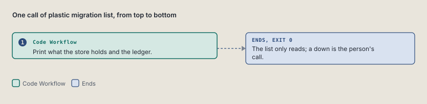

# plastic migration list

Print the ledger rows of one store and what a down would undo now.

```sh
plastic migration list --store SLUG
```

| Argument or option | What it gives | Default |
| --- | --- | --- |
| `--store SLUG` | the registered project whose backups the call works on |  |

## The events of one call, step by step



The boxes on the left run in order. The boxes on the right are the ways the call stops or ends at that step.

## What one call changes

This command changes nothing.

The command is `Plastic::Commands::Migration::List`, in [`commands/migration/list.rb`](../../../../lib/plastic/commands/migration/list.rb).
