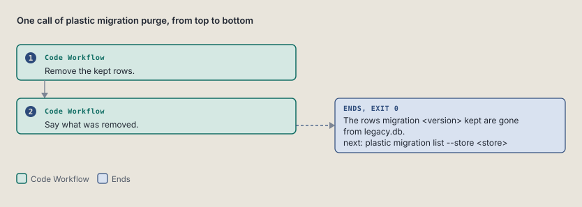

# plastic migration purge

Remove the rows one migration of a store kept in legacy.db, so a down can no longer undo it.

```sh
plastic migration purge VERSION --store SLUG
```

| Argument or option | What it gives | Default |
| --- | --- | --- |
| `VERSION` | the migration whose kept rows go, by its version | |
| `--store SLUG` | the registered project whose backups the call works on |  |

## The events of one call, step by step



The boxes on the left run in order. The boxes on the right are the ways the call stops or ends at that step.

## What one call changes

| What changes | Where | Reach |
| --- | --- | --- |
| The legacy tables of the migration go from legacy.db, and the ledger in plastic.db gets a purge row | the database files of the store, in the store folder | stays on this machine |

The command is `Plastic::Commands::Migration::Purge`, in [`commands/migration/purge.rb`](../../../../lib/plastic/commands/migration/purge.rb).
