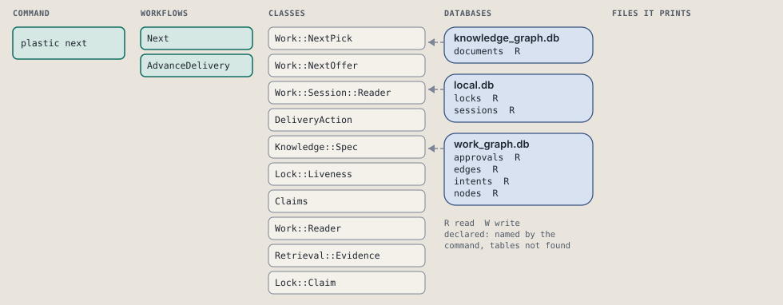
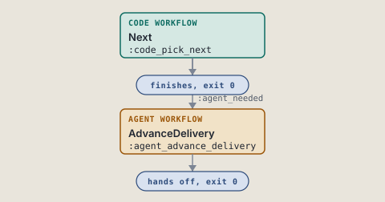
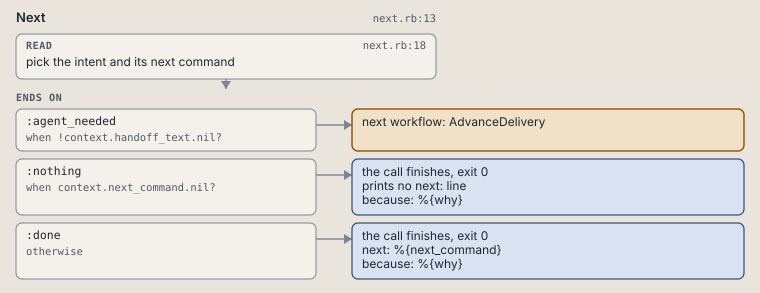
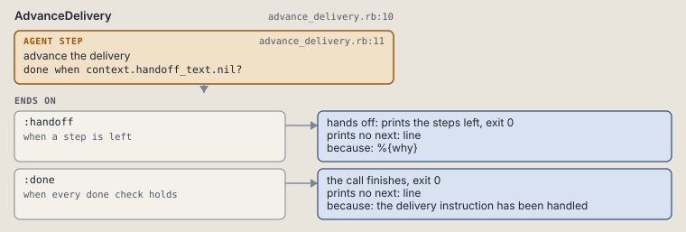
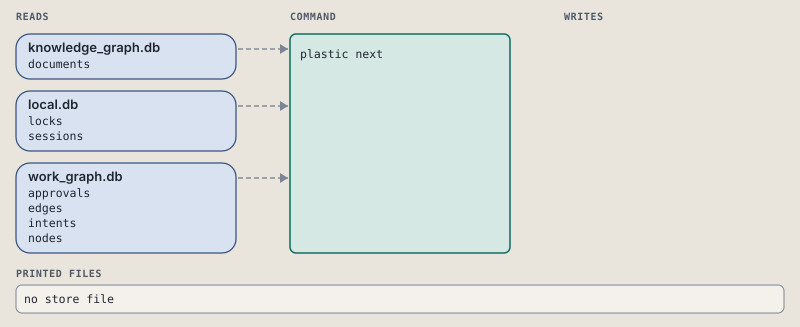

# plastic next

Pick the intent in play and offer its next command.

```sh
plastic next
```

The command is `Next`, in [`next.rb:8`](../../../../lib/plastic/commands/next.rb#L8). The words on this page, such as gate, step and outcome, are explained in [the command DSL](../../dsl/README.md).

## Components



The figure shows the command, the workflows it runs, the classes behind them, and the databases and files they reach.

## The events of one call



| Workflow | Kind | Code |
| --- | --- | --- |
| [Code::Next](#codenext) | code | [`next.rb:13`](../../../../lib/plastic/workflows/code/next.rb#L13) |
| [Agent::Shared::AdvanceDelivery](#agentsharedadvancedelivery) | agent | [`advance_delivery.rb:10`](../../../../lib/plastic/workflows/agent/shared/advance_delivery.rb#L10) |

### Code::Next

The code workflow `:code_pick_next`, in [`next.rb:13`](../../../../lib/plastic/workflows/code/next.rb#L13).

Picks the intent this session is working on and offers its next command: the spec, the start, the brief, a failed node, the check or the ready list. Several candidates offer status; none offers a new intent.



Its rows run in this order:

1. Read: pick the intent and its next command. [`next.rb:18`](../../../../lib/plastic/workflows/code/next.rb#L18)
2. Outcome `:agent_needed`, when `!context.handoff_text.nil?`: starts the workflow [Agent::Shared::AdvanceDelivery](#agentsharedadvancedelivery). [`next.rb:23`](../../../../lib/plastic/workflows/code/next.rb#L23)
3. Outcome `:nothing`, when `context.next_command.nil?`: finishes with exit 0; prints no next: line. [`next.rb:24`](../../../../lib/plastic/workflows/code/next.rb#L24)
4. Outcome `:done`, otherwise: finishes with exit 0; next: NEXT_COMMAND. [`next.rb:25`](../../../../lib/plastic/workflows/code/next.rb#L25)

It sets `next_command`, `why`, `handoff_text`.

### Agent::Shared::AdvanceDelivery

The agent workflow `:agent_advance_delivery`, in [`advance_delivery.rb:10`](../../../../lib/plastic/workflows/agent/shared/advance_delivery.rb#L10).

The harness performs judgment and records the result through commands.



Its rows run in this order:

1. Agent step: advance the delivery. Done when `context.handoff_text.nil?`, while it fails, the call prints its `say:` text. [`advance_delivery.rb:11`](../../../../lib/plastic/workflows/agent/shared/advance_delivery.rb#L11)
2. Outcome `:handoff`, when a step is left: hands off with exit 0; prints no next: line. [`advance_delivery.rb:12`](../../../../lib/plastic/workflows/agent/shared/advance_delivery.rb#L12)
3. Outcome `:done`, when every done check holds: finishes with exit 0; prints no next: line. [`advance_delivery.rb:13`](../../../../lib/plastic/workflows/agent/shared/advance_delivery.rb#L13)

The agent step "advance the delivery" prints:

> HANDOFF_TEXT

While a step is left, the call hands off with exit 0 from `:handoff`: it prints the `say:` text of each failing step and prints no next: line. The command writes nothing, so the call keeps no routine run row. The next call starts fresh and checks the steps again.

In the words of workflow engines, the rows are these four parts:

- **Trigger**: the call starts the workflow `Code::Next`; each later workflow starts from an outcome of the one before it.
- **Activities**: 1 read and 1 agent step.
- **Transitions**: a step runs only while its done check fails; Next goes to AdvanceDelivery on `:agent_needed`.
- **Outcomes**: `:nothing` of Next, `:done` of Next, `:handoff` of AdvanceDelivery, `:done` of AdvanceDelivery end the call.

## What one call reads, writes and prints



| Place | Database or file | Tables | Reads or writes | Code |
| --- | --- | --- | --- | --- |
| the store folder | knowledge_graph.db | `documents` | reads | [`next.rb:9`](../../../../lib/plastic/commands/next.rb#L9) |
| the home folder | local.db | `locks`, `sessions` | reads | found in the code, not declared |
| the store folder | work_graph.db | `approvals`, `edges`, `intents`, `nodes` | reads | [`next.rb:9`](../../../../lib/plastic/commands/next.rb#L9) |

A second call runs the same rows again. A step runs again only when its done check fails.

| Step | Done when | The second call | Code |
| --- | --- | --- | --- |
| advance the delivery | `context.handoff_text.nil?` | skips it | [`advance_delivery.rb:11`](../../../../lib/plastic/workflows/agent/shared/advance_delivery.rb#L11) |

## How a call ends

Every call can also end in [the ways any call can end](../../dsl/README.md#how-any-call-can-end).

| Ending | Exit | next: | Code |
| --- | --- | --- | --- |
| WHY | 0 | prints no next: line | [`next.rb:24`](../../../../lib/plastic/workflows/code/next.rb#L24) |
| WHY | 0 | NEXT_COMMAND | [`next.rb:25`](../../../../lib/plastic/workflows/code/next.rb#L25) |
| WHY | 0 | prints no next: line | [`advance_delivery.rb:12`](../../../../lib/plastic/workflows/agent/shared/advance_delivery.rb#L12) |
| the delivery instruction has been handled | 0 | prints no next: line | [`advance_delivery.rb:13`](../../../../lib/plastic/workflows/agent/shared/advance_delivery.rb#L13) |
| a step raises | 1 | prints no next: line | [`code_workflow.rb:102`](../../../../lib/plastic/code_workflow.rb#L102) |

## What the page leaves out

Every call shares a few things that this page does not repeat; [the command DSL](../../dsl/README.md#what-every-call-shares) names them.

- No gate of this command refuses, so exit 3 never happens.
