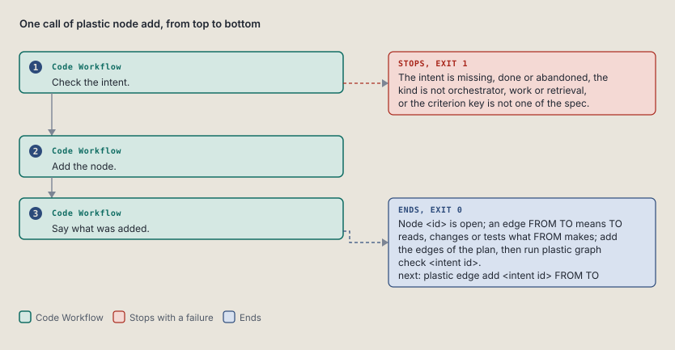

# plastic node add

Add a node to an intent's work graph, of kind work, orchestrator or retrieval.

```sh
plastic node add ID TITLE --criterion KEY [--kind KIND] [--found-in NODE] [--input PATH]
```

| Argument or option | What it gives | Default |
| --- | --- | --- |
| `ID` | the intent | |
| `TITLE` | what the node is for | |
| `--criterion KEY` | the key of the spec done criterion this node serves |  |
| `--kind KIND` | orchestrator, work or retrieval; work when left out |  |
| `--found-in NODE` | the node of this intent where the new work was found; it orders nothing |  |
| `--input PATH` | a file the node reads |  |

## The events of one call, step by step



The boxes on the left run in order. The boxes on the right are the ways the call stops or ends at that step.

## What one call changes

| What changes | Where | Reach |
| --- | --- | --- |
| The node is added to the work graph of the intent | the work graph database, in the store folder | goes with the store |
| The files of the intent and the index of the store are rewritten | the store folder | goes with the store |

Goes with the store: the files of the store carry the change, and `plastic sync up` rebuilds it on another machine. The database files themselves stay on this machine.

The command is `Plastic::Commands::Node::Add`, in [`commands/node/add.rb`](../../../../lib/plastic/commands/node/add.rb).
