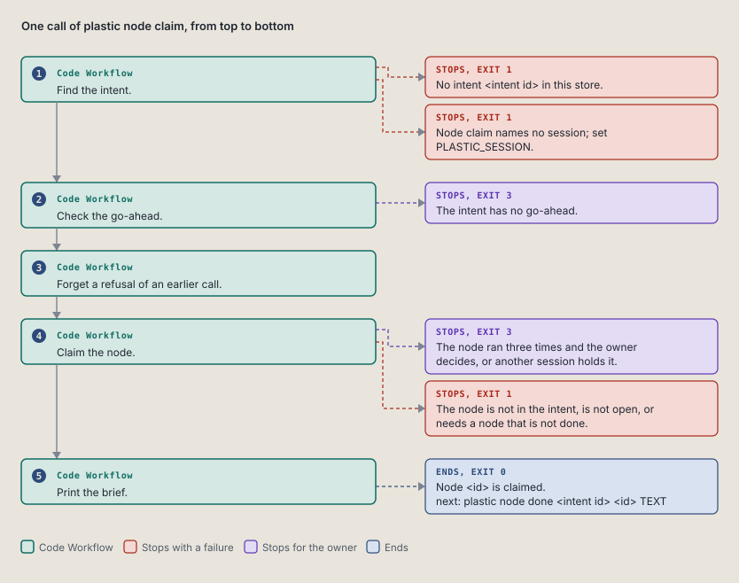

# plastic node claim

Claim an open node, or take a lapsed claim, and print its brief.

```sh
plastic node claim ID NODE [--agent NAME]
```

| Argument or option | What it gives | Default |
| --- | --- | --- |
| `ID` | the intent | |
| `NODE` | the node | |
| `--agent NAME` | the agent that runs the node, recorded on its run; empty when left out | `""` |

## The events of one call, step by step



The boxes on the left run in order. The boxes on the right are the ways the call stops or ends at that step.

## What one call changes

| What changes | Where | Reach |
| --- | --- | --- |
| The node is claimed by this session: PLASTIC_SESSION, else the harness session, else terminal- and the login at a terminal | the work graph database, in the store folder | goes with the store |
| A node with three runs moves to needing information, with the question for the owner | the work graph database, in the store folder | goes with the store |
| The files of the intent and the index of the store are rewritten | the store folder | goes with the store |

Goes with the store: the files of the store carry the change, and `plastic sync up` rebuilds it on another machine. The database files themselves stay on this machine.

The command is `Plastic::Commands::Node::Claim`, in [`commands/node/claim.rb`](../../../../lib/plastic/commands/node/claim.rb).
