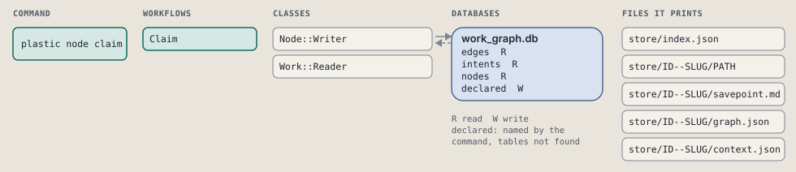
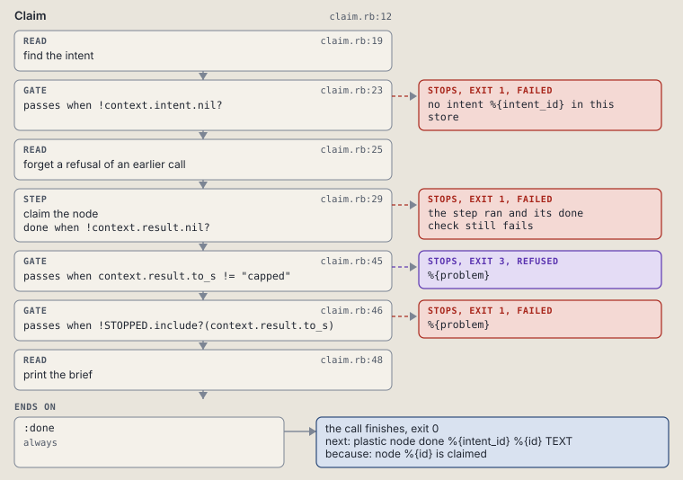
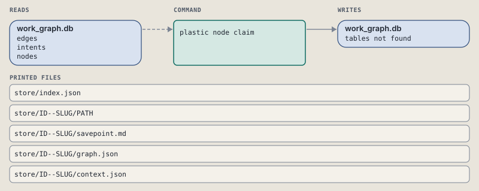

# plastic node claim

Claim an open node and print its brief.

```sh
plastic node claim ID NODE
```

The command is `Node::Claim`, in [`claim.rb:9`](../../../../lib/plastic/commands/node/claim.rb#L9). The words on this page, such as gate, step and outcome, are explained in [the command DSL](../../dsl/README.md).

| Argument or option | What it gives | Default |
| --- | --- | --- |
| `ID` | the intent | |
| `NODE` | the node | |

## Components



The figure shows the command, the workflows it runs, the classes behind them, and the databases and files they reach.

## The events of one call

The call starts the workflow `Code::Node::Claim`, in [`claim.rb:12`](../../../../lib/plastic/workflows/code/node/claim.rb#L12).

Claims an open node whose needed nodes are done. The fourth claim of a node moves to needs_info instead, with the owner's question, and refuses. A refused claim keeps its routine run open, so the next call claims again.



Its rows run in this order:

1. Read: find the intent. [`claim.rb:19`](../../../../lib/plastic/workflows/code/node/claim.rb#L19)
2. Gate: passes when `!context.intent.nil?`; otherwise the call stops with exit 1 and prints no intent INTENT_ID in this store. [`claim.rb:23`](../../../../lib/plastic/workflows/code/node/claim.rb#L23)
3. Read: forget a refusal of an earlier call. [`claim.rb:25`](../../../../lib/plastic/workflows/code/node/claim.rb#L25)
4. Step: claim the node. Done when `!context.result.nil?`, so a second call skips it. [`claim.rb:29`](../../../../lib/plastic/workflows/code/node/claim.rb#L29)
5. Gate: passes when `context.result.to_s != "capped"`; otherwise the call stops with exit 3 and prints PROBLEM. [`claim.rb:45`](../../../../lib/plastic/workflows/code/node/claim.rb#L45)
6. Gate: passes when `!STOPPED.include?(context.result.to_s)`; otherwise the call stops with exit 1 and prints PROBLEM. [`claim.rb:46`](../../../../lib/plastic/workflows/code/node/claim.rb#L46)
7. Read: print the brief. [`claim.rb:48`](../../../../lib/plastic/workflows/code/node/claim.rb#L48)
8. Outcome `:done`, always: finishes with exit 0; next: plastic node done INTENT_ID ID TEXT. [`claim.rb:56`](../../../../lib/plastic/workflows/code/node/claim.rb#L56)

It sets `intent`, `result`, `node`, `problem`.

In the words of workflow engines, the rows are these four parts:

- **Trigger**: the call starts the workflow `Code::Node::Claim`.
- **Activities**: 3 reads and 1 step.
- **Transitions**: 3 gates stop the call when their checks fail; a step runs only while its done check fails.
- **Outcomes**: `:done` ends the call.

## What one call reads, writes and prints



| Place | Database or file | Tables | Reads or writes | Code |
| --- | --- | --- | --- | --- |
| the store folder | work_graph.db | `edges`, `intents`, `nodes` | reads and writes | [`claim.rb:11`](../../../../lib/plastic/commands/node/claim.rb#L11) |
| the store folder | store/index.json | | writes | [`prints.rb:14`](../../../../lib/plastic/graph/prints.rb#L14) |
| the store folder | store/ID--SLUG/PATH | | writes | [`prints.rb:15`](../../../../lib/plastic/graph/prints.rb#L15) |
| the store folder | store/ID--SLUG/savepoint.md | | writes | [`prints.rb:16`](../../../../lib/plastic/graph/prints.rb#L16) |
| the store folder | store/ID--SLUG/graph.json | | writes | [`prints.rb:17`](../../../../lib/plastic/graph/prints.rb#L17) |
| the store folder | store/ID--SLUG/context.json | | writes | [`prints.rb:18`](../../../../lib/plastic/graph/prints.rb#L18) |

A second call runs the same rows again. A step runs again only when its done check fails.

| Step | Done when | The second call | Code |
| --- | --- | --- | --- |
| claim the node | `!context.result.nil?` | skips it | [`claim.rb:29`](../../../../lib/plastic/workflows/code/node/claim.rb#L29) |

## How a call ends

Every call can also end in [the ways any call can end](../../dsl/README.md#how-any-call-can-end).

| Ending | Exit | next: | Code |
| --- | --- | --- | --- |
| no intent INTENT_ID in this store | 1 | prints no next: line | [`claim.rb:23`](../../../../lib/plastic/workflows/code/node/claim.rb#L23) |
| PROBLEM | 3 | prints no next: line | [`claim.rb:45`](../../../../lib/plastic/workflows/code/node/claim.rb#L45) |
| PROBLEM | 1 | prints no next: line | [`claim.rb:46`](../../../../lib/plastic/workflows/code/node/claim.rb#L46) |
| node ID is claimed | 0 | plastic node done INTENT_ID ID TEXT | [`claim.rb:56`](../../../../lib/plastic/workflows/code/node/claim.rb#L56) |
| a step raises | 1 | prints no next: line | [`code_workflow.rb:102`](../../../../lib/plastic/code_workflow.rb#L102) |

## What the page leaves out

Every call shares a few things that this page does not repeat; [the command DSL](../../dsl/README.md#what-every-call-shares) names them.

- A call that writes saves a routine run row in local.db. A stop by a gate or a step saves the run, and the next call resumes from it. A dry run saves no row.
