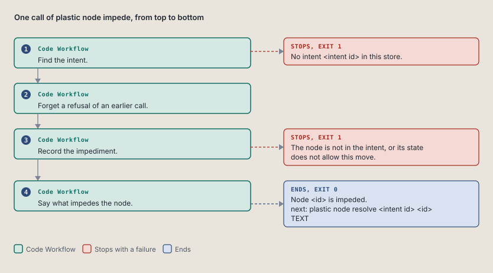

# plastic node impede

Move a claimed node to impeded with the impediment.

```sh
plastic node impede ID NODE TEXT [--file PATH]
```

| Argument or option | What it gives | Default |
| --- | --- | --- |
| `ID` | the intent | |
| `NODE` | the node | |
| `TEXT` | the impediment | |
| `--file PATH` | a file of the intent folder to read as the result; repeat for more; every changed file when left out | `[]` |

## The events of one call, step by step



The boxes on the left run in order. The boxes on the right are the ways the call stops or ends at that step.

## What one call changes

| What changes | Where | Reach |
| --- | --- | --- |
| The node is marked impeded with the reason | the work graph database, in the store folder | goes with the store |
| The files of the intent and the index of the store are rewritten | the store folder | goes with the store |

Goes with the store: the files of the store carry the change, and `plastic sync up` rebuilds it on another machine. The database files themselves stay on this machine.

The command is `Plastic::Commands::Node::Impede`, in [`commands/node/impede.rb`](../../../../lib/plastic/commands/node/impede.rb).
