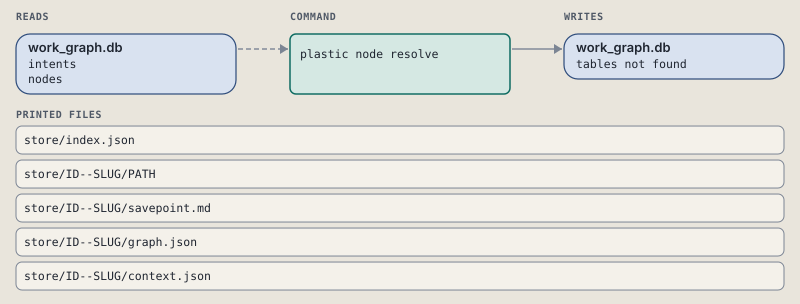

# plastic node resolve

Reopen a needs_info or impeded node with its resolution.

```sh
plastic node resolve ID NODE TEXT
```

The command is `Node::Resolve`, in [`resolve.rb:10`](../../../../lib/plastic/commands/node/resolve.rb#L10). The words on this page, such as gate, step and outcome, are explained in [the command DSL](../../dsl/README.md).

| Argument or option | What it gives | Default |
| --- | --- | --- |
| `ID` | the intent | |
| `NODE` | the node | |
| `TEXT` | the resolution | |

## Components


The figure shows the command, the workflows it runs, the classes behind them, and the databases and files they reach.

## The events of one call

The call starts the workflow `Code::Node::Resolve`, in [`resolve.rb:11`](../../../../lib/plastic/workflows/code/node/resolve.rb#L11).

Reopens a needs_info or impeded node with its resolution and resets its retries.


Its rows run in this order:

1. Read: find the intent. [`move_node.rb:39`](../../../../lib/plastic/workflows/move_node.rb#L39)
2. Gate: passes when `context.intent`; otherwise the call stops with exit 1 and prints no intent INTENT_ID in this store. [`move_node.rb:40`](../../../../lib/plastic/workflows/move_node.rb#L40)
3. Read: forget a refusal of an earlier call. [`move_node.rb:44`](../../../../lib/plastic/workflows/move_node.rb#L44)
4. Step: resolve the node. Done when `[true, false].include?(context.moved)`, so a second call skips it. [`move_node.rb:45`](../../../../lib/plastic/workflows/move_node.rb#L45)
5. Gate: passes when `context.moved == true`; otherwise the call stops with exit 1 and prints PROBLEM. [`move_node.rb:46`](../../../../lib/plastic/workflows/move_node.rb#L46)
6. Read: say what was resolved. [`move_node.rb:59`](../../../../lib/plastic/workflows/move_node.rb#L59)
7. Outcome `:done`, always: finishes with exit 0; next: plastic node claim INTENT_ID ID. [`move_node.rb:60`](../../../../lib/plastic/workflows/move_node.rb#L60)

It sets `intent`, `problem`, `moved`.

In the words of workflow engines, the rows are these four parts:

- **Trigger**: the call starts the workflow `Code::Node::Resolve`.
- **Activities**: 3 reads and 1 step.
- **Transitions**: 2 gates stop the call when their checks fail; a step runs only while its done check fails.
- **Outcomes**: `:done` ends the call.

## What one call reads, writes and prints



| Place | Database or file | Tables | Reads or writes | Code |
| --- | --- | --- | --- | --- |
| the store folder | work_graph.db | `intents`, `nodes` | reads and writes | [`resolve.rb:13`](../../../../lib/plastic/commands/node/resolve.rb#L13) |
| the store folder | store/index.json | | writes | [`prints.rb:14`](../../../../lib/plastic/graph/prints.rb#L14) |
| the store folder | store/ID--SLUG/PATH | | writes | [`prints.rb:15`](../../../../lib/plastic/graph/prints.rb#L15) |
| the store folder | store/ID--SLUG/savepoint.md | | writes | [`prints.rb:16`](../../../../lib/plastic/graph/prints.rb#L16) |
| the store folder | store/ID--SLUG/graph.json | | writes | [`prints.rb:17`](../../../../lib/plastic/graph/prints.rb#L17) |
| the store folder | store/ID--SLUG/context.json | | writes | [`prints.rb:18`](../../../../lib/plastic/graph/prints.rb#L18) |

A second call runs the same rows again. A step runs again only when its done check fails.

| Step | Done when | The second call | Code |
| --- | --- | --- | --- |
| resolve the node | `[true, false].include?(context.moved)` | skips it | [`move_node.rb:45`](../../../../lib/plastic/workflows/move_node.rb#L45) |

## How a call ends

Every call can also end in [the ways any call can end](../../dsl/README.md#how-any-call-can-end).

| Ending | Exit | next: | Code |
| --- | --- | --- | --- |
| no intent INTENT_ID in this store | 1 | prints no next: line | [`move_node.rb:40`](../../../../lib/plastic/workflows/move_node.rb#L40) |
| PROBLEM | 1 | prints no next: line | [`move_node.rb:46`](../../../../lib/plastic/workflows/move_node.rb#L46) |
| node ID is open | 0 | plastic node claim INTENT_ID ID | [`move_node.rb:60`](../../../../lib/plastic/workflows/move_node.rb#L60) |
| a step raises | 1 | prints no next: line | [`code_workflow.rb:102`](../../../../lib/plastic/code_workflow.rb#L102) |

## What the page leaves out

Every call shares a few things that this page does not repeat; [the command DSL](../../dsl/README.md#what-every-call-shares) names them.

- No gate of this command refuses, so exit 3 never happens.
- A call that writes saves a routine run row in local.db. A stop by a gate or a step saves the run, and the next call resumes from it. A dry run saves no row.
