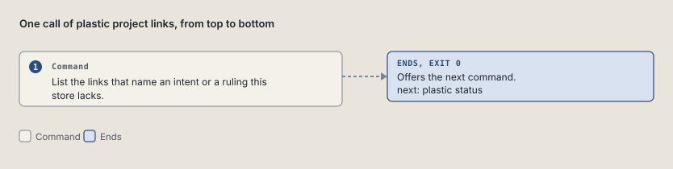

# plastic project links

List the links that name an intent or a ruling this store lacks.

```sh
plastic project links
```

## The events of one call, step by step



The boxes on the left run in order. The boxes on the right are the ways the call stops or ends at that step.

## What one call changes

This command changes nothing.

The command is `Plastic::Commands::Project::Links`, in [`commands/project/links.rb`](../../../../lib/plastic/commands/project/links.rb).
