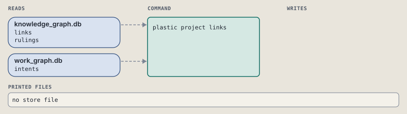

# plastic project links

List the links that name an intent or a ruling this store lacks.

```sh
plastic project links
```

The command is `Project::Links`, in [`links.rb:13`](../../../../lib/plastic/commands/project/links.rb#L13). The words on this page, such as gate, step and outcome, are explained in [the command DSL](../../dsl/README.md).

## Components


The figure shows the command, the workflows it runs, the classes behind them, and the databases and files they reach.

## The events of one call


The command's `call`, at [`links.rb:16`](../../../../lib/plastic/commands/project/links.rb#L16):

```ruby
def call
  broken = broken_links
  broken.each { |link| output.raw("#{link.from_ref} #{link.kind} #{link.to_ref}") }
  output.raw(Plastic::Graph::Knowledge::Link::Check.summary(broken.size)) if broken.any?
  output.next_step("plastic status", because: "every link names an intent or a ruling this store holds")
end
```

Its steps run in this order:

1. `broken = broken_links` [`links.rb:17`](../../../../lib/plastic/commands/project/links.rb#L17)
2. `broken.each { |link| output.raw("#{link.from_ref} #{link.kind} #{link.to_ref}") }` [`links.rb:18`](../../../../lib/plastic/commands/project/links.rb#L18)
3. `output.raw(Plastic::Graph::Knowledge::Link::Check.summary(broken.size)) if broken.any?` [`links.rb:19`](../../../../lib/plastic/commands/project/links.rb#L19)
4. `output.next_step("plastic status", because: "every link names an intent or a ruling this store holds")` [`links.rb:20`](../../../../lib/plastic/commands/project/links.rb#L20)

## What one call reads, writes and prints



| Place | Database or file | Tables | Reads or writes | Code |
| --- | --- | --- | --- | --- |
| the store folder | knowledge_graph.db | `links`, `rulings` | reads | [`links.rb:14`](../../../../lib/plastic/commands/project/links.rb#L14) |
| the store folder | work_graph.db | `intents` | reads | [`links.rb:14`](../../../../lib/plastic/commands/project/links.rb#L14) |

## How a call ends

Every call can also end in [the ways any call can end](../../dsl/README.md#how-any-call-can-end).

| Ending | Exit | next: | Code |
| --- | --- | --- | --- |
| Offers the next command | 0 | plastic status | [`links.rb:20`](../../../../lib/plastic/commands/project/links.rb#L20) |

## What the page leaves out

Every call shares a few things that this page does not repeat; [the command DSL](../../dsl/README.md#what-every-call-shares) names them.

- No gate of this command refuses, so exit 3 never happens.
