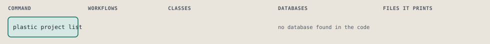
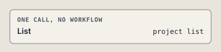
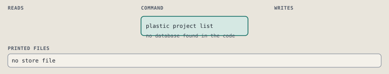

# plastic project list

List the registered projects with their paths.

Lists the projects of projects.yml, each with its path, and marks the ones whose store folder is missing. It writes nothing.

```sh
plastic project list
```

The command is `Project::List`, in [`list.rb:10`](../../../../lib/plastic/commands/project/list.rb#L10). The words on this page, such as gate, step and outcome, are explained in [the command DSL](../../dsl/README.md).

## Components



The figure shows the command, the workflows it runs, the classes behind them, and the databases and files they reach.

## The events of one call



The command's `call`, at [`list.rb:13`](../../../../lib/plastic/commands/project/list.rb#L13):

```ruby
def call
  projects = scope.projects
  projects.sort.each { |slug, path| output.row("project", "#{slug}: #{path}#{NO_STORE unless store?(slug)}") }
  return output.next_step("plastic project new SLUG PATH", because: "no project is registered yet") if projects.empty?

  output.next_step("plastic status", because: "the projects are listed")
end
```

Its steps run in this order:

1. `projects = scope.projects` [`list.rb:14`](../../../../lib/plastic/commands/project/list.rb#L14)
2. `projects.sort.each { |slug, path| output.row("project", "#{slug}: #{path}#{NO_STORE unless store?(slug)}") }` [`list.rb:15`](../../../../lib/plastic/commands/project/list.rb#L15)
3. `return output.next_step("plastic project new SLUG PATH", because: "no project is registered yet") if projects.empty?` [`list.rb:16`](../../../../lib/plastic/commands/project/list.rb#L16)
4. `output.next_step("plastic status", because: "the projects are listed")` [`list.rb:18`](../../../../lib/plastic/commands/project/list.rb#L18)

## What one call reads, writes and prints



It reads and writes no store database and prints no store file.

## How a call ends

Every call can also end in [the ways any call can end](../../dsl/README.md#how-any-call-can-end).

| Ending | Exit | next: | Code |
| --- | --- | --- | --- |
| Offers the next command | 0 | plastic project new SLUG PATH | [`list.rb:16`](../../../../lib/plastic/commands/project/list.rb#L16) |
| Offers the next command | 0 | plastic status | [`list.rb:18`](../../../../lib/plastic/commands/project/list.rb#L18) |

## What the page leaves out

Every call shares a few things that this page does not repeat; [the command DSL](../../dsl/README.md#what-every-call-shares) names them.

- No gate of this command refuses, so exit 3 never happens.
