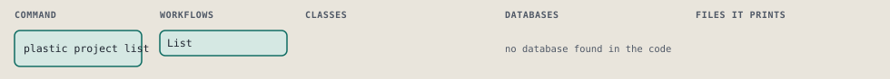
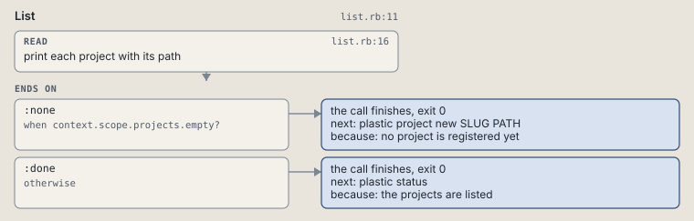
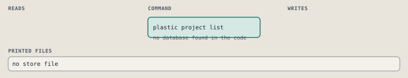

# plastic project list

List the registered projects with their paths.

Lists the projects of projects.yml, each with its path, and marks the ones whose store folder is missing. It writes nothing.

```sh
plastic project list
```

The command is `Project::List`, in [`list.rb:10`](../../../../lib/plastic/commands/project/list.rb#L10). The words on this page, such as gate, step and outcome, are explained in [the command DSL](../../dsl/README.md).

## Components



The figure shows the command, the workflows it runs, the classes behind them, and the databases and files they reach.

## The events of one call

The call starts the workflow `Code::Project::List`, in [`list.rb:11`](../../../../lib/plastic/workflows/code/project/list.rb#L11).

Lists the projects of projects.yml, each with its path, and marks the ones whose store folder is missing. It writes nothing.



Its rows run in this order:

1. Read: print each project with its path. [`list.rb:16`](../../../../lib/plastic/workflows/code/project/list.rb#L16)
2. Outcome `:none`, when `context.scope.projects.empty?`: finishes with exit 0; next: plastic project new SLUG PATH. [`list.rb:23`](../../../../lib/plastic/workflows/code/project/list.rb#L23)
3. Outcome `:done`, otherwise: finishes with exit 0; next: plastic status. [`list.rb:25`](../../../../lib/plastic/workflows/code/project/list.rb#L25)

In the words of workflow engines, the rows are these four parts:

- **Trigger**: the call starts the workflow `Code::Project::List`.
- **Activities**: 1 read.
- **Transitions**: .
- **Outcomes**: `:none`, `:done` end the call.

## What one call reads, writes and prints



It reads and writes no store database and prints no store file.

## How a call ends

Every call can also end in [the ways any call can end](../../dsl/README.md#how-any-call-can-end).

| Ending | Exit | next: | Code |
| --- | --- | --- | --- |
| no project is registered yet | 0 | plastic project new SLUG PATH | [`list.rb:23`](../../../../lib/plastic/workflows/code/project/list.rb#L23) |
| the projects are listed | 0 | plastic status | [`list.rb:25`](../../../../lib/plastic/workflows/code/project/list.rb#L25) |
| a step raises | 1 | prints no next: line | [`code_workflow.rb:107`](../../../../lib/plastic/code_workflow.rb#L107) |

## What the page leaves out

Every call shares a few things that this page does not repeat; [the command DSL](../../dsl/README.md#what-every-call-shares) names them.

- No gate of this command refuses, so exit 3 never happens.
