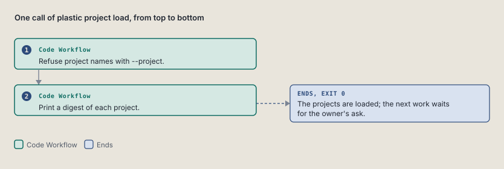

# plastic project load

Print a short digest of each named project to warm the context before the next ask.

```sh
plastic project load [SLUG...]
```

| Argument or option | What it gives | Default |
| --- | --- | --- |
| `SLUG` | the projects to load, as words or comma separated; the call's own store when left out | |

## The events of one call, step by step



The boxes on the left run in order. The boxes on the right are the ways the call stops or ends at that step.

## What one call changes

This command changes nothing.

The command is `Plastic::Commands::Project::Load`, in [`commands/project/load.rb`](../../../../lib/plastic/commands/project/load.rb).
